# PhotoLiker

PhotoLiker is a Windows desktop tool for finding your photos again and sorting out the good ones. When the folder is a NAS
full of old photos you can no longer scroll through, let PhotoLiker index it once in the background and then **search it like
the web**: type "birthday cake" or "children on a stage", name a person once and find every photo they are in, or combine them
("Mom playing guitar 2005"). It all runs on your own computer, no photo is ever uploaded. See [Photo search](#photo-search).

And for going through photos quickly: open a folder, flip through it with the arrow keys, press <kbd>Space</kbd> to like a
photo or a letter/number key to sort it into a group. Likes are plain copies of the files, so nothing is hidden in a database.

## Contents

- [Install](#install)
  - [Updating](#updating)
- [Photo search](#photo-search)
- [Happy path walkthrough](#happy-path-walkthrough)
  - [Keyboard and mouse](#keyboard-and-mouse)
  - [Toolbar](#toolbar)
    - [Generate Video](#generate-video)
  - [About box](#about-box)
- [Settings](#settings)
  - [Folder picker](#folder-picker)
  - [Changes that reload the folder](#changes-that-reload-the-folder)
  - [Order of the photos](#order-of-the-photos)
- [Groups](#groups)
- [Deleting photos](#deleting-photos)
- [Rotating photos](#rotating-photos)
- [Slideshow](#slideshow)
- [Videos](#videos)
- [Big folders open at once](#big-folders-open-at-once)
- [EXIF and GPS](#exif-and-gps)
- [Aligning file dates](#aligning-file-dates)
- [Removing empty folders](#removing-empty-folders)
- [Finding duplicates](#finding-duplicates)
- [Progress on the taskbar](#progress-on-the-taskbar)
- [Dark and light theme](#dark-and-light-theme)
- [Language](#language)
- [Settings file](#settings-file)
- [User manual](#user-manual)
- [Project layout](#project-layout)
- [Development](#development)
  - [Releasing](#releasing)
  - [Smoke tour](#smoke-tour)
- [License](#license)


- **AI photo search** of a big old library, by what is in the photos ("snow", "autumn leaves") and by who is in them:
  a background indexer with a progress bar, face detection and naming, "more like this". See [Photo search](#photo-search).
- **Fast browsing** with a thumbnail strip, preloading of the neighbouring photos, and a folder scan that also works
  on network shares. The photos are listed oldest first (or newest first, or as the disk gives them) by the date their
  files were created. A big folder opens at once on every visit after the first, from a list saved on this computer
  (see [Big folders open at once](#big-folders-open-at-once)).
- **Likes and groups**: copy the current photo to a `Liked` folder, or into `1 - Group` ... `Z - Group` folders under it.
- **Delete** moves the photo to a `Deleted` folder inside the photo folder; nothing is erased, and the scan leaves that
  folder out.
- **Rotate** turns the shown photo a quarter clockwise (or counterclockwise, with the button before it; <kbd>Ctrl</kbd>+<kbd>+</kbd> and <kbd>Ctrl</kbd>+<kbd>-</kbd>) from the buttons in the right corner of the status bar and saves
  it in its file, without losing anything (see [Rotating photos](#rotating-photos)).
- **Slideshow** on the whole screen, or on every monitor with a different photo on each (<kbd>Alt</kbd>+<kbd>Enter</kbd>): random or one by one,
  with a time for each photo, an effect between the photos (fade, slide, zoom, Ken Burns or a random one) and the year or the date and time the photo was taken in the
  bottom right corner. <kbd>Right</kbd> / <kbd>Left</kbd> go to the photos next to the shown one, also in
  the random mode, and holding a key scrolls at the speed of the key repeat (see [Slideshow](#slideshow)).
- **Videos** next to the photos, when **SupportVideo** is on: a poster picture with a play mark in the viewer and the strip, and an
  embedded player (any format: AVI of a camera, MP4 and MOV of a phone ...) with a slider, a box to type a time to jump to, and keys to step 5 or 30 seconds.
  They are liked, grouped, copied and deleted like photos. See [Videos](#videos).
- **Settings grid** next to the photo, with a folder picker for the liked folder. Changing which photos are listed,
  or in what order, reloads the folder at once.
- **EXIF and GPS** of the shown photo, GPS decoded to coordinates and a link to the map.
- **Dark and light theme**, remembered per folder.
- **Portable settings**: each photo folder keeps its own settings file, so the folder opens the same from any machine.

## Install

PhotoLiker needs Windows 10/11 (x64) and the [.NET 10 Desktop Runtime](https://dotnet.microsoft.com/download/dotnet/10.0).

- **Installer** (the way to go): take `PhotoLiker-Setup-<version>.exe` from the
  [latest release](https://github.com/YBalan/PhotoLiker/releases/latest). It installs per user, needs no administrator rights and
  checks for the runtime. Once it is installed, the program [updates itself](#updating) from the same page when you ask it to.
- **Zip**: `PhotoLiker-<version>-win-x64.zip` of the same release: unpack it anywhere and run `PhotoLikerUI.exe`.
- **Windows SmartScreen**: the program is not code-signed (yet), so the first time you run the setup Windows may say *Windows
  protected your PC*. Choose *More info*, then *Run anyway*.
- **A build of a branch**: every push and pull request to `master` builds both `PhotoLikerUI` (the zip) and `PhotoLiker-Setup`
  (the installer) as artifacts of a GitHub Actions run. To get them for another branch, open *Actions > Build and Package
  PhotoLikerUI > Run workflow* and pick the branch. The artifacts are on the page of the run (and expire). Or build the installer
  yourself with `installer\build-installer.ps1` (see [Development](#development)). These builds are not releases: they know no
  version number, and the update button does not offer them a setup.
- **From source**: `dotnet run --project PhotoLikerUI -c Release -- "C:\Photos\Holiday"`. The folder argument is optional;
  without it the last folder you used is opened.

The **Register Context Menu** button of the toolbar adds *Open in Photo Liker* to the right-click menu of folders (current
user only, no administrator rights). The same button removes it again.

The installer and the zip also carry the [user manual](#user-manual), in English and Ukrainian: it opens from the **About** box.

`ffmpeg.exe` (Generate Video) is not part of PhotoLiker: it is GPL v3 software by the [FFmpeg](https://ffmpeg.org/) project (the
[gyan.dev](https://www.gyan.dev/ffmpeg/builds/) build), run as a separate program. Its licence and the place to get its source are in
`ffmpeg\COPYING.GPLv3.txt` and `ffmpeg\FFMPEG-NOTICE.txt` beside the program, in the installer and in the zip.
The player of videos is the engine of [VLC](https://www.videolan.org/) (libvlc, LGPL 2.1 or later). The installer and the zip of a release do not carry it, which keeps the installer at 32 MB
instead of 55 MB: it is [downloaded once](#videos) when videos are turned on. A build from the source has it in `libvlc\win-x64`. Its licence and the place to get its source are in
`libvlc\COPYING.LGPLv2.1.txt` and `libvlc\VLC-NOTICE.txt` beside the program.

### Updating

Open the [About box](#about-box) (the question mark of the toolbar, or <kbd>F1</kbd>) and press **Check for updates**. PhotoLiker asks
GitHub for the latest release of the project, and says if it is newer than the version you have. Only that button asks: nothing is checked
in the background, nothing runs at startup.

- If there is a newer version, **Install x.y.z and restart** does all of it from the box, with no further question: it downloads the
  setup (a progress bar and the megabytes so far), checks it against the size and the SHA-256 that GitHub gives for the file (a download that
  does not match is thrown away), closes PhotoLiker (after it saved what it keeps), runs the setup silently over the installed copy (nothing to
  click: only the setup's small progress window shows) and starts PhotoLiker again. Your settings, likes and search indexes stay: they are in
  `%LocalAppData%\PhotoLiker` and in your photo folders, which the setup does not touch.
- **Release page** opens the page of that release (what changed, the files).
- A copy that the setup did not put there (unpacked from the zip, or a build run from the source) cannot be replaced by a setup: the setup
  installs PhotoLiker for your user as a second copy, and starts that one. So this is the one case in which **Install** asks first, and says so;
  this copy stays where it is, and shares its settings, likes and indexes with the installed one. A build from the source, which has no version number
  to compare, is offered the latest release the same way.
- If an index is being built, closing for the update asks the same question as closing the window does; answer No and nothing is installed (the
  box says so; press Install again to retry).

## Photo search

Searching is what PhotoLiker is mostly for. For a library of thousands of old photos on a NAS, PhotoLiker can look at every photo once (**Index photos**, in the strip
above the viewer) and then answer questions about them. Nothing is uploaded: the analysis runs on this computer.

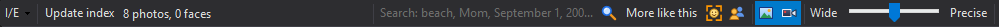

1. **Index photos** analyzes the folder and its subfolders in the background, with a progress bar and an estimate of the
   time left. You can keep browsing, stop it (the button turns into **Stop indexing**) and continue later: only new or
   changed photos are done again. The search box works as soon as the first photos are in the index.
   The first time, the AI models are downloaded (about 900 MB for the standard search model, you are asked first).
2. **Search** by describing what you look for: `children on a stage`, `snow`, `a dog`, `autumn leaves`. Type it into the
   search box and press <kbd>Enter</kbd> or click the magnifier icon. The results replace
   the folder in the viewer, and the keyboard focus moves to the photo, so the keys work at once: browse, like and group
   them like any photos (<kbd>Alt</kbd>+a group key groups all of them, see [Groups](#groups)). If nothing is found the focus stays in the
   search box, to change the words. <kbd>Esc</kbd> or **Close results** goes
   back. **More like this** finds photos that look like the one shown. Descriptions work in English; the **Model** box (see 6) can be
   set to a model that understands other languages.
   There is no limit to the number of photos a search shows (a text search shows the photos that match well, however many that is).
   Each photo is shown once: a photo that is in the library several times (a card copied into two folders, its copy in a group
   folder) is one result. Copies are photos of the same size, saved at the same second and showing the same picture, the way the
   name of a copy in a group folder is made (see [Groups](#groups)); of them the one that is not itself a saved copy stays, then
   the first by path. A copy whose file time was changed on the way is not recognised here, **Find duplicates** deals with those.
   The results are in the order of **SortOrder**: `OldestFirst` and `NewestFirst` by the date the photos were taken (the EXIF
   date, see below; the folder itself goes by the date the file was created because that costs nothing there), `ByName` by the
   name of the file, `Random` shuffled, `None` as the search ranks them, best match first.
3. **Dates**: put a date into the search box to look at when the photos were taken, alone or together with the rest of the
   search: `September 1` (that day in every year), `September 2009`, `1 Sep 2009`, `2009-09-01`, `2009`, `2009-2011`,
   `beach September 2009`, `Mom 2005`, `Mom playing guitar 2005`. A date alone lists the photos oldest first (or as **SortOrder** says), like every search without a limit. Month names are English;
   a short name (`sep`, `dec`) needs a day or a year with it, and a text in double quotes is searched as words only.
   The window title says how the date was understood.
4. **Faces**: switch the face icon (the smiling face in scanner brackets, last button of the strip) on to see the faces
   found in the shown photo. Click a face to say who it is (**New person...**
   or one you named before), to find all photos of that person, or to delete a wrong face (dolls, posters). Typing the name
   of a person into the search box finds their photos, best match first. A name can be combined with words, a date or other
   names, anywhere in the text: `Yurii playing guitar` finds the photos of Yurii that fit the words (ranked like any description,
   so the precision slider and the model apply to the words), `Mom and Dad on the beach 2009` the photos in which both have a
   face of their own, taken in 2009, that fit the words. Who is in a photo comes from the faces, so it works the same with every
   model; the words are matched by the chosen model, so they only look at the photos it has been through (the status bar says how
   many of the person's photos were left out). A name counts as a whole word in any case (`Yurii's` too), the longest name wins
   (`Grandma Olga` is not `Olga`), and "with", "and", "on" at the ends of the rest are dropped. A text in double quotes is only words:
   `"Yurii playing guitar"` does not look for Yurii. A dashed yellow box with a name and a question
   mark is a guess ("looks like Mom"); click it to confirm. A face the program missed (small, turned away, dark): hold
   <kbd>Shift</kbd> and drag a box around it.

   **Groups of people.** With many people named, sort them into groups (Family, Friends, Work...). The **People** button (two heads,
   next to the faces icon) opens **People and groups**: the people you named, with the number of faces named and the groups each
   one is in. Select one person or many (<kbd>Ctrl</kbd>+<kbd>A</kbd> selects everybody, Shift + click or Ctrl + click picks several) and tick the
   groups they belong to on the right: a box that is only half filled means some of the selected people are in that group, and a
   click puts all of them in. A person can be in several groups. **New group...** makes a group and puts the people who are selected
   into it, **Show** limits the list to one group or to the people who are in none, **Rename group...** and **Delete group** work on the group that
   is shown (deleting a group does not delete its people), and a click on a column title sorts the list (by **Faces**, the names with
   the fewest named faces come first). Every change is saved at once.

   **Rename person...** (also <kbd>F2</kbd> in the list, and **Rename ...** in the menu of a face) gives the selected person another name
   everywhere: the faces named so in this folder, the same person in the other folders (each folder follows when you open it,
   see below), and the groups the person is in. A name that another person has already makes the two **one person** (you are asked
   first): all their faces are the faces of the one who was there, with that spelling, and in the groups they are there once. That is
   also how to fix a name that was typed two ways. A name that differs only in case is another spelling of the same name.

   **Export...** and **Import...** (at the bottom of the window) take the people and the groups to another computer, or into a backup,
   through one `.plpeople` file. **Export...** writes every person with the faces you named (this folder's and, from the shared file,
   the other folders') and every group. **Import...** first tells what the file holds, and after you agree it **adds** it: a face that
   is named here already keeps its name, a group you have gets the people it did not have, a group that is not here is made, and
   nothing is removed, so importing the same file twice changes nothing and a computer that went its own way can be taken in without
   losing what was done here. The part of the file that comes from this very folder (the same path) becomes the names of this folder,
   kept in its `photo-liker-people.json`; the parts of other folders go into the shared `people.json` as examples of how those people
   look (a folder you open later that has a people file of its own puts its own people in place of its part, as it always does). A group
   with the name of a person here, or a person with the name of a group here, is left out, and the message says so. A file made with
   other face models than this version uses brings only its groups.

   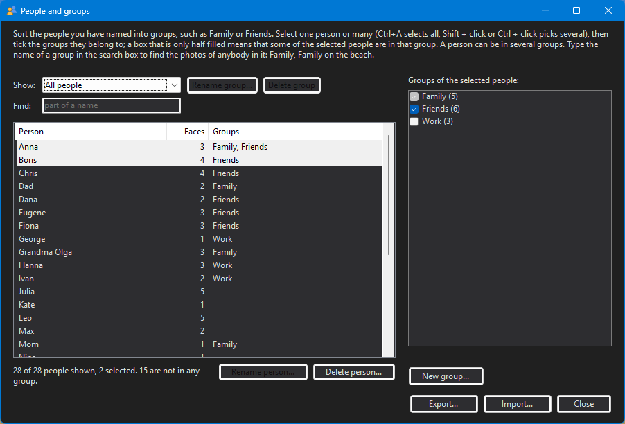

   Groups are used in three places. The menu of a face shows each group by name with its people in a sub-menu, then the people who
   are in no group, and the person the face looks like at the top. **New person...** asks for a group too (it starts with the one
   you used last; a name that is new makes a new group). And the name of a group typed into the search box finds the photos of
   anybody in it: `Family`, `Family on the beach 2009`, `Family and Yurii` (Yurii together with somebody of the family). A group
   can not have the name of a person. The groups are the same in every folder, and a folder that has people named in it keeps a copy of them next to the photos.

   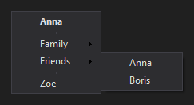
5. **Precision**: the slider at the right end of the strip (**Wide** to **Precise**) sets how strict the searches are. To the
   left they let more photos through (looser matches), to the right fewer (closer matches); the middle is the standard. It moves
   the cutoffs of all the searches together: how well a photo must fit the words and how far below the best one it may be,
   how alike a photo must be for **More like this**, and how close a face must be for the photos of a person. Moving it repeats
   the last search at once, so you can widen a search that found too little or narrow one that found too much. Hold the mouse
   over the slider to see the cutoffs it stands for. The position is kept for each folder in its `photo-liker-config.json` (`SearchPrecision`,
   0 to 100, 50 is the standard). Faces named in the photo (the yellow "looks like Mom?" boxes) are not affected.

   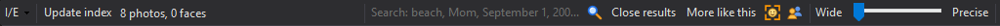

   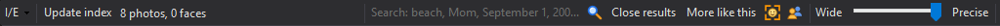
6. **Model**: the box at the right end of the strip chooses the model that matches words with photos; each line of the list gives the name, the vendor in brackets and the languages the model understands. The choice is kept for each folder
   in its `photo-liker-config.json` (`SearchModel`: `clip-vit-b32`, `siglip2-b16` or `xlmr-vit-b32`; a name the app does not know reads
   as `clip-vit-b32`). The numbers below are from a test with 300 photos and their 1,500 descriptions (Flickr30k): how often the right
   photo was the first result, and one of the first ten.

   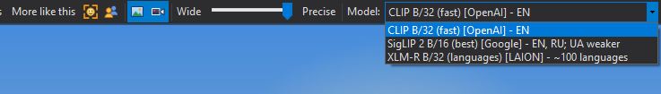

   | Model | First | In the first 10 | Speed of the model | Download | Understands |
   |---|---|---|---|---|---|
   | **CLIP B/32** (OpenAI) | 74 % | 97 % | 21 photos/s | 610 MB | English |
   | **SigLIP 2 B/16** (Google) | 88 % | 99.5 % | 5 photos/s | 1.5 GB | English and Russian well, Ukrainian less well |
   | **XLM-R B/32** (LAION) | 78 % | 97.5 % | 16 photos/s | 1.5 GB | about a hundred languages, Ukrainian and Russian included |

   (The speed is the photo model alone, 6 threads, small photos; a real run is also limited by how fast the photos are read and
   decoded.) CLIP B/32 is the standard: the fastest and the smallest download. SigLIP 2 finds the right photo most often, at about
   four times the indexing time. XLM-R is as fast as CLIP, a little better in English, and the one for descriptions in Ukrainian
   or Russian: in the [Immich project's benchmark](https://docs.immich.app/features/search) of the same models it finds 76 % for
   Ukrainian against 65 % for SigLIP 2 B/16 (Russian: 76 % against 81 %, English: 77 % against 85 %, CLIP B/32 70 %).
   The results of different models can not be compared, so each model has to go through the photos once: **Update index** does it,
   and only that: the faces, the names of the people and the dates are kept, and so are the results of the models you used before,
   so going back to one of them costs nothing (a model's results take 2 to 3 KB per photo in the index). The strip says how far it is
   ("3,000 of 12,345 photos for SigLIP 2 B/16"); until it is done a description or **More like this** only looks at the photos that
   are done (the status bar says how many were left out), while dates and people work on all of them. Stopping and continuing works as always, and the box is locked
   while photos are being analyzed. The first time a model is used it is downloaded, after asking.
   The scores of every model are put on the scale the cutoffs and the **Precision** slider were made for (from the same test), so the
   middle of the slider finds about as many photos with each; on your own library you may still want to move it.

| Input | What it does |
|---|---|
| Click / right click on a face | The menu of the face: name it, find the person, delete it. |
| <kbd>Shift</kbd>+drag over the photo | Mark a face that was not found (with the face icon on). |
| <kbd>Enter</kbd> in the search box | Search. |
| <kbd>Esc</kbd> | Close the results. |

The models need the current Microsoft Visual C++ runtime (it comes with Windows updates, or as the *Visual C++
Redistributable* x64). PhotoLiker loads the one of Windows first thing when it starts: some programs (the shell extension of
TortoiseGit, for one) put an old private copy of it into every program that opens a file or folder dialog, and ONNX Runtime
does not just fail with that, it takes the whole program down (`0xC0000005` while loading the models). If an old copy is
there all the same, loading the models stops with a message that says so.

How long indexing takes depends mostly on the processor and on how fast the photos can be read: on a 6-core desktop
processor it is about three photos per second (20,000 photos: roughly two hours), a network drive can be slower. It does
not need a graphics card.

Where the date of a photo comes from: the EXIF date of the camera. If that is missing or cannot be believed, the date the file
was created is used instead (for photos copied off a camera or a card that is about the day they were copied), and the status
bar says how many of the results are dated that way. A camera date is not believed when it is before 1995 or in the future, or
when it is on January 1 before noon (an old camera that lost its clock starts again there, and writes `2001-01-01` into every
photo) and the file was not created at about that time (two days, for a time zone); a real photo of New Year's night is
kept. An index made before dates were kept gets them when you press **Update index**: that reads only the start of each file,
needs no models and takes about a minute per 2,000 photos on a network drive.

What is kept where:

- **The index** (what was found in each photo, and when it was taken, with one vector for each search model that has been through it) is a cache in `%LocalAppData%\PhotoLiker\index`, one file per photo folder.
  It can always be rebuilt, so deleting it only costs the time of indexing again. Your photos are only read, never changed
  (except by [Align dates](#aligning-file-dates), which you press yourself).
  To use it on another computer (or to index on the faster one), choose **I/E > Export index...** (the first button of the
  strip: import / export), bring the `.plindex` file over, open the same photos there (whatever the drive letter) and choose
  **I/E > Import index...**. When videos have been analyzed the same file carries them (their moments, faces and the speech that was read): the question of the import says so, and the videos analyzed
  for that folder are replaced by them; a file made without videos leaves the folder's videos as they are.
  **Update index** then brings it up to date: photos whose size and date are the same are not analyzed again. The models
  are downloaded there on first use, or copy the `models` folder (below) along. A search by description needs the search
  model's files, so **Update index** asks to download them also when every photo is in the imported index already (only the
  search model then, the face models wait until a photo needs them).
- **The names you give** are kept in `photo-liker-people.json` in the photo folder, next to the photos: the face examples of each
  person. It is plain JSON, and a rebuilt index finds the same people again. (The only other file PhotoLiker adds to a folder is the
  copy of the groups, `photo-liker-groups.json`, see below.)
  The people of all your folders are also collected in `%LocalAppData%\PhotoLiker\people.json`, so a folder you open and index
  for the first time already knows the people you named in the others: their names are in the list of the face menu and
  the search box, typing one finds the photos of that person in this folder, and a face that looks like one of them is
  offered as "Looks like ...". Names are matched without caring about case, so *Mom* in two folders is one person.
  A face named in another folder is only an example here, it is not marked as named: the faces you confirm in this folder
  go into this folder's file. The file of a folder stays the truth about that folder (delete it and the folder's people are
  gone from the shared file the next time the folder is opened), the shared one is a copy that can be deleted any time.
  It also remembers the last 100 renames of people (**Rename person...**): a folder you open later that still has a person under the
  old name gets the new one in its own file, unless the person was named in it after the folder last agreed with the shared file
  (a new person who has the old name is somebody else and is left alone).
  Folders you named people in before this existed join it when you open them once (no indexing needed).
  The **groups** of people are one set for all folders, kept in `%LocalAppData%\PhotoLiker\people-groups.json` and also in
  `photo-liker-groups.json` in every photo folder that has people named in it, so that the groups travel with the photos (to
  another computer, into a backup) the way the names do. Both are plain JSON and say when they were saved, and the one saved
  later is the set: when you open a folder whose copy is newer than the groups on this computer (a new computer, or a change made on another
  one) the copy replaces them, and an older or missing copy is written again. A change is written to both at once, so a group you
  deleted stays deleted in every folder you open afterwards. Two computers that both changed the groups since they last met are
  not merged: the later change wins as a whole. A folder that can not be written (read-only, a drive that is off) only misses its
  copy, the status bar says so and the groups on this computer are saved all the same. Delete a copy and it is written again
  the next time the folder is opened. To move the people of *all* folders and the groups in one go, use **Export...** / **Import...**
  in the People window (see Groups of people above): a `.plpeople` file is plain JSON too, with the vectors as base64.
- **The models** are in `%LocalAppData%\PhotoLiker\models`, a folder for each, downloaded when they are first needed: to match
  words with photos CLIP ViT-B/32 (OpenAI, MIT licence, the standard), SigLIP 2 Base/16 (Google, Apache 2.0) and XLM-RoBERTa with ViT-B/32 (LAION,
  MIT licence) (see **Model** above; the last two are ONNX exports of the Immich project, fixed to one revision), and
  InsightFace's SCRFD and ArcFace (`buffalo_l`) to find and recognize faces. The InsightFace models are free for
  non-commercial use only, which fits a private photo library. Delete the folder of a model you do not use to get its space back.

## Happy path walkthrough

1. Launch the app with a photo folder loaded.
2. Browse to the next image using the **Right Arrow** key.
3. Toggle like/unlike for the current image using the **Space** key.
4. Move back using the **Left Arrow** key.

| | |
|---|---|
| 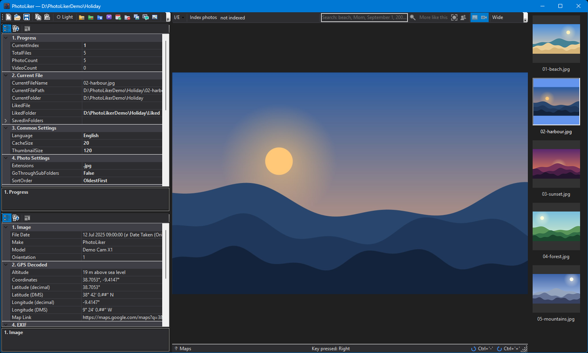 | 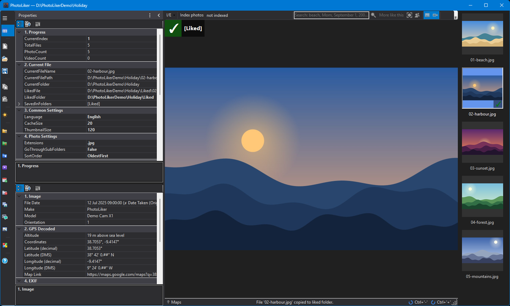 |
| **Right Arrow**: next photo. | **Space**: the photo is copied to the Liked folder. It gets a green check, in the viewer and on its thumbnail. |

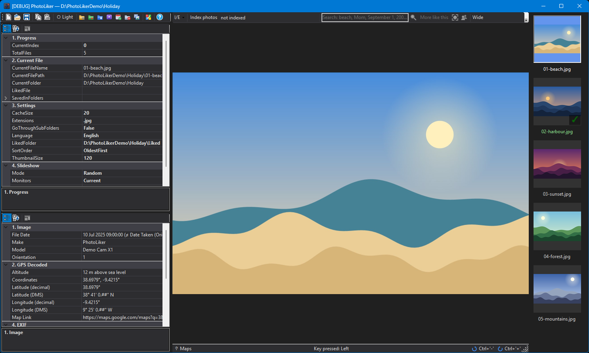

### Keyboard and mouse

| Input | What it does |
|---|---|
| <kbd>Right</kbd> / <kbd>Left</kbd> | Next / previous photo. Clicking a thumbnail jumps to it. |
| <kbd>Home</kbd> / <kbd>End</kbd> | The first / the last photo of the list (of the search results, while they are shown). |
| <kbd>PageDown</kbd> / <kbd>PageUp</kbd> | The first photo of the next / the previous month of the list. The list is cut into runs of photos of the same month, in the order it has (see **SortOrder**), so in a folder that is not in date order every change of month counts. A photo's month is the one of its date: the EXIF date if the folder is [indexed](#photo-search), otherwise the date its file was created. The status bar names the month. |
| <kbd>Space</kbd> | Like the photo (copy it to the Liked folder), or remove the copy again. |
| <kbd>Delete</kbd> | Move the photo to the `Deleted` folder and show the next one (see [Deleting photos](#deleting-photos)). |
| <kbd>1</kbd>-<kbd>9</kbd>, <kbd>A</kbd>-<kbd>Z</kbd> | Save the photo in a group, or take it out again (see [Groups](#groups)). |
| <kbd>Alt</kbd>+<kbd>1</kbd>-<kbd>9</kbd> (also on the numpad), <kbd>Alt</kbd>+<kbd>A</kbd>-<kbd>Z</kbd> | While search results are shown: save *all* of them in the group, after telling how many photos and MB that is and asking. A group without a folder gets one named after the search (see [Groups](#groups)). |
| <kbd>0</kbd> | Fit the image to the viewer (after zooming in). |
| <kbd>Alt</kbd>+<kbd>Enter</kbd> | Show the photos of the list as a [slideshow](#slideshow) on the whole screen, beginning with the shown photo. In it any key but <kbd>Esc</kbd> pauses the show and <kbd>Space</kbd> continues it, <kbd>F</kbd> / <kbd>N</kbd> turn the faces / the names of the people on and off, <kbd>Right</kbd> / <kbd>Left</kbd> show the photo next to the shown one, <kbd>Down</kbd> / <kbd>Up</kbd> choose the next / previous effect, and <kbd>Esc</kbd> (or <kbd>Alt</kbd>+<kbd>Enter</kbd> again) goes back. Like F1-F3 it also works while you type into a text box. |
| <kbd>F1</kbd> | Open the [About box](#about-box). |
| <kbd>F2</kbd> / <kbd>F3</kbd> | Open the [user manual](#user-manual) in Ukrainian / in English, in the browser. F1-F3 also work while you type into a text box. |
| <kbd>F5</kbd> | List the folder again from scratch instead of from the saved list (see [Big folders open at once](#big-folders-open-at-once)). |
| <kbd>Ctrl</kbd>+<kbd>C</kbd> | Copy the photo to the clipboard, as a file and as a picture: paste it into Explorer or a messenger. |
| <kbd>Ctrl</kbd>+<kbd>+</kbd> / <kbd>Ctrl</kbd>+<kbd>-</kbd> | Rotate the photo a quarter clockwise / counterclockwise and save it (see [Rotating photos](#rotating-photos)). The plus of the main keyboard (with or without <kbd>Shift</kbd>) and the numpad keys both work. |
| <kbd>Ctrl</kbd>+mouse wheel | Over the photo: zoom, then drag to pan. Over the thumbnail strip: change the size of the thumbnails. |
| <kbd>Enter</kbd> | On a video: play it, or pause / resume it ([Videos](#videos)). A click on the poster plays it, a click on the playing picture pauses it. |
| <kbd>Shift</kbd>+<kbd>Right</kbd> / <kbd>Left</kbd>, <kbd>Ctrl</kbd>+<kbd>Right</kbd> / <kbd>Left</kbd> | While a video plays: 5 seconds / 30 seconds ahead or back. |
| <kbd>Ctrl</kbd>+<kbd>Up</kbd> / <kbd>Down</kbd> | While a video plays: the volume up / down. |
| <kbd>Esc</kbd> | While a video plays: back to its poster picture (the next <kbd>Esc</kbd> closes search results). |
| <kbd>.</kbd> / <kbd>,</kbd> | On a video: go to the next / the previous place a search found in it (without a search, the next / previous moment), and play from there. |
| <kbd>Ctrl</kbd>+<kbd>S</kbd> | On a video: save the picture it shows as a photo in the Liked folder, with the date it was recorded there. |

Keys are ignored while you type into a text box: the value you are editing in a grid, the search box. A click on the
photo (or on a thumbnail, or on the empty space around the photo) takes the keyboard focus out of the text box, so the keys
work on the photo again.

### Toolbar

| Button | What it does |
|---|---|
| **Open** | Open a photo folder. |
| **Copy** | Copy the shown photo to the clipboard (the same as <kbd>Ctrl</kbd>+<kbd>C</kbd>). |
| **Dark** / **Light** | Switch the theme, see [Dark and light theme](#dark-and-light-theme). |
| **Open Source Folder**, **Open Liked Folder** | Show the photo folder, or the Liked folder, in File Explorer. |
| **Load Liked Folder** | Load the Liked folder as a photo folder of its own. |
| **Generate Video** | Turn photos into a video with ffmpeg, see [Generate Video](#generate-video). |
| **Align dates** (the calendar with the green equals sign) | Make the dates of the photo files the date the photo was taken, see [Aligning file dates](#aligning-file-dates). |
| **Remove empty folders** (a folder with a red cross) | List the folders that hold no photos and remove them, see [Removing empty folders](#removing-empty-folders). |
| **Find duplicates** (two overlapping photos) | Find photos that are the same file in different folders and move the copies in the worse folders away, see [Finding duplicates](#finding-duplicates). |
| **Register Context Menu** | Add *Open in Photo Liker* to the right-click menu of folders (the same button removes it). |
| **Help** (the question mark) | The *About* box: the version, the keys and the user manual, see [About box](#about-box). |

The window that a button opens carries the icon of that button: in its title bar, and in Alt+Tab. Generate Video, Align dates (also the window that gives
photos a date), Remove empty folders, Find duplicates and the About box (the question mark) have theirs; the People window, the windows that
rename a person or a group and the one that copies results into a group have the icon of the People button of the search strip, and the one that
names a face has the faces icon. They are drawn from the same pictures as the buttons, again at each size a title bar can ask for (16 to 64 px), so
they stay sharp at any scaling of the screen. (A window with the dialog frame has no icon in its title bar in Windows, so those windows have a thin
fixed frame instead.)

#### Generate Video

Turns photos into a video with ffmpeg. A copy of `ffmpeg.exe` ships with the app; otherwise the one on your `PATH` is used. The dialog opens
at once and follows the dark theme of the window. A step by step walkthrough with screenshots is in
[How to make a video of your photos](docs/how-to-generate-video.md).

- **Photos from** picks the photos:
  - **Current**: the loaded ones, the folder or the search results;
  - **Liked**: the copies in the Liked folder;
  - one of the **group folders** that are in the Liked folder (`A - Group`, `3 - Group Family`, ...), each listed under its own name once
    the dialog has looked them up.

  It starts on **Liked**, and every entry shows its number of photos, "Liked (123)" (the folders are counted in the background, one after
  the other, so a count shows `...` until it is known).
- **Output folder** follows the pick: the folder of the photos, or the Liked or group folder. One that you typed or browsed to is left alone.
- **The settings are kept with the photos.** When you press *Generate*, every value of the dialog is written to `photo-liker-video.json` in the
  folder of the picked source (the Liked or group folder, or the folder of the loaded photos), and the next time you open the dialog or pick that
  folder in *Photos from* they are put back. The log says where they were saved.
  - What is kept: the sort order, the output folder and file name, the audio and its Repeat/Once, the cover with its ticks and times, the
    resolution, *Start*, *End* and *Use random*, the codec, the quality, and the cut on the beat with its ÷2/×2.
  - Paths below the folder or beside it are stored relative to it (`"AudioPath": "..\\music\\song.mp3"`), so a folder that is moved or opened from
    another machine keeps working. A file name the dialog made itself (`timelapse_<date>_<time>.mp4`) is not put back, a new one is made each time.
    The random times are not kept: they are drawn again.
  - The file is plain, indented JSON that you may edit. A value that is missing, or one that makes no sense, leaves the dialog as it is; a
    file that cannot be read is ignored. *Photos from* itself is not in it: it is the folder the file is in.
- **Sort order** is the order of the photos in the video. It starts as the *SortOrder* setting.
  - Oldest first, newest first: by file date, as the *SortOrder* setting does. A copy in Liked or a group goes by the date of its photo, not by
    when it was liked.
  - By name: as Explorer lists them, `IMG_2` before `IMG_10`.
  - Random: a new order for each video.
  - As listed.
- **Resolution**, **Video codec** (H.264 / H.265) and **Quality (CRF)**.
- **Frame time range** gives the time of the first photo (*Start*) and of the last (*End*), the others in steps between them.
  **Use random** instead gives each photo a time of its own, picked at random between the two (it does not matter which of them is the larger).
  The times are drawn in the dialog, when you tick the box and whenever you pick another folder in *Photos from* (tick it off and on to
  draw again), so that *Video length* is the sum of the times that were drawn and the video gets exactly those times. Changing *Start* or *End*
  moves the same draw along, and making another video from the same dialog gives the same times.
- **Cover (optional)** is a picture of your choice for the start and/or the end of the video.
  - **Browse...** picks it, and a preview shows it (small, and upright, as it will look).
  - **Show at the start** (ticked to begin with) shows it before the photos, for the number of seconds in the box beside it (3 to begin with).
    The *Frame time range* is spread over the photos only, the cover is not part of it.
  - **Show at the end** (not ticked to begin with) shows it after the last photo, for the seconds in the box beside it (3 to begin with).
    With the photos set to **Repeat** and a longer audio, the cover takes the last seconds of the audio (the photo that is showing then is cut
    short), so the video still ends together with the audio.
  - The two ticks and their times are on only when there is a cover, a time only while its tick is on. With both ticks off the cover is left out
    (the log says so).
  - **Clear** takes it away again (the ticks stay for the next cover).
  - The cover is the first picture of the video whatever the sort order is, and the last one if it is shown at the end. A photo that is the
    cover as well is shown once, as the cover.
- **Audio (optional)** puts a sound under the video.
  - **Browse...** picks the file (mp3, m4a, wav, flac, ogg... anything ffmpeg can read). Only the sound of the file is used, not the cover
    picture of a music file.
  - **Play audio** and **Stop** let you listen to it first (ffmpeg makes a WAV of the first 10 minutes of it in a temporary folder, which is
    removed when the dialog closes). **Clear** takes it away again.
  - The length of the audio is shown beside it (`Length: 3:25`; ffmpeg reads it, `unknown` if the file has none).
  - A longer audio is cut where the video ends (unless the photos repeat for it, see below), and a shorter one is played over and over
    until the video ends (or once, see below).
- **Rhythm (experimental)**, **Cut photos on the beat**: finds the beats of the audio (it needs an audio file, and starts when you tick the box;
  a few seconds for a song) and changes the photo on a beat.
  - Each photo is shown for a whole number of beats, as near its time (*Start* to *End*) as that can be, and at least one beat. The cover at
    the start is moved to the nearest beat, so that the first photo starts on one. The photos play once, and the video is as long as they are
    (the audio is cut, or played over and over, as it always is).
  - The dialog grows by a strip of **bars**: how hard the sound hits (blue), the beats found (orange) and where the photos change (green).
    It shows 20 seconds of the audio at a time; the scroll bar, the mouse wheel (click the strip first) or dragging moves along it.
  - The tempo found and the number of beats are shown beside the box. The beat is sometimes taken for half or double of what you would tap:
    **÷2** keeps every second beat, **×2** puts a beat between each two (the photos follow at once).
  - **Use random** and **Photos: Repeat** do not go with it: they are put off and greyed while the box is ticked, and are what they were
    when you untick it. With no clear beat in the audio (speech, ambient music...) or a file ffmpeg cannot read, the times are used as set.
  - How it works: ffmpeg decodes the audio, the rise of the spectrum (in 40 bands, as the ear hears pitch) gives the hits, the tempo comes from
    how they repeat and the beats from dynamic programming (Ellis, "Beat Tracking by Dynamic Programming", 2007). No library is added.
    Checked on clicks at known times (cuts land within a video frame of them) and on six real songs (the strength at the beats is several
    times that between them); how it *sounds* is for you to judge.
- **Repeat or once** has a box for the photos and one for the audio (both are off without an audio file). Each one matters when the other is the longer.
  - **Photos: Once** plays the photos once, so that a longer audio is cut.
  - **Photos: Repeat** plays them over and over, in the same order and with the same times, until the audio ends, when the audio is longer than
    the cover and the photos once through. The audio is then played once and ends the video, and the cover is shown only at the start and/or at
    the end, once (it is not repeated with the photos).
  - **Audio: Repeat** (the default) plays an audio that is shorter than the photos over and over until they end.
  - **Audio: Once** plays it once and the rest of the video is silent (the video is as long as the photos either way).
  - An audio whose length is not known (`Length: unknown`) is not repeated for.
- **Video length** is how long the video will be with the settings as they are: the photos of the picked folder with the time of each, plus the
  cover (and its time at the end, if ticked; with the photos set to **Repeat** and a longer audio: the length of the audio). It follows every change at once, and, when an audio is
  chosen, says what becomes of it (cut, played over and over, played once and then silence, about as long as the video, or how many times the
  photos play). It is exact for the photos it counts: photos that have gone from the disk since they were listed are not taken off, and the video
  is a few hundredths of a second longer than the times add up to.

How the photos are prepared:

- Photos that have gone from the disk since they were listed are left out.
- The photos come out the way the app shows them, turned upright by their EXIF orientation. ffmpeg is told not to turn them itself (ffmpeg 7.1
  also turned the photos that come after a turned one, so landscape photos came out as portrait), so before it starts, each photo that has to be
  turned or mirrored is copied upright, no bigger than the video frame, into a temporary folder that is removed when the video is done; the log says
  how many. Photos that GDI+ cannot read are left as they are.
- ffmpeg also cannot join pictures of different kinds (a PNG followed by JPEG files gives a video of one frame, without an error), so when the
  pictures are not all of one kind, say PNG photos among JPEG ones or a PNG cover, those that are not JPEG are copied as JPEG the same way.
- The video is encoded without B-frames (`-bf 0` for libx264, `bframes=0` for libx265). With them the encoder reorders pictures and the file
  has to delay the decode time of the first ones by a stretch of the first three pictures (3.32 s behind a cover of 3 s); ffmpeg writes that as
  an edit list, and a player that does not honour it shows the video that much late: the cover for twice its time and the end 3 s too late,
  although the file itself says the right length. Without B-frames there is nothing to delay. For a slideshow of stills the size is the same.
  Videos made before this still have the delay.

### About box

The **Help** button (the question mark, last on the toolbar) or <kbd>F1</kbd> opens the About box: the version (the release, like `2.1.0`; a
build that is no release shows its assembly version) and build date, the list of
keys and mouse moves of the window (the table under [Keyboard and mouse](#keyboard-and-mouse), without the explanations; keep the two
in step: the list is `AboutStrings.Shortcuts`), the **Check for updates** button (see [Updating](#updating)), and two buttons,
**User manual (English)** and **Посібник користувача (українською)**, that open the
[user manual](#user-manual) in the browser. The box follows the dark theme of the window. If the page is not beside the program (a build
that did not copy it) a message says where it should be.

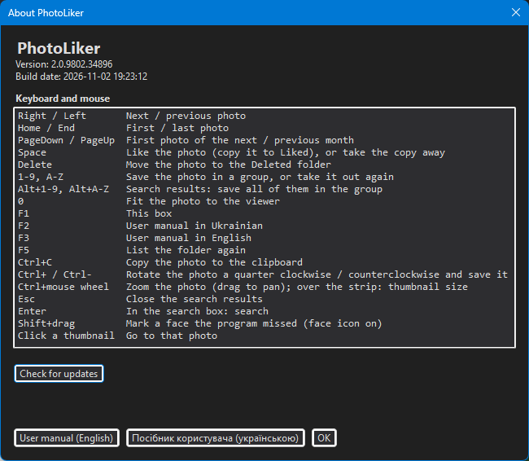

When a newer version is found the box says so and offers it (a stand-in for GitHub made this picture, see the [smoke tour](#smoke-tour)):

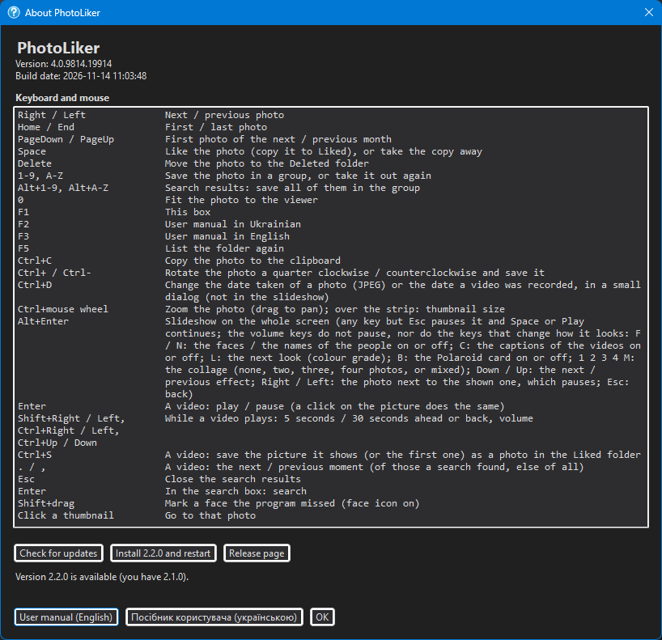

## Settings

The settings grid at the top left shows the progress, the current file and the settings of the folder. It scrolls back to
the top whenever another photo is shown:

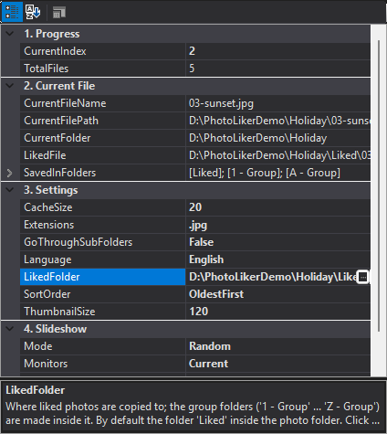

The rows are in six groups: **1. Progress**, **2. Current File**, **3. Common Settings**, **4. Photo Settings**, **5. Video Settings** and **6. Slideshow**.

**3. Common Settings** (the whole program, photos and videos alike):

| Setting | Meaning |
|---|---|
| **Language** | The language of the program, `English` or `Українська`. It changes at once and is kept for all folders. See [Language](#language). |
| **LikedFolder** | Where liked photos are copied. By default the folder `Liked` inside the photo folder. Click the **...** button for a folder picker. A folder with any other name than `Liked` is kept as it is, wherever it is. |
| **CacheSize** | How many photos on each side of the current one are kept decoded in memory. |
| **ThumbnailSize** | Size of the thumbnails in pixels. <kbd>Ctrl</kbd>+mouse wheel over the strip changes it. |

**4. Photo Settings** (which files are listed, and in what order):

| Setting | Meaning |
|---|---|
| **GoThroughSubFolders** | Also list the photos in the subfolders. The Liked folder itself is left out. |
| **Extensions** | The file extensions that count as photos, separated by `;` or `,`, each with its dot: `.jpg; .png`. Case does not matter. |
| **SortOrder** | The order of the photos: `OldestFirst` (the default) or `NewestFirst`, by the date the file was created, `ByName` by the name of the file, `Random` in a random order, or `None` for the order the disk gives (by name on most local disks). See [below](#order-of-the-photos). |

**5. Video Settings:**

| Setting | Meaning |
|---|---|
| **SupportVideo** | List the videos of the folder with its photos (off by default). See [Videos](#videos). |
| **VideoExtensions** | The file extensions that count as videos when **SupportVideo** is on: `.mp4; .mov; .avi; .mkv ...` (the default list has the usual ones). |
| **VideoSpeech** | Also turn what is said in the videos into text when the index is updated, so that a spoken word finds the video (off by default; about a third of the length of the speech, and a model of 465 MB). See [Videos](#videos). |
| **SpeechModel** | `tiny`, `base` or `small` (the one to use). |
| **SpeechLanguage** | The language that is spoken: `ru`, `uk`, `en` ..., or `auto` (the model hears it for each video). |
| **CpuCores** | How many cores of this computer the speech recognition may use, from 1 to all the cores it has (the default). With more cores several videos are heard at the same time. It can be changed while **Update index** runs: the next video that is started follows it. |

The group **6. Slideshow** has its own eleven rows, **Mode**, **Monitors**, **Timeout**, **Watermark**, **PeopleFaces**, **PeopleNames**, **Effect**, **UseVideo**, **MuteVideo**, **VideoPart** and **LowerOtherAudio**; see [Slideshow](#slideshow).

The rows of **Current File** and **TotalFiles** are read-only, and so are **PhotoCount** and **VideoCount**, which say how many of the files in the list now are photos and how many are
videos (together they are **TotalFiles**; there are no videos unless **SupportVideo** is on). **CurrentIndex** is the number of the shown photo, counted
from 0: type another number into it to jump to that photo (a number outside the list goes to the nearest end).

Every row has a description: select it and the pane under the grid says what it is for (drag the divider above the pane to
make it taller when a text is cut off).

### Folder picker

The **...** button of **LikedFolder** opens the Windows folder dialog, starting at the current folder. Cancelling keeps
the old value.

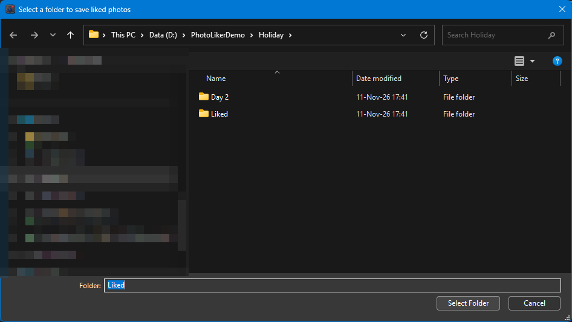

*(The navigation pane of the dialog is blurred in this screenshot, it lists the folders of whoever took it.)*

### Changes that reload the folder

Changing **GoThroughSubFolders**, **Extensions** or **SortOrder** lists the folder again straight away: the settings are
saved first, and the photo you are looking at stays selected if it is still in the list. The other settings do not need
that: the new **LikedFolder** is used from the next like. (A folder that was listed before opens from its saved list, see
[Big folders open at once](#big-folders-open-at-once).)

With **GoThroughSubFolders** on, the title of the window names the subfolder of the current photo:

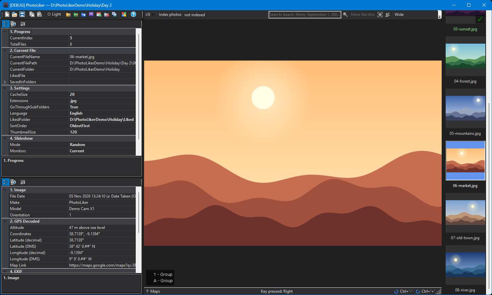

Adding `.png` to **Extensions** brings the PNG files of the folder in:

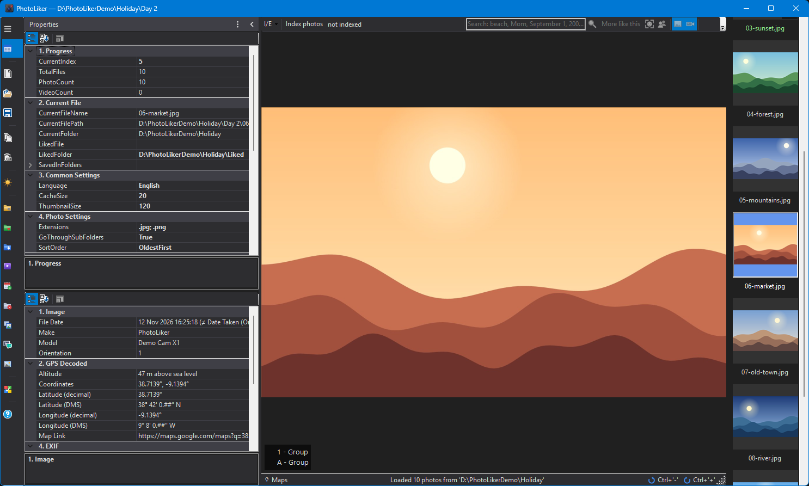

### Order of the photos

**SortOrder** decides how the list is ordered, and so what <kbd>Right</kbd>, <kbd>Left</kbd>, <kbd>Home</kbd>, <kbd>End</kbd>
and <kbd>PageDown</kbd> / <kbd>PageUp</kbd> walk through:

- `OldestFirst` (the default) and `NewestFirst` go by the date each file was **created**. That date comes with the listing of
  the folder, so sorting costs nothing extra, even on a network share. (Reading the date a photo was taken from its EXIF
  data would mean opening every photo, which is what takes minutes over a network.) Photos created at the same moment are
  ordered by their path, so `NewestFirst` is exactly `OldestFirst` backwards.
- `ByName` goes by the name of the file, the way Explorer lists a folder: case does not matter and numbers count as numbers,
  so `IMG_2` comes before `IMG_10` and `IMG_007` is the same as `IMG_7`. With subfolders, the photos of a folder come first,
  then those of its subfolders, each folder in this order. The name comes with the listing, so it costs nothing extra either.
- `Random` shuffles the photos, and it is a **new** order every time the photos are listed: when the folder is opened again,
  with <kbd>F5</kbd>, when the folder changed while it is open (the photo that is shown stays on screen), and for each search
  and each video. To get another order, list the folder again.
- `None` does not sort: the photos come in the order the file system lists them, by name on most local disks (which is not
  quite `ByName`: `IMG_10` comes before `IMG_2` there). It is the quickest on a folder with very many photos.

Keep in mind that the created date is when the file appeared on that disk. A photo copied from a card or another disk
usually has the date of the copy, not of the shot, so a folder copied in one go is in the order it was copied.
A folder whose settings file has no **SortOrder** yet is listed `OldestFirst`.

The results of a [search](#photo-search) follow the same setting, but by the date the photos were taken, which the index
knows for every photo without opening it: `OldestFirst` and `NewestFirst` order them by that date (photos of the same moment by
path), `ByName` by the name of the file, `Random` shuffles them, `None` leaves them as the search ranked them. Where the created date and the date taken differ (a folder copied in one
go), the results are in the order of the photos, the folder in the order of the copying; [Align dates](#aligning-file-dates) makes them agree.

## Groups

Besides liking a photo, you can sort it into groups. Press `1`-`9` or `A`-`Z` (without Ctrl/Alt/Shift) and a copy of the
current photo is saved in the folder `<key> - Group` under the Liked folder, e.g. `A - Group` or `3 - Group`. The
folders are created when they are first needed, together with the Liked folder. Pressing the same key again removes
the copy. Liking with `Space` works as before and is independent of the groups.

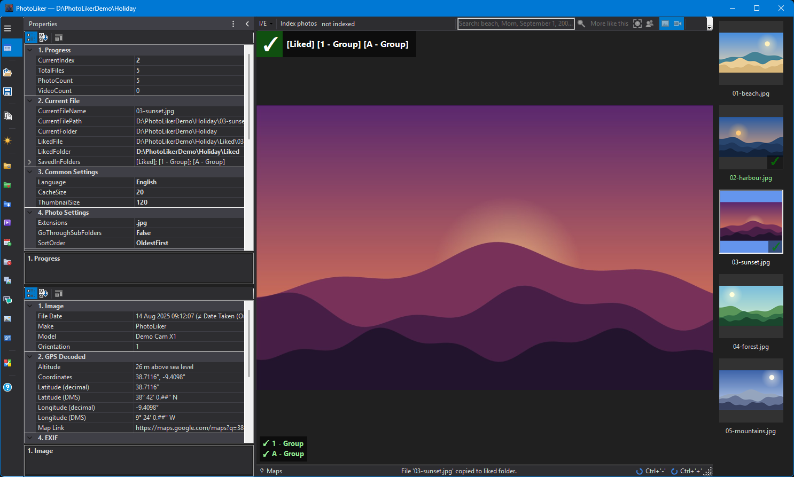

You can rename a group folder as long as the new name still starts with `<key> - Group`: `A - Group Family` is
used for `A` from then on. The **Current File** section of the settings grid lists every folder that holds a copy
of the current photo (**SavedInFolders**). The row shows them on one line, e.g. `[Liked]; [3 - Group]; [A - Group Family]`,
and expands into one row per folder.

A photo that is in the Liked folder or in any group gets a green check in the top-left corner of the viewer (and on its
thumbnail). The viewer lists the folders next to the check, each in brackets, e.g. `[Liked] [3 - Group] [A - Group Family]`.

The bottom-left corner of the viewer shows a legend of all group folders, under their current names, so you can see which
key saves where. The folders that hold a copy of the current photo are ticked and highlighted. A group shows up in the
legend once its folder exists, that is after the first press of its key.

`0` is not a group: it fits the image to the viewer. (It used to be `O`, which is a group like every other letter now.)

**All the results at once.** While the results of a [search](#photo-search) are shown, <kbd>Alt</kbd>+`1`-`9` or <kbd>Alt</kbd>+`A`-`Z`
saves *every* photo of the results in that group. Nothing is copied before you agree: a box tells how many photos will be copied
and how many MB they take (and how many of the results are in the group already, which are left as they are), and asks. On
*Yes* the program is blocked and a progress bar shows how far the copying is; **Cancel** stops after the photo that is being copied,
and the copies made by then stay. Unlike the single key this only ever adds: a photo that has a copy in the group is never taken
out again. A photo that cannot be copied (it was moved away after it was indexed, the drive is gone) is listed afterwards and the
others go on; after ten in a row the run stops, because the same thing will happen to the rest (a full disk, a share that went
away). Outside the results the keys do nothing but say so in the status bar. The digits of the numpad work with <kbd>Alt</kbd>
too (<kbd>Alt</kbd>+numpad `3` is group 3).

If the group has no folder yet, it is made for the occasion and named after the search: after `children on a stage` the
folder is `A - Group children on a stage` (the request is tidied for a folder name, quotes and characters Windows does not
allow are dropped, and it is cut at 50 characters), and the box says so before you agree. That is a renamed group folder like any
other, so the group is still `A` and you can rename it again. A group that has a folder is used as it is, whatever it is
called; the single key (<kbd>A</kbd> without <kbd>Alt</kbd>) still makes `A - Group`.

A copy has the id of its photo in its name: `IMG_0001 [3f9a1c2e].jpg`. Photos of different folders often share a file
name (every camera folder has its own `IMG_0001.jpg`), and the id keeps their copies apart: a copy never replaces the copy
of another photo, and a photo is never shown as liked because another one of the same name is. The id is made from the
size of the photo and the time it was last written, and from nothing else, not from its folder, its drive or the
computer. So the same photo gets the same name wherever it is found and whatever else is open, and the Liked folders of
different computers can be put together. Copies made before the ids (`name.jpg`, `name (2).jpg`) are still recognised, by
size and date.

## Deleting photos

<kbd>Delete</kbd> moves the shown photo into the folder `Deleted` inside the photo folder, takes it out of the list and
shows the photo that came after it (the one before it, if it was the last). Nothing is erased. The photo keeps its path
below the photo folder: `314CANON\IMG_0001.jpg` goes to `Deleted\314CANON\IMG_0001.jpg`, so photos of different
subfolders with the same name don't meet. If a photo with that name is already in `Deleted`, the new one is called
`name (2).jpg`. To put a photo back, move it out of `Deleted` in Explorer; the next time the folder is listed it is there.

The `Deleted` folder of the photo folder is left out when the folder is listed (also with **GoThroughSubFolders** on) and
by the search indexer. Only that one: a folder called `Deleted` further down is yours and is listed as any folder. A photo
that is deleted leaves the search index at once; its copies in the Liked and group folders stay where they are. Open the
`Deleted` folder itself with the folder button to look at what is in it. The copies that [Find duplicates](#finding-duplicates) moves
away are in `Deleted\Duplicated`, in the same way.

While search results are shown, <kbd>Delete</kbd> works the same on the photo shown. Like the other keys, it does nothing
while you type into a text box.

## Rotating photos

The two buttons in the right corner of the status bar turn the shown photo a quarter counterclockwise (the first) or clockwise
(the last) and save that in its file; press again for the next quarter. <kbd>Ctrl</kbd>+<kbd>-</kbd> and <kbd>Ctrl</kbd>+<kbd>+</kbd>
do the same (the plus and minus of the numpad, and <kbd>Ctrl</kbd>+<kbd>Shift</kbd>+<kbd>=</kbd> on a keyboard that makes the plus with <kbd>Shift</kbd>,
work too). It works on JPEG files (`.jpg`, `.jpeg`); with another kind of file the status bar says so and
nothing is written.

A JPEG is not decoded and written again: that would lose a little of the picture each time. What changes is its **orientation**,
the number in its EXIF block that tells every viewer how the stored picture is turned to show the photo upright (this app,
Windows, phones and browsers all follow it). So turning is lossless however often you do it, and on a network share it costs two
bytes instead of a new file.

- A photo that has the orientation already (every phone and most cameras write it, also when it is 1) gets the new number in the
  same place: the file keeps its size and nothing else in it changes.
- A photo that has none (a scan, a picture saved by an editor) gets it added: a new EXIF block of 36 bytes, or, if it has an EXIF
  block, a copy of its directory with the entry in it at the end of the block (nothing the block points to moves, maker notes
  included). That file is written next to the old one and replaces it, so it is a little larger. A block that is almost 64 KB
  full has no room for the entry; the photo is then left as it is and the status bar says why.
- The **Date Taken (Original)** of the photo and the **dates of its file** (created, modified) become one moment: the date taken
  the photo has when the app believes it (the EXIF date, by the rules of [Aligning file dates](#aligning-file-dates)), else the
  date of its file (created, else modified), which is then **written into the photo** as its Date Taken (Original) as well, so a
  photo that had none (a scan) ends with the two equal, and the **File Date** row says `(= Date Taken (Original))`. A photo that has
  no date at all to go by keeps the dates it had. The dates of the file are set again after the write (writing moves them to now),
  and if the drive does not keep a date that is set, the status bar tells.
- The copies of the photo in the Liked and group folders are not turned; they are the photo as it was when it was liked. The app
  knows a photo by its size and its date of change, so when either changed (the orientation was added, or the file got the date
  taken) the copies get the dates of the photo and are renamed to the new id (see [Groups](#groups)), and are still shown as its
  copies. The saved list of the folder and the search index take over the new size and date, and the boxes of the faces in the
  index turn with the photo, so "Update index" does not analyze it again. The list is not sorted again until the folder is
  listed anew (<kbd>F5</kbd>).

## Slideshow

<kbd>Alt</kbd>+<kbd>Enter</kbd> shows the photos of the list as a slideshow on the whole screen the window is on (or on every monitor, see **Monitors**
below), beginning with the photo that is shown (while search results are shown, the results). Each photo is as large as the screen lets it be, with
black around it, and the mouse pointer is hidden. <kbd>Esc</kbd> (or <kbd>Alt</kbd>+<kbd>Enter</kbd> again) goes back, and the window shows the photo the slideshow ended on.

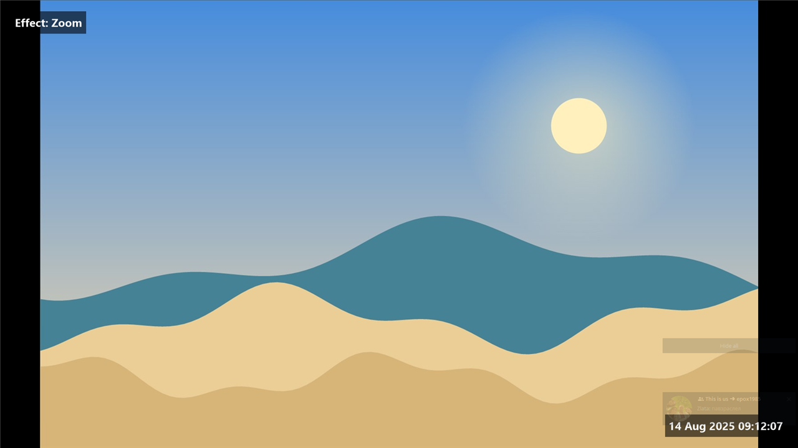

- **Any key but <kbd>Esc</kbd> pauses the show**, and <kbd>Space</kbd> continues it (<kbd>Space</kbd> is a key like the others, so it pauses a show that runs; a
  held <kbd>Space</kbd> does not flicker between the two). While it is paused nothing changes by itself: the timer is off, a video that plays is held (and plays on
  from the same place), and **Paused (Space to continue)** is written in the top right corner of every monitor. The keys still work, and the show stays paused after them:
  <kbd>Right</kbd> / <kbd>Left</kbd> browse, <kbd>Down</kbd> / <kbd>Up</kbd> choose the effect. <kbd>Space</kbd> gives the shown photo its full time again from that
  moment. A change of photo that is under way when the key is pressed finishes, and a change the timer has just asked for, whose photo is not ready yet, is called off
  (the photo you were looking at stays). A modifier key alone (<kbd>Shift</kbd>, <kbd>Ctrl</kbd>, <kbd>Alt</kbd>, <kbd>Win</kbd>, <kbd>Caps Lock</kbd>) and <kbd>Alt</kbd>+<kbd>F4</kbd> do not
  pause; <kbd>Esc</kbd> and <kbd>Alt</kbd>+<kbd>Enter</kbd> go back, paused or not.
- **Media keys and remote controls** (a keyboard with media keys, or a remote such as that of Windows Media Center): **Play** continues a paused show (and does nothing
  to one that runs), **Pause** pauses it, and a single **Play/Pause** button does what <kbd>Space</kbd> does. **Volume up, volume down and mute do not pause**: they are left to
  Windows, so the sound changes and the show goes on. The buttons are understood both as keys (Play/Pause, Play, and <kbd>Ctrl</kbd>+<kbd>Shift</kbd>+<kbd>P</kbd>, which is how
  Media Center remotes send Play) and as Windows application commands.
- **The computer stays awake while the show runs** (paused or not): the screen saver does not start, the display does not go off and the computer does not go to sleep because of
  idleness, even if nobody touches the keyboard for hours. Windows gets all of this back as soon as the show ends (or the program does).
- **An indexing that runs behind the show is shown**: a small bar at the top, in the middle of every monitor, says `Indexing: 1,234 / 16,000 (7%), 5 min left`, with a green line that
  fills as it goes (for videos only the percent, while the folder is looked through or the models are loaded `Indexing: getting ready...`, while the models are downloaded
  `Indexing: downloading the models, 50%`). It is updated four times a second at most, so it costs the photos nothing, and it lies over a video as well. When the indexing ends the bar goes
  and `Indexing is over` is written in the top left corner for a moment. (The show is of the photos that were listed when it began; it does not take the photos that are indexed meanwhile.)
- <kbd>F</kbd> turns **the faces of the people** on and off, and <kbd>N</kbd> **their names**: <kbd>F</kbd> puts a box round the face of every known person with the name above it (green
  and solid for a face you named, gold and dashed with a `?` for a look-alike, as the main window shows the faces), <kbd>N</kbd> writes the names in one line in the bottom left corner
  (`Anna, Oleh?, Mom`). They are two switches that do not depend on each other, on every monitor, and the photo that is shown gets (or loses) them at once and so do the photos after it.
  Like every key they also pause the show (<kbd>Space</kbd> continues; the people stay on). Each press writes `Faces: on` / `Faces: off` / `Names: on` / `Names: off` in the top left corner for
  a moment; a held key counts once. They show the people the search found, so the folder has to be indexed and the people named: without an index the corner says
  `No people to show: index the folder and name the people first`. The rows **PeopleFaces** and **PeopleNames** of the grid are how the show begins, and how the keys left them when it ended
  is the setting from then on (as with the effect). The boxes follow the photo through every effect.
- <kbd>Right</kbd> / <kbd>Left</kbd> show the photo next to the shown one **in the list, also in the random mode** (where only the timer picks
  at random), and give that photo its full time again (when the show is not paused). After the last photo comes the first, and before the first the last. A key that is held
  down keeps scrolling.
- <kbd>Down</kbd> / <kbd>Up</kbd> choose **the next / previous effect** (in the order of the drop-down of the **Effect** row, round at the ends: `None`,
  `Fade`, `Slide`, `Zoom`, `KenBurns`, `Random`) while the show runs. The name is written in the top left corner of every monitor for about two seconds
  (`Effect: Slide`), the next change of photo is made by that effect, and with `KenBurns` the photo that is on the screen begins to move at once. The effect
  the show ended with becomes the setting: the **Effect** row shows it afterwards, and it is saved with the other settings of the folder.
- The settings are the eleven rows of the **6. Slideshow** group of the settings grid (the last four are for [videos](#videos-in-the-slideshow)). They are kept in the settings file of the folder, so a
  folder can have its own.

| Setting | Meaning |
|---|---|
| **Mode** | `Random` (the default): after the time of a photo, another one of the list, every photo once before any comes a second time and never the same one twice in a row (the photo the slideshow began with counts as shown). `OneByOne`: the next photo of the list. |
| **Monitors** | `Current` (the default): the screen PhotoLiker is on. `All`: every connected monitor, each with a photo of its own: **never the same photo on two monitors**, and all of them change together (a new set is shown once the photos of all are ready). In `Random` every monitor takes the next photo of the random order. In `OneByOne` the monitors, from left to right as Windows places them, show photos that follow each other (the shown photo stays on the monitor the window is on, the one before it is on the monitor to its left) and the next set begins where this one ends. <kbd>Right</kbd> / <kbd>Left</kbd> move every monitor to its neighbouring photo, so the row of photos moves a place. With more monitors than photos the ones farthest from the window are left out. |
| **Timeout** | How many seconds a photo stays on the screen: 2 by default, not less than 0.2. The time counts from the moment the photo is on the screen, so a photo that is slow to come (a network share) is not shortened. |
| **Watermark** | What is written in the bottom right corner, white on a dark band: `DateTime` (the default), the day and the time the photo was taken (`14 Aug 2025 09:12:07`, as everywhere in the program), `Year`, or `None`. The date is the one the search and <kbd>PageUp</kbd> / <kbd>PageDown</kbd> use: the date the camera wrote into the photo if it can be believed, else the date of the file (see [Aligning file dates](#aligning-file-dates)). A photo with no date at all gets no text. |
| **PeopleFaces** | `False` (the default): no boxes. `True`: **a box round the face of every known person with the name above it**, as the main window shows the faces: green and solid for a face you named yourself, gold and dashed with a `?` after the name for a face that only looks like that person; a face nobody is known by gets no box. The faces are the ones the [search](#photo-search) found, so the folder has to be indexed and the people named (the **Faces** button); a photo that is not in the index yet, or has no known person, is shown as it is, and videos have no boxes. The <kbd>F</kbd> key turns it on and off while the show runs, and what the show ended with is kept here. The boxes are drawn on the window after the photo, at the place the photo has at that moment, so they go with it through every effect (Ken Burns, Slide, Zoom) and fade with it while it dissolves into the next; the lines and the letters keep their size on the screen, so they stay sharp when the photo is magnified. The name goes under the box, or inside it, or to the left, where there is no room above it or at the right. **What it costs.** Drawing the boxes takes about a millisecond for each picture put on the screen (0.6 ms for 3 faces at 720p, about 1 ms for 6 faces at full HD) and nothing while they are off. Working out who is who takes about 0.6 microseconds for every face and every named example (7 ms for a photo with 6 faces against 2,000 named faces, 38 ms against 10,000): it is done once for a photo, in the background, along with the making of its frame, and only while the boxes or the names are on (with both off the index is not asked at all; turning one on during the show works out the photos that are ready already, two at a time, and a photo that is painted before its turn comes is worked out at once). A frame of a 12 MP JPEG at full HD took about 65 ms on this PC, so the lookup adds 5 to 11 ms with 2,000 named faces and 37 ms with 10,000: the show goes on as fast as it did, only the photos that are made ahead come a little later. |
| **PeopleNames** | `False` (the default): no names. `True`: the names of the people in the photo in one line in the bottom left corner, in the same band as the date has on the other side, left to right as the people stand (`Anna, Oleh?, Mom`; the `?` is a face that only looks like that person). They come from the same faces as **PeopleFaces**, and a person with several faces is written once (without the `?` if any of the faces is named). A long list is wrapped over more lines upwards and leaves room for the date, and while a change is under way the names fade like the date. The <kbd>N</kbd> key turns it on and off while the show runs, and what the show ended with is kept here. It does not depend on **PeopleFaces** (with both on the names are written twice). |
| **Effect** | How one photo takes the place of the last. `Fade` (the default): the old photo dissolves into the new one. `Slide`: the new photo pushes the old one out to the left (the date in the corner stays where it is). `Zoom`: the new photo grows from 80% of its size while it fades in over the old one. `KenBurns`: every photo drifts and zooms slowly all the time it is on the screen (in or out, by 8 to 16%, around a point of the picture chosen at random, and never so that part of the screen it covered at the start is left bare), and dissolves into the next. `Random`: one of those four for every change, never the same twice in a row. `None`: the next photo appears at once. A change takes 0.8 seconds at most and never more than 40% of the **Timeout** (so a short timeout still leaves the photo on the screen for most of it); it begins when the timer ends, and the time of the new photo counts from then. While a change is under way the date fades out in the first half and the new one fades in in the second, so two dates are never written over each other. <kbd>Right</kbd> / <kbd>Left</kbd> put the next photo there at once, with no change (whoever holds a key wants to get on), but with `KenBurns` it still moves. <kbd>Down</kbd> / <kbd>Up</kbd> change the effect while the show runs (see above). With **Monitors** `All` all the monitors change at the same moment, each by the same effect. |
| **UseVideo** | `False` (the default): the slideshow shows photos only. `True`: it plays the videos of the list as well, between the photos (there are videos in the list while **SupportVideo** is on). See [below](#videos-in-the-slideshow). |
| **MuteVideo** | `True`: the videos of the slideshow play without their sound. `False` (the default). |
| **VideoPart** | How much of a video is played. `OnlyFoundTimeFrames` (the default): only the places a search found in it, 6 seconds around each (2 before, 4 after; places that touch are one stretch); a video of a folder, where nothing was searched for, has none and is played whole. `FullVideo`: the whole video. |
| **LowerOtherAudio** | While a video plays with its sound, the sound of the other programs (a player in the background, a browser) is turned down by this many percent, and put back when the video ends: 50 by default, 0 leaves them as they are, 100 silences them. Not used when **MuteVideo** is `True`. |

**How the effects stay smooth.** GDI+, which draws everything else in the program, needs 13 ms (plus 7 ms for the black around it) to draw a full HD photo that is only partly there and 23 to 43 ms
to draw one that is magnified (four times that on a 4K monitor: 50 ms, and 85 to 190 ms): that is a slide show of slides. So while an effect lasts, the photos are put together by a small compositor of our
own (`FrameCompositor`) working on the pixels, on all the cores at once: the sum of the two photos by their shares (so the black around a photo dissolves too), copied
as they are when they only move, and smoothed (bilinear) when they are magnified. The result goes into a buffer the size of the screen (8 MB at full HD, 33 MB at 4K,
made when the first effect runs) which GDI+ copies on the screen, which takes 1 ms. The steps follow the clock and not a count, so a slow computer shows fewer
steps and not a longer effect. When nothing moves, a photo is drawn as it always was. In a test on this PC, off screen, one step with everything (the photos, the
buffer, the date) took 6 to 19 ms at full HD and 11 to 39 ms at 4K, in the middle of a Fade, Slide, Zoom or Ken Burns. To make that possible the pixels of a frame are kept in an
array in memory that does not move, and the bitmap GDI+ draws is a view of the same array, so there is still one copy of each frame. The photo that is leaving stays in
the cache while it is painted.

**How it stays quick.** The slideshow does not show the decoded photos of the main window (a 24 MP photo is 96 MB, and every repaint
would have to scale it to the screen). It makes **frames** of its own: each photo is decoded by the Windows imaging component straight at the
size of the screen, turned upright (a JPEG is decoded at the reduced size from the start, several times quicker than with GDI+, which
also cannot make several at once), so a frame is drawn as it is. A full HD frame is 8 MB however large the photo was, which is why
many can be kept ready: the frames of the 6 photos ahead (the way you last went with <kbd>Right</kbd> / <kbd>Left</kbd>), the 2 behind, and, in the
random mode, the next 3 photos of the random order, which is decided ahead for this purpose. They are made 4 at a time, the most likely first, and never more than
about 512 MB are kept. So the timer and the keys show a photo from memory. In the random mode only the two photos next to the shown one are kept ready
until a key is used, because every new photo has new neighbours; then the frames follow the way you go. With **Monitors** `All` every monitor has frames
of its own, made for its own size (monitors of different sizes are fine), the memory for frames (512 MB) and the photos made at a time are shared by the
monitors, and in the random mode only the photo after each is kept ready until a key is used.

A key that comes while its photo is still being made is not lost: up to three are kept and the photo is shown the moment it is there, the
nearest that is ready first, so holding a key scrolls as fast as the photos can be made and never stands still. In a test on a local disk
(12 MP test photos) a held key showed 59 of the 60 photos, at the 30 a second the keyboard repeats at; over a network share the reads set the pace.
A photo that cannot be read is passed over (a list of only such photos says so on the black screen).


### Videos in the slideshow

With **UseVideo** on, the videos of the list are part of the show: the shown folder, or the results of a search (the **Photos** and **Videos** buttons of the search strip make them videos only, for
a slideshow of what a search found in them). The photos go on exactly as they did; a video is played **in between**, and when it is over the show goes on.


- **Where it plays.** On the screen PhotoLiker is on, and only there: with **Monitors** set to `All` the other monitors keep their photos while the video plays (the photos change together again when
  it is over). A video that was shown in the window when <kbd>Alt</kbd>+<kbd>Enter</kbd> was pressed plays first.
- **Where in the show.** `OneByOne`: a video plays where it lies in the list, after the photo it follows, when the screen goes past that photo. `Random`: videos are drawn in as often as they are
  among the items, each once before any comes again. A list of videos only plays them one after the other (also in this order, or at random), on that screen.
- **What is played.** With `OnlyFoundTimeFrames` and the results of a search shown, the places the search found (the orange places of the viewer's strip), 2 seconds before to 4 after each; a search by
  date alone finds nothing in a video, so such a video is played whole. The date the video was recorded is written in the corner, as a photo's is.
- **Keys.** <kbd>Right</kbd> / <kbd>Left</kbd> skip a video that plays (and in a list of videos only go to the next / the previous one); any other key but <kbd>Esc</kbd> pauses the video (and the show), <kbd>Space</kbd> plays it on; <kbd>Esc</kbd> and <kbd>Alt</kbd>+<kbd>Enter</kbd> go back.
- **Sound.** The other programs' sound is turned down by **LowerOtherAudio** percent through the Windows mixer (every program has a volume of its own there) and put back when the videos are over
  or the show ends; a volume you changed meanwhile is left as you set it. With **MuteVideo** nothing is touched.
- **The player.** Videos are played by the same engine as in the viewer; if it has to be [downloaded](#videos), you are asked before the show starts. It is started before the first video so that
  the screen does not wait for it (the first start can take seconds).

## Videos

A folder of an old family archive holds videos next to its photos: the AVI of a camera, the MP4 and MOV of a phone. Turn **SupportVideo** on in the
[settings grid](#settings) (it is off by default, so a folder looks as it always did until you do) and the videos of the folder are listed with its photos,
in the same order, also in the subfolders if **GoThroughSubFolders** is on. Which files are videos is the **VideoExtensions** row; the player is VLC's, so it plays
nearly every format there is. A folder that holds only videos works the same: open it as a folder of its own. Changing either row lists the folder again at once.

**What you see.** A video shows its poster picture (a frame from a tenth of the way in, at most 5 seconds in) with a round play mark and its length in the corner; its
thumbnail in the strip has a small play mark. The grid under the settings has a category **0. Video** instead of EXIF: **Duration**, **Frame size** (as it is seen: a phone
video held upright is stored sideways, and the row says so), **Frame rate**, **Video codec**, **Audio**, **Bitrate**, **File size**, **Recorded**, **Date from** and **File dates**
(and **Location** and **Encoder** where the video has them). **Recorded** is the date the camera or phone wrote into the video, by the same rules as for photos
(see [Photo search](#photo-search)); a Canon camera writes its own clock, a phone writes UTC, which is shown as local time. **File dates** shows the dates of the file next to it:
a copied file is created when it is copied, so it is often days younger than the recording (`≠ Recorded`).

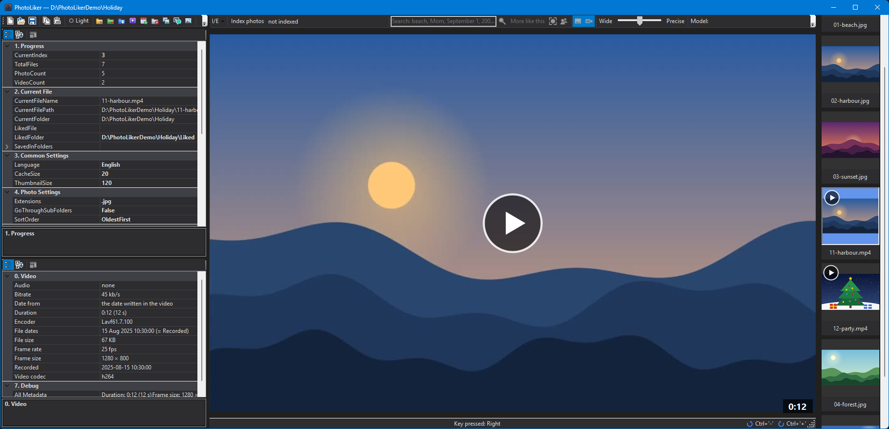

**Playing.** <kbd>Enter</kbd>, or a click on the poster, puts the player over the picture; under it are the play / pause button, where you are (`0:12 / 1:17`), a slider to go
anywhere (click or drag), a **Go to** box where you type a time and press <kbd>Enter</kbd> (`83`, `1:23`, `1:02:03` or `1m23s`), a mute button and the volume. A click on the
picture pauses and plays. The keys are in the [table above](#keyboard-and-mouse): <kbd>Enter</kbd> pauses, <kbd>Shift</kbd>+<kbd>Left</kbd> / <kbd>Right</kbd> go 5 seconds and
<kbd>Ctrl</kbd>+<kbd>Left</kbd> / <kbd>Right</kbd> 30 seconds, <kbd>Ctrl</kbd>+<kbd>Up</kbd> / <kbd>Down</kbd> change the volume, <kbd>Esc</kbd> goes back to the poster. Going to
another item of the list stops the video. The first start of the player after an installation can take ten seconds or more while the virus scanner looks at its files; it starts in the background as soon as a video is shown,
and the bar says **Starting the video player...** until it is ready. If it cannot start at all, the video is opened in the program Windows plays such files with.

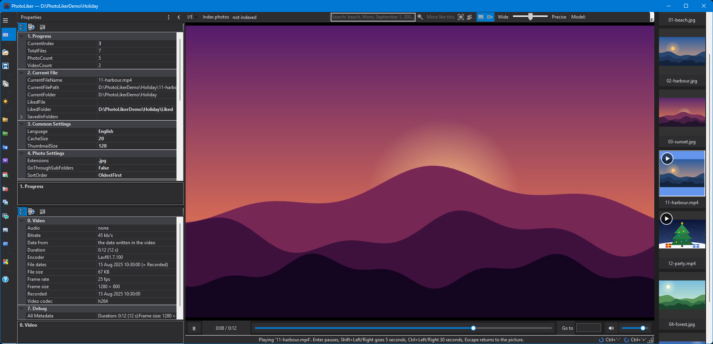

**Searching the videos.** With **SupportVideo** on, **Update index** goes through the videos after the photos, with the same model and the same Stop button. ffmpeg takes a picture out of each
video every two seconds (the key frames only, where a video has them: 60 times faster than playing it) and the model looks at it; a picture that is no longer like the last one kept becomes a
**moment** of the video (about one in three, with a small picture of it and the faces in it, found with the same models as in photos), and the rest are dropped. The search box then searches
photos and videos together: words ("a cat"), a person ("Mom", or "Mom and Dad"), a date ("September 2009"), or any mix, and the result is one list, the better fits first. A video is in it
once, and the viewer shows where it fits: under the picture is a strip of the moments of the video, the ones the search found marked in orange, and the slider has orange ticks at the same
places. <kbd>Enter</kbd> (or a click) plays from the best fitting place, a click on a picture of the strip goes there, and <kbd>.</kbd> / <kbd>,</kbd> go to the next / the previous place that
was found (without a search, the next moment of all). Two buttons in the search strip, a picture (**Photos**) and a video camera (**Videos**) (there while **SupportVideo** is on; hold the pointer over one for its name), choose what a search looks through: both on is the default, **Photos** off searches the videos only ("a cat" among
the videos), **Videos** off the photos only; the last one on cannot be switched off, the choice is kept with the folder, and a search that is shown is run again when it changes. The precision slider works on videos too; a picture out of a video has to fit a little better than a photo to count, because motion blur and
compression make words match by chance more often (on clips with no cat in them, "a cat" scored as high as a photo needs to). A person is found by the faces in the moments, with the examples from
the photos: a video is searched for people from the photos you named. On the real clips this was made with (a Canon camera, 640 x 480): 144 seconds of video took 19 seconds with faces.
Switching the search model makes the moments again with the new model, like the photos.

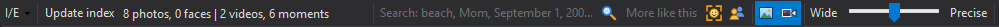

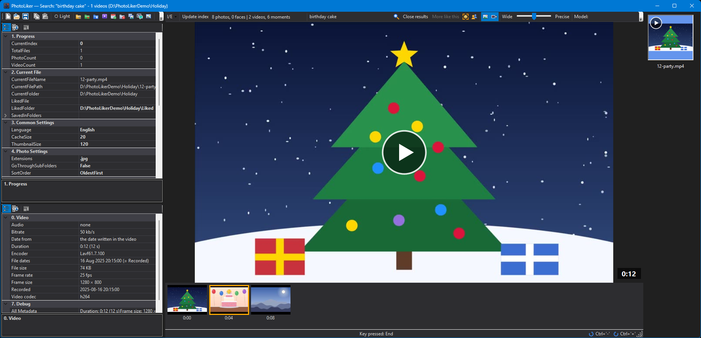

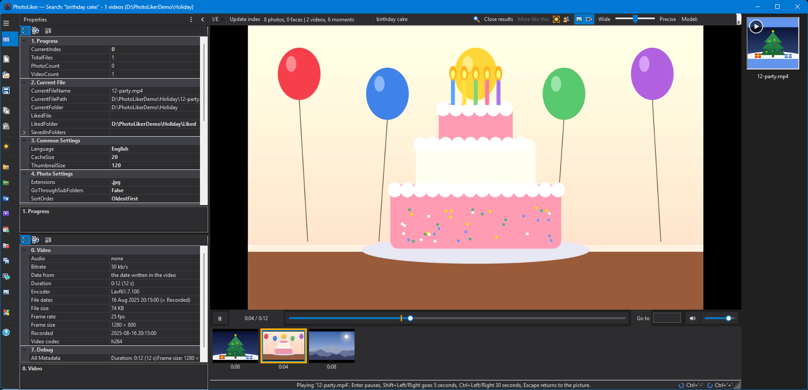

**What is said.** Turn **VideoSpeech** on (it is off by default) and **Update index** also turns what is said in the videos into text, on this computer: Whisper (whisper.cpp), the **small** model
(465 MB, downloaded the first time after asking), reads the sound of each video, a video with no sound worth reading (digital silence) is skipped, and what is heard is kept with the time of each
sentence. It takes about a third of the length of the speech: 3 hours of video in about an hour; it continues where it stopped. A word that you type is then looked for in what is said, in whatever
form it was said (<q>лошадка</q> finds <q>лошадку</q>), also when the sentence was cut in two by the model, and a video where it is said comes before the ones that only look right. The words are
shown in a line under the player while the video plays. The text is the model's guess: it is good with adult speech and poor with children's and with noise (a song is written as its words), and the
**SpeechLanguage** row (`ru`, `uk`, `en`, or `auto`) helps it when the family speaks one language. **SpeechModel** chooses `tiny`, `base` or `small`. Nothing leaves the computer.
(The words are searched in the text whichever search model is chosen; for a query in Russian or Ukrainian the pictures are best searched with the XLM-R model of the [photo search](#photo-search).)

**Saving a picture of a video.** <kbd>Ctrl</kbd>+<kbd>S</kbd> saves the picture the video shows now (the first one, if it is not playing) as a photo in the Liked folder: full size, named after the
video and the place (`MVI_4069 1m23s.jpg`), with the date it was recorded at that place as its date taken, so it is a photo like any other.

**What works on a video, and what does not.** <kbd>Space</kbd> likes it, a group key sorts it, <kbd>Delete</kbd> moves it to the `Deleted` folder (a video that is playing is let go of first),
<kbd>Ctrl</kbd>+<kbd>C</kbd> copies the file: all as for a photo. The [slideshow](#videos-in-the-slideshow) (with **UseVideo** on) and [Align dates](#aligning-file-dates) take the videos along;
rotating, duplicates, "More like this" and Generate Video work on photos only for now: the videos are left out of them.

**Where it keeps what it knows.** What ffmpeg reads from a video (its size, length, codec and dates), its poster picture, its moments (with their pictures, vectors and faces) and what is said in it
are kept in a catalog of their own, `video-<folder>-<hash>.db`
next to the photo index in `%LocalAppData%\PhotoLiker\index`: a separate file, so the photos and the videos never get in each other's way. A video is read when it is first shown and not again
until the file changes: on a router, 24 videos of a Canon camera took 9 seconds the first time and 17 milliseconds the second. The catalog is a cache: deleting it costs nothing but that time.

**The video player is downloaded.** The engine that plays videos (VLC's libvlc, LGPL 2.1 or later) is not in the installer or the zip of a release (23 MB of the installer): the first time **SupportVideo**
is turned on, or a video is played, the program says how big it is and where it comes from, and asks. Yes downloads it once, with the progress in the status bar, into
`%LocalAppData%\PhotoLiker\libvlc\<version>` (40 MB from the releases of this project on GitHub; if it is not there, 83 MB, the same files, from VideoLAN's own server). A download is used only if it is the file whose
SHA-256 the program knows, and the folder is made whole or not at all. No means that videos open in the program Windows plays them with, and the question comes again when **SupportVideo** is turned off and on. When it was turning **SupportVideo** on that started the download, the folder is listed again once the player is there (as <kbd>F5</kbd> does); a download started by playing a video does not interrupt the video.
A build from the source, and an installer made with `installer\build-installer.ps1 -BundleVlc` (for a computer with no internet), have the engine in `libvlc\win-x64` next to the program (86 MB) and download nothing.
`installer\pack-libvlc.ps1` makes the zip for a new version of VLC (and the list of its files, `PhotoLiker.Video\libvlc-files.txt`); it is attached once to a pre-release named `libvlc-<version>`. Its licence and the place to get the source of VLC are in `libvlc\VLC-NOTICE.txt`.
## Big folders open at once

Listing a folder on a network share costs a round trip per subfolder, however few photos each holds: 6.6 seconds for
16,000 photos in 985 folders on a router, minutes for a big archive. So the list is kept. The first time a folder is
opened it is listed (a little faster than before: four folders at a time), and the list is saved on this computer, in
`%LocalAppData%\PhotoLiker\listing`, one file per folder and set of settings (625 KB for those 16,000 photos). From then
on the folder opens from the saved list in a fraction of a second, and is checked for changes while you already look at
the photos.

The check asks every subfolder for the time it last changed: one short question each (a router answers in about 1.5 ms),
instead of a listing. A folder's time moves when something is created, renamed, moved or deleted in it. The folders whose
time differs are listed again, and new subfolders are found through their parent. When the check ends, photos that came
or went are in the list or out of it, the photo you are looking at stays where it is, and the status bar says what was
found:

> Loaded 16,337 photos from 'Y:\OldFotik\Photo'. Checked for changes in 1.5 s: 2 added.

For the 16,000 photos above that is 1.5 seconds in the background where it was 6.6 in front. If the folder cannot be reached
(a share that is off) the saved list is shown and the status bar says so.

What the check does not see is a photo that another program changes in place: the time of a folder does not move when a
file inside is rewritten. For an archive that is only touched with PhotoLiker that does not matter. <kbd>F5</kbd> lists
the folder from scratch, and **Align dates**, **Find duplicates** and **Remove empty folders** do the same themselves after
they changed files. Photos that you delete with <kbd>Delete</kbd> are taken out of the saved list by the app.

Changing **SortOrder** only puts the saved list in another order. Another **Extensions**, **GoThroughSubFolders** or
**LikedFolder** (the liked folder is left out of the list) is another list, made the first time it is used. The saved lists
are only a cache: they can be deleted at any time, and the folders are listed again.

## EXIF and GPS

The grid below the settings shows the metadata of the shown photo in categories: Image, GPS Decoded, EXIF, Thumbnail, and
the tags PhotoLiker has no name for under Unknown. The *All Metadata* row under Debug holds everything as text. Select a row
and the pane under the grid explains the tag: what shutter speed or ISO means, what the numbers of *Flash* or *Orientation*
stand for, which date PhotoLiker takes as the date of the photo.

GPS tags are decoded into decimal and degree/minute/second coordinates, altitude, speed and the UTC time. When the photo has a
position, the **Map Link** row and the **Maps** link at the right of the status bar open it in Google Maps.

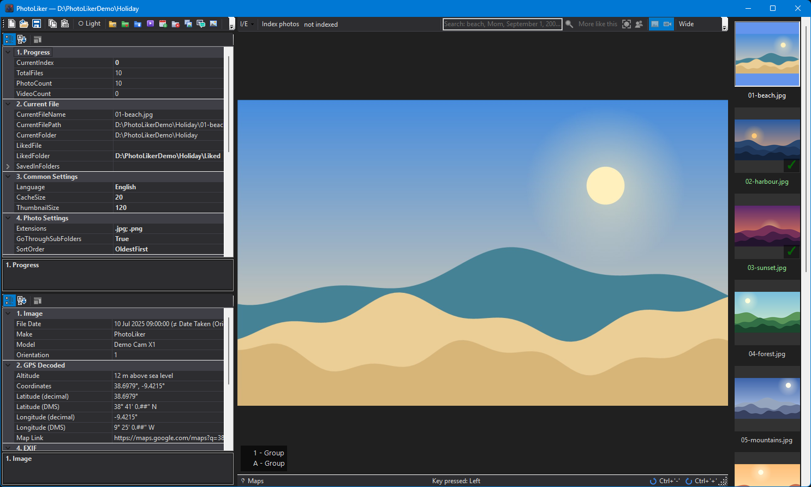

Dates are shown with the month as a word, `14 Aug 2025 09:12:07` (the month is English whatever the language of Windows), in
the grids and in the dialogs below; the file itself keeps them the way EXIF writes them, `2025:08:14 09:12:07`. The format is
set in one place, `DateText` in `PhotoLiker.Core`.

The **File Date** row (in the Image rows, right after *Date Last Saved* when the photo has that tag) is not EXIF: it is the
date of the file on the disk, created and, if different, modified. It ends with `(= Date Taken (Original))` when the file has the
time of shooting that the camera wrote into the photo and with `(≠ Date Taken (Original))` when it has not (a copied file gets
the day of the copy); the note names the row it was compared with, and that one is never *Date Last Saved*.

**Editing the dates.** In a JPEG the date rows of the grid can be edited: **Date Taken (Original)**, **Date Time Digitized**,
**Date Last Saved** and **File Date**. Type a date (`2015-05-01 14:30:00`, `01.05.2015 14:30`, `14 Aug 2025 09:12:07`; a day alone is
taken at noon; always day first or year first) or press the `...` button of the row and pick one. The photo is saved with it: a new
*Date Taken (Original)* is also given to the dates of the file, the other EXIF dates change only themselves, and *File Date* sets
created and modified both and nothing inside the photo. A photo that has no Date Taken shows `(none)` in that row, and typing a
date there adds one (its Exif block grows a little). The copies in the Liked and group folders follow, as with Rotate, and the
search index takes over the new date. Rows of a PNG or another kind of file are read-only.

Two EXIF dates look alike and are not. **Date Taken (Original)** (in the EXIF rows) is when the picture was shot. **Date Last Saved**
(in the Image rows, EXIF's `DateTime`) is when a program last saved the photo: a photo that was turned or edited in Windows Photo
Viewer shows that day there, months after it was shot. Everything in PhotoLiker (search by date, the order of the list, Align dates) goes by the first.

## Aligning file dates

A file that was copied from a card, a phone or an old disk has the day of the copy as its created date, and the date of the
photo only sits inside it (EXIF). The **Align dates** button of the toolbar sets the dates of the files to the date taken, so
that Explorer, other programs and the order of the list (**SortOrder** goes by the created date) agree with the camera.

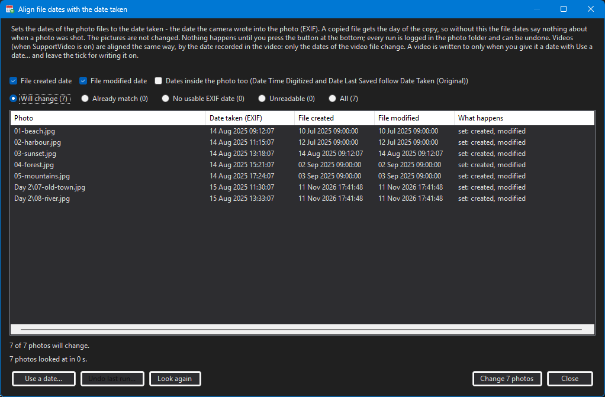

The dialog looks at the folder first (it reads only the start of each file, so it takes minutes for tens of thousands of photos
even on a network drive, and can be stopped) and shows, before anything is touched, how many photos will change and which:

- **Will change** lists each photo with its date taken, its created and modified date now, and what would be set; **Already
  match**, **No usable EXIF date** and **Unreadable** list the others. The counts and the list follow the ticks at once.
- The ticks are *File created date* and *File modified date* (on) and *Dates inside the photo too* (off). With the last one on,
  the other two dates inside the photo (Date Time Digitized and Date Last Saved) are made equal to Date Taken (Original). They are overwritten
  in place (a date has a fixed size), so the file does not grow and the picture is not touched.
- A photo can be taken out of the run: select it, then <kbd>Space</kbd> or the right-click menu *Leave out of this run*.
- A **double click** on a row opens the photo in the program Windows has for it (the right-click menu also has *Open* and *Show in
  File Explorer*, which opens the folder with the file selected), to look at it before deciding. This works while a run is in progress too.
- **Videos.** With **SupportVideo** on, the videos of the folder are looked at too: the date a video says it was recorded (read from its header with ffmpeg, kept in the video catalog, and believed by the
  same rules) is its date taken, and its file dates are set to it. Nothing is written into a video (it has no EXIF), so *Dates inside the photo too* and writing a given date into the file
  are for photos only; a video is the same byte for byte after a run. The catalog of the videos is told the new date of change, so that **Update index** does not analyze them again.
  The first look reads the header of every video that has not been read (about 0.4 seconds each over a network share, a few at a time).
- Only the date the camera wrote is used, and only if PhotoLiker believes it (see [Photo search](#photo-search): not before
  1995, not in the future, not a camera that lost its clock). A photo without such a date is listed under **No usable EXIF
  date** and left as it is, unless you give it one (next list). The date of the camera has no time zone, so it is taken as the
  time of this computer.

**Photos without a usable date.** Select some of them (or none, for all) and press **Use a date...** (<kbd>Enter</kbd>, or
the right-click menu). It asks where their date taken comes from, and shows for each answer how many of the photos have one
from there, and what it would be:

- *The date the photo has: I know it is right*: the EXIF date that looks like a camera that lost its clock but is real, a
  photo of New Year's night in a folder `2016-01-01`;
- *The date in the name of its folder*: a day in the folder name (`2015-05-01`, `20150501`, `01.05.2015 Anna`), the innermost
  folder that has one, at the time of day the photo has, or at noon (a folder called `2015-05` has no day and gives none);
- *The date of the file*: when it was created, else changed. For a photo that was copied this is the day of the copy, which
  the dialog says;
- *This date*: one you type.

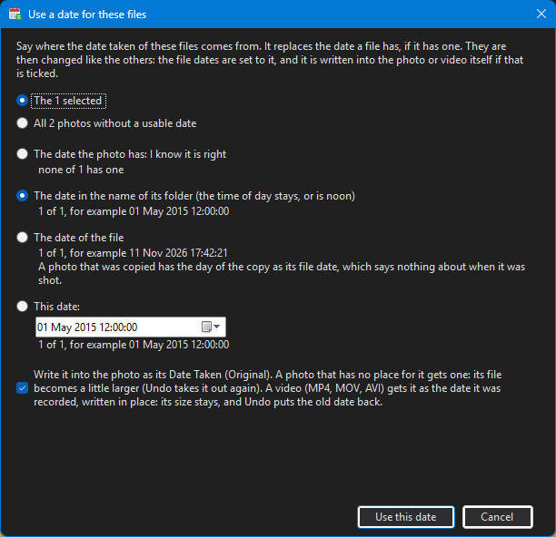

The photos then count as having that date taken: they move to **Will change** (marked "(given)") and are changed like the others,
with the file dates set to it, and, if *Write it into the photo as its Date Taken (Original)* is ticked in the question (it is by
default), the date written into the photo as its Date Taken (Original): replacing the date that was not believed, or added to a
photo that has none (no EXIF at all, or no date in it), whose Exif block then grows a little and whose file is written anew. That
makes the date a date of the photo itself and not only of its file. **Undo last run** takes it out again: the log keeps the old block
of the photo. The copies in the Liked and group folders get the new dates and, as the size of the photo changed, the new id in
their names. Without the tick a photo that has no place for a date inside it only gets its file dates, which is also the date the
app goes by for it (the date of its file). "Forget the date given" in the right-click menu takes a date back; a given date is
not kept after the dialog closes, and the run is logged and can be undone like any other.

**Change N photos** does it. Things that go along:

- Every run writes a log (`photo-liker-datefix-<date>-<time>.jsonl`) in the photo folder, before the first file of each hundred is
  touched. **Undo last run...** puts the dates (and the dates inside the photo) back from it; a photo that was changed after the
  run, or whose date was changed again, is left alone and counted.
- The copies of a changed photo in the Liked and group folders get the same dates. A copy is matched with its photo by the id in its
  name, which comes from the size and the date the photo had when it was copied, or else by size and date.
- If the folder is indexed, the index is told that the photos are the same ones: without that, "Update index" would take every
  changed date for a changed photo and analyze it again. (Stop indexing before using the button.)
- The dates are read back after writing. A network drive that does not keep the created date is reported, not ignored.
- The folder is listed again afterwards, so the list is in the new order and the **File Date** row is up to date.

## Removing empty folders

Moving and deleting photos leaves folders behind, and Windows leaves a thumbnail cache (`Thumbs.db`) in the ones it showed. The
**Remove empty folders** button of the toolbar lists the folders of the photo folder, at any depth, that hold nothing of use:
nothing at all, or only thumbnail files (`Thumbs.db`, `ehthumbs.db`, `desktop.ini`, `.DS_Store`, `._*` stubs of macOS), or only
other folders like that. Every folder is ticked and nothing is deleted until you press **Remove N folders**.

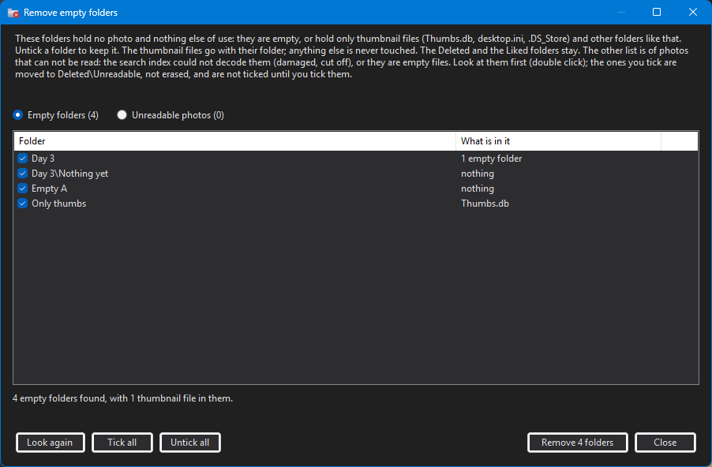

- The rule is strict: any other file, whatever it is, keeps its folder and every folder above it. A folder that can not be read
  is not guessed at. A link to another folder, the `Deleted` folder, the Liked folder with its group folders, and NAS or system
  folders (`@eaDir`, `#recycle`, `$RECYCLE.BIN`) are left alone, and so are the folders that hold them. The photo folder itself is never removed.
- Unticking a folder unticks the folders above it (they could not go without it); ticking a folder ticks the ones inside it.
- A **double click** on a row opens the folder in File Explorer (also *Open in File Explorer* in the right-click menu), to see what is in it before it is removed. It does not change the tick.
- The thumbnail files are deleted with their folder, the folder is deleted without recursion (a folder that got a file since
  the list was made stays, and is reported), and the folders inside go before the folder around them.
- Nothing can be undone here: there is nothing in these folders to bring back, and a missing folder is made again when needed.

**Photos that can not be read.** The second list of the dialog, *Unreadable photos*, holds the photos that no program can show:

- the ones the [search index](#photo-search) could not decode (a damaged or cut-off file: "The image header might be corrupted"). These
  are the "unreadable" of the index status, and they are only as many as the indexer has got to, so index the folder first;
  they are taken from the index, so listing them reads nothing from the (possibly slow) drive;
- empty files (0 bytes) with the extension of a photo, found on the same walk of the folders.

Unlike a thumbnail cache, a photo may still be worth something to another program, so the list starts **unticked**; double click
a row to look at it, tick the ones to go (*Tick all* ticks them all) and press **Move N to Deleted\Unreadable**. They are moved, not
erased, with the path they had, like every deleted photo, and the search index forgets them; to bring one back, move it up again in File Explorer
(to erase them for good, empty that folder). A folder that held only such photos is empty afterwards: press *Look again* to find it. Moving is
not offered while the folder is being indexed. Photos in the `Deleted` and Liked folders are left out.

## Finding duplicates

Photos get copied: a card into a folder named for the day, the same card again, a folder of discards. The **Find duplicates**
button of the toolbar finds photos that show *exactly the same picture* in different folders, keeps one of each and moves the other
copies to `Deleted\Duplicated` inside the photo folder, with the path they had, so a copy goes back by moving it up again.

**How they are found.** The name plays no part (a renamed copy is a copy; two cameras that both count to `IMG_1234` are not).
Neither does what is written around the picture: a JPEG has a header (EXIF, XMP, a thumbnail) in front of its picture data, and a
program that writes a rating, a keyword or a date changes the header, often without changing the size of the file. Two copies of
one camera photo are then not the same *file*, but they are the same photo, so the comparison is of the picture data after the
header. Only files with the same size can be the same, and the folder listing says that for free, so only those are looked at, by a
fingerprint of three blocks of 64 KB of the picture data (the start, the middle and the end), which takes minutes for tens of
thousands of photos even on a network drive. Tick *Compare all of the picture* to read all of it instead: much slower, no doubt left. The
sample can miss two photos that are the same everywhere but between the blocks; the unit tests show that case. A group whose
metadata is not the same in all copies says so in the list ("metadata differs from the others"): the copy that stays keeps
its own, so look at those if you rated or tagged photos in a folder that loses. A file that is not a JPEG is compared as it is.
Subfolders are always included, and the photos in a folder called `Liked` or in a group folder (`A - Group ...`) are left out: they are copies on purpose.
A copy whose metadata has another *size* (an XMP block that was added to one of them) is hidden from a comparison of sizes; tick
*Also look at photos that only share their name with another* to look at those too: it reads more files, and the name is only
what picks the photos to look at, the picture decides.

**Which copy stays.** The folder decides, the way you would have sorted them by hand:

- a folder **named for a date** (`2014-11-23`, `20141123`, `23.11.2014`, `2014`) or **with a name of its own** (`Natasha's camera`,
  `Crete trip`) beats a folder that only holds what the camera called the card (`107_2311`, `135___07`, `314CANON`, `100NIKON`);
  what all the copies have in common (the folder `Photo` that every photo is in) counts for nothing;
- anything inside a folder called `Deleted` (or `Duplicated`, `Trash`) loses, and among copies that are all in such folders the better name still wins;
- between copies in equally good folders, the one whose file name is not that of a copy stays: `IMG_5407 - копия.JPG`,
  `IMG_5407 - Copy.JPG`, `IMG_5407 (2).JPG` and `Copy of IMG_5407.JPG` move, `IMG_5407.JPG` stays (the folder still counts first);
- the copies that still tie (two date-named folders, two card folders) are left to you, and are never moved until you choose.

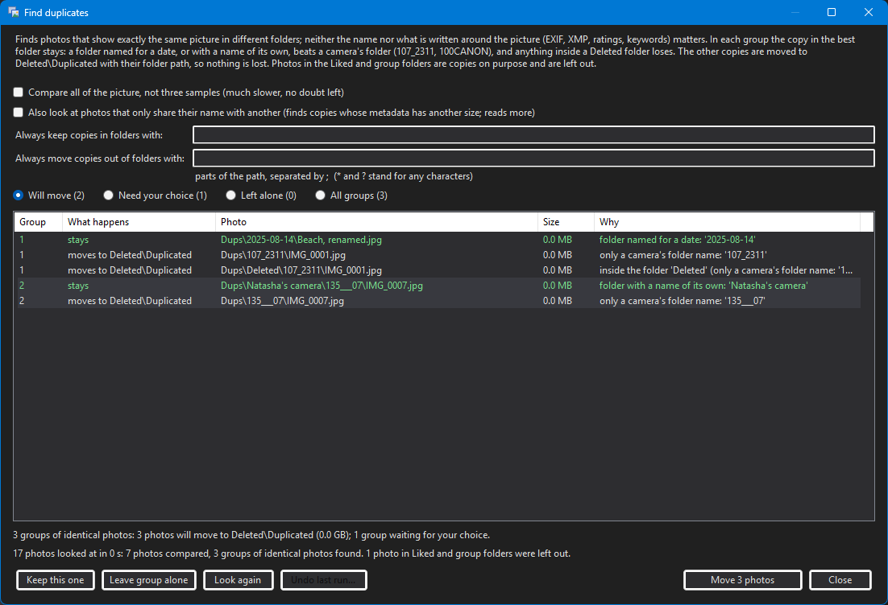

Every row says why. You can fill in the two boxes to override the rules: *Always keep copies in folders with* and *Always move
copies out of folders with* take parts of a path, separated by `;`, with `*` and `?` as wildcards (`107_*; Fotik1`). Select a
photo and press **Keep this one** (<kbd>Enter</kbd>) to make it the one that stays whatever the rules say, or **Leave group
alone** (<kbd>Delete</kbd>) to keep a group out of the run; both work from the right-click menu too. At least one copy of every group always stays.
A **double click** on a row opens that copy in the program Windows has for it, to see which one is the better picture before you
decide (the right-click menu also has *Open* and *Show in File Explorer*).

**Move N photos** does it. A copy is only moved if the photo that stays is still there with the same size and the copy itself
is unchanged since the look. Every run writes a log (`photo-liker-duplicates-<date>-<time>.jsonl`) in the photo folder before the
first move of each hundred, and **Undo last run...** puts the copies back (a copy whose old place is taken stays where it is, and is counted).
The search index forgets the moved copies at once (after an undo, *Update index* adds them again). Stop indexing before using the button.
Which folder you open matters for one thing: the `Deleted` folder directly inside the opened folder is the app's own and is not
scanned; a `Deleted` folder deeper down is a folder like any other, and its copies are found and are the first to go.
Afterwards **Remove empty folders** clears the card folders that are left with nothing in them.

## Progress on the taskbar

Whatever takes a while also shows its progress on the taskbar button of PhotoLiker, as a green bar that fills up under the icon, the way a browser
shows a download, so it can be followed with the window minimized or behind another one. A bar that runs to and fro means that
something is going on but its end is not known yet (listing the photos, loading the models).

It follows the progress bars the program already shows: the indexing of the photos (the strip above the photo), and the dialogs **Align dates**,
**Find duplicates**, **Remove empty folders** and **Generate Video**, saving all search results in a group, and the download of a new version in
the About box. When two run at once the one in front is shown: a dialog opened over the window wins over the indexing behind it, and the indexing
is back on the button when the dialog is closed. With nothing running the button shows nothing. (The code is in `TaskbarProgress`: each
progress bar registers itself with one line, and the main window asks them a few times a second.)

## Dark and light theme

The theme button of the toolbar switches between the two. The choice is stored in the settings file of the folder.

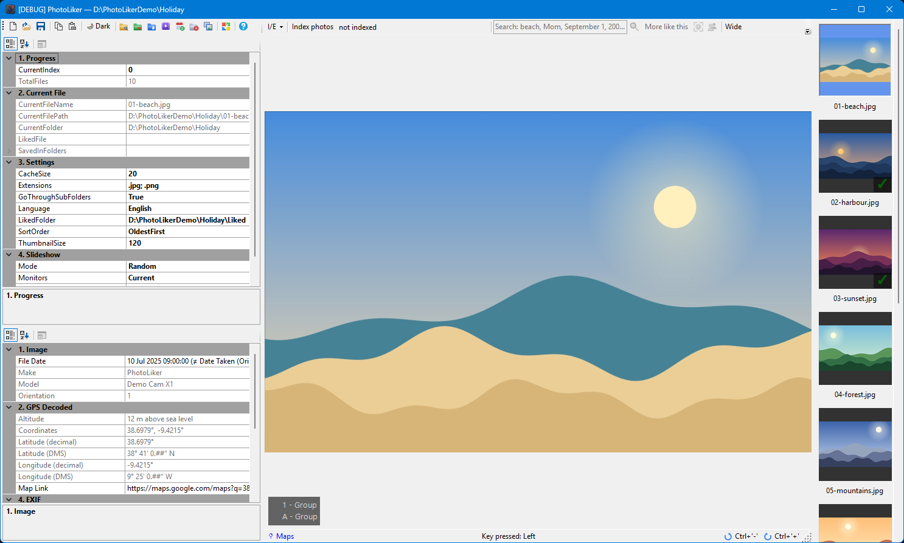

## Language

The program speaks **English** (built in, and the default) or any language that has a **language file**. The **Language** row of the settings grid
lists them; the change is made at once, without a restart: the toolbar and its tips, the search strip (including the lines of the model box), the
status line, every dialog (Generate Video, Align dates, Remove empty folders, Find duplicates, the confirmations and messages), the About box and the
help texts of the two grids are written again in the new language, and the dialogs that open later use it too. The choice goes to `global-config.json`
in `%LocalAppData%\PhotoLiker`, not to the settings file of a folder, so it is the same for every folder and does not travel with a folder that is
shared between computers.

**The files.** A language is a plain text file named `photo-liker-<code>.txt` (UTF-8): `photo-liker-ua.txt` is Ukrainian, `photo-liker-en.txt` English
(`ua` is the code of the file, not of the culture). The program looks for them in the folder `Languages` next to the program (the build, the zip and
the installer put `photo-liker-en.txt` and `photo-liker-ua.txt` there) and in `%LocalAppData%\PhotoLiker\Languages`, where a file wins over the one beside
the program and survives a new version being installed. Every file found is a choice in the Language row, named as the file's own `Name` line says;
with no file at all there is English only. The list is read again each time it is opened, so a file you just added is in it; to see an edit of a file
that is in use, pick another language and then this one again.

**The format.** One text per line, `Name = text`; empty lines and lines that begin with `#` are ignored. The name is the class that offers the text and
its member (`SearchStrings.IndexButton`) and is not to be changed; the text is what you translate. In a text, `\n` is a new line, `\t` a tab, `\\` a
backslash and `\s` a space (the spaces at the very start and end of a text are cut off, so write `\s` where one is meant there); any other backslash stays
(`Deleted\Duplicated`). `{0}`, `{1}` ... are filled in by the program: keep them (their order is yours). A text of the form `photo|photos` holds the forms
of a noun for a number; Ukrainian has three (`фото|фото|фото`: 1, 2-4, 5+). The first lines, without a dot in their name, describe the language:

```
Name = Українська        how the language is named in the list
Culture = uk-UA          the .NET culture: month names, and the language of what .NET itself says
Plural = east-slavic     one-other (1 | the rest: English, German ...) or east-slavic (1, 21 | 2-4, 22-24 | the rest: Ukrainian, Russian ...)
```

**A new language.** Copy `photo-liker-en.txt` to `photo-liker-<code>.txt` (in `%LocalAppData%\PhotoLiker\Languages`, or in the folder `languages` of the
repository, from where the build copies it), change the three lines above and translate the texts. A text that is left out, or that has other `{0}` than
English, is shown in English, and when the language is picked the status line says how many of those there are and names the first, so a language can be
translated in steps. `Plural = ...` has two rules for now (`PluralRule` in Core); another is a few lines in `Plural.Index`.

What is **not** translated, on purpose: the names of the rows of the two grids (`LikedFolder`, `Date Taken (Original)`, the categories), the names of the
folders (`Liked`, `Deleted`, `1 - Group`) and of the settings file, and the words of a search (descriptions and month names are English; see
[Photo search](#photo-search)). Windows' own dialogs (the folder picker, the file dialogs, the buttons of a message box) follow the language of
Windows. Dates and numbers follow the regional settings of Windows, not this setting, except for the month names of <kbd>PageDown</kbd> / <kbd>PageUp</kbd>.
The setup program is in English or Ukrainian too (it offers both when it starts); the program itself starts in English whatever language the setup used.

**For developers.** The English texts are `languages\photo-liker-en.txt`, built into `PhotoLiker.Core` (so there is a word for everything with no file),
and every other language is measured against it. A text is offered by a class of one of the three assemblies (`AboutStrings`, `SearchStrings`, `VideoStrings`,
`CoreStrings` ...) as one line, `public static string IndexButton => T();`, and the code uses it as it always did; a text whose name ends in `Format` is a format
string. A new text is one such line and one line in `photo-liker-en.txt` (and in the other files, or it is shown in English). `Loc` holds the language that is
on (`Loc.Language`, `Loc.Changed`; a test puts one on for itself with `Loc.Use`), `AppLanguage` finds and reads the files, `MainForm.ApplyLanguage` writes the
texts of the window again. The tests (`LanguageFilesOfTheRepositoryTests`) check that every file of `languages` has exactly the texts English has, with the same
placeholders and the right number of forms of each noun, and that the code asks for no text that is missing and no text goes unasked.

## Settings file

Each photo folder keeps its settings in `photo-liker-config.json` inside the folder, so every folder remembers its own
theme, window position, extensions and the photo you stopped at. The paths in it are stored relative
to that folder (`"CurrentFolder": "."`, `"LikedFolder": "Liked"`), so the folder opens the same from any machine, drive
letter or network share. Files written by older versions, which hold full paths such as `Y:\...`, are read the same way:
the paths below the stored `CurrentFolder` are taken to be below the folder you opened, and the file is converted the next
time it is saved. A liked folder outside the photo folder, for example on another drive, keeps its full path.

```json
{
  "CurrentFolder": ".",
  "LikedFolder": "Liked",
  "GoThroughtSubFolders": true,
  "Extensions": [ ".jpg", ".png" ],
  "SortOrder": "OldestFirst",
  "CacheSize": 20,
  "ThumbnailSize": 120,
  "SlideshowMode": "Random",
  "SlideshowMonitors": "Current",
  "SlideshowTimeout": 2,
  "SlideshowWatermark": "DateTime",
  "SlideshowEffect": "Fade",
  "SupportVideo": true,
  "VideoExtensions": [ ".avi", ".mp4", ".mov" ],
  "IsDarkTheme": true,
  "WindowLeft": 30, "WindowTop": 20, "WindowWidth": 1500, "WindowHeight": 900,
  "ScreenIndex": 0,
  "WindowState": 0,
  "CurrentFilePath": "01-beach.jpg"
}
```

`GoThroughtSubFolders` is spelled like that in the file on purpose: it is the name the first versions wrote, and folders are
shared between machines that may run different versions. The spelling `GoThroughSubFolders` (used by the MAUI app) is read
as well. `WindowState` is the number of `FormWindowState`: 0 normal, 2 maximized. `SortOrder` is written by name
(`OldestFirst`, `NewestFirst`, `ByName`, `Random` or `None`); a name the app does not know (a typo, or one written by a newer version) reads
as `OldestFirst` and does not spoil the rest of the file. `SlideshowMode` (`Random`, `OneByOne`), `SlideshowMonitors` (`Current`, `All`), `SlideshowWatermark` (`None`, `Year`, `DateTime`) and
`SlideshowEffect` (`None`, `Fade`, `Slide`, `Zoom`, `KenBurns`, `Random`) are
written by name and read the same way (an unknown name gives `Random` / `Current` / `DateTime` / `Fade`); `SlideshowPeopleFaces` and `SlideshowPeopleNames` are `true` or `false`; `SlideshowTimeout` is in seconds. `SearchPrecision` (the slider) and `SearchModel` (the model box) are the
settings of the [photo search](#photo-search).

Besides that the app keeps small files in `%LocalAppData%\PhotoLiker`: `global-config.json` (the last folder that
was opened, and the [language](#language)), `people.json` (the people named in all folders, see above), `people-groups.json` (the groups of people) and `crash.log` (the stack trace of an unexpected
error). Set the environment variable `PHOTOLIKER_DATA_DIR` to keep them somewhere else; the tests do that, so running them
leaves your own files alone.

## User manual

The user manual is two HTML pages for people who do not read READMEs: [docs/manual.en.html](docs/manual.en.html) in English and
[docs/manual.ua.html](docs/manual.ua.html) in Ukrainian, with [docs/manual.css](docs/manual.css) for the look (it follows the light or
dark setting of Windows) and the screenshots of `docs/images`. They are written from this README without the technical details (no
file formats, ids, ffmpeg workarounds, project layout or development), with the same sections in both languages.

- **In the package.** `PhotoLikerUI.csproj` copies the pages and the PNG files of `docs\images` to `Manual\` and `Manual\images\` next to the
  program, so a build, a publish, the zip and the installer (which packs the published folder) all have them, and the pages find their
  pictures at `images\` both there and in the repository.
- **From the program.** The [About box](#about-box) opens `Manual\manual.en.html` or `Manual\manual.ua.html` (`UserManual.Find` in Core) in the
  default browser, and so do <kbd>F3</kbd> (English) and <kbd>F2</kbd> (Ukrainian) in the main window.
- **File names.** The suffix of a page is the one `UserManual` uses (`en`, `ua`); the page itself says `lang="uk"`, which is the code of the
  Ukrainian language (`ua` is the country), so that browsers and screen readers know the language.
- **Keeping it up to date.** The manual is not generated: when a feature changes, change this README, the pages (both languages) and, for the
  keys, `AboutStrings.Shortcuts`. A new screenshot goes to `docs/images` (the file name decides where the pages show it).
- **Another language.** Copy `manual.en.html` to `manual.<code>.html`, translate it, add a button to the About box and `UserManual`. The
  manuals name the buttons as they are in English; the Ukrainian one has a table of the Ukrainian names (see [Language](#language)).

## Project layout

| Project | What it is |
|---|---|
| `PhotoLikerUI` | The Windows (WinForms) app. Everything that needs WinForms or GDI+: the window, decoding and caching of photos, the settings grid with its editors, themes, the context menu registration. |
| `PhotoLiker.Core` | The logic without a user interface: settings and their file, scanning folders and keeping the list of a folder between runs, finding empty ones and duplicates (and the rules that pick the copy to keep), the liked and group libraries, EXIF reading and GPS decoding, how dates are shown. Shared by all front ends. |
| `PhotoLiker.GenerateVideo` | Making a video of photos, without a user interface: the pictures and the time of each (also cut on the beats of the audio), the ffmpeg run, the audio (its length, a WAV to listen to, its rhythm: tempo and beats), the sources of photos, and the `photo-liker-video.json` settings kept with a folder. Uses Core for the photos and the texts. |
| `PhotoLiker.Search` | Photo search: model download, the indexing pipeline, CLIP text search, face detection and recognition, the SQLite index and the people files (one per folder, one shared by all); the dates of photos (reading them, the rules, and writing them back for **Align dates** with its log and undo). Windows only (WPF's image decoder). |
| `PhotoLiker.Video` | Videos in the archive, without a user interface: what a video says about itself (ffmpeg's header, read as text), its poster picture, the dates (the one inside the video, else the file's), the rows for the metadata grid, the times typed to jump to, the catalog of the videos of a folder in an SQLite file of its own, and what is in the videos: the pictures taken out of them (ffmpeg, as raw pixels), their moments (CLIP vectors and faces, chosen by how much they change), the indexing job, the search of moments (words, people, dates) merged with the photos, what is said (Whisper, kept as text and searched in any word form) and saving a picture of a video as a photo. Uses Core and Search (the models and the rules of the dates). Windows only. |
| `PhotoLiker.Maui` | An experimental cross-platform front end on top of the Core library. It is not built by CI and needs the .NET MAUI workloads. |
| `PhotoLiker.Tests` | xUnit tests of the Core library (and of the one WinForms-free converter of the app), and of the [language](#language) files. |
| `PhotoLiker.GenerateVideo.Tests` | xUnit tests of the video library: the order and the times of the photos, the sequence of a video (cover, repeats, audio), the ffmpeg arguments, the cuts on the beat, the rhythm analysis (on synthetic songs), the settings file. They need no ffmpeg. |
| `PhotoLiker.Video.Tests` | xUnit tests of the video library: ffmpeg's text of a Canon, a phone and a camera without a clock, the dates and places, the typed times, the catalog (read once, kept, read again when the file changes, a file that is no video, no ffmpeg), the pictures taken out of a real video and their times, the choice of moments, the faces, the search (words, people, dates, speech) and its merge with the photos, the word forms of the speech and the speech job with a stand-in for the model, saving a picture. The tests that make a short video do so with the ffmpeg of the repository and do nothing without it; the one that runs the real CLIP model does nothing without it. |
| `PhotoLiker.Search.Tests` | xUnit tests of the search library: tokenizers, image and face geometry, index, people file, search. They need no models; the tests that run a real model do so only if its files are there (in the app's models folder, or in the one named by the environment variable `PHOTOLIKER_TEST_MODELS`) and otherwise pass without doing anything. |
| `tools/SmokeTour` | Smoke test of the real window in dark mode that also takes the screenshots of this README, see below. |
| `installer` | Inno Setup script (setup in English or Ukrainian), `build-installer.ps1` and `publish-release.ps1` (tags and pushes a release, see [Releasing](#releasing)). |
| `.github` | `workflows\build.yml` (builds every push and pull request to `master`, as artifacts) and `workflows\release.yml` (makes a GitHub release from a tag, see [Releasing](#releasing)), with `release-intro.md`, the text that opens the notes of a release. |
| `languages` | The language files of the program, `photo-liker-en.txt` (the English texts, built into Core) and `photo-liker-ua.txt`; the build copies them to `Languages\` beside the app. See [Language](#language). |
| `docs` | Screenshots, the [user manual](#user-manual) pages, [a how-to for Generate Video](docs/how-to-generate-video.md) and a small sample folder of photos. |

## Development

You need the .NET 10 SDK (see `global.json`) on Windows.

```powershell
dotnet build PhotoLikerUI\PhotoLikerUI.csproj          # build the app
dotnet test  PhotoLiker.Tests\PhotoLiker.Tests.csproj  # run the tests of the Core library
dotnet test  PhotoLiker.GenerateVideo.Tests\PhotoLiker.GenerateVideo.Tests.csproj  # run the tests of the video library
dotnet test  PhotoLiker.Search.Tests\PhotoLiker.Search.Tests.csproj  # run the tests of the search library
dotnet test  PhotoLiker.Video.Tests\PhotoLiker.Video.Tests.csproj  # run the tests of the video library (videos in the archive)
installer\build-installer.ps1                           # publish and pack the installer (needs Inno Setup 6)
```

The installer is written to `publish\installer\PhotoLiker-Setup-<version>.exe`. Inno Setup is available with
`winget install JRSoftware.InnoSetup`. `installer\build-installer.ps1 -Version 2.1.0` names the installer after that version and stamps it on
the program too, as a release does (see below).

### Releasing

A release is made by pushing a tag of the form `v<major>.<minor>.<patch>` on the commit that is to be released (normally on `master`, pushed to
GitHub first). Pushing the tag is the only manual step; `release.yml` starts by itself when GitHub receives it, and nothing else starts it (a push to a
branch does not). The task does the tagging with its checks:

```powershell
installer\publish-release.ps1 -Version 2.1.0 -DryRun   # every check, nothing tagged or pushed
installer\publish-release.ps1 -Version 2.1.0 -Watch    # tag v2.1.0, push it, follow the workflow run (needs gh)
```

In VS Code: *Terminal > Run Task > **publish-release-check** / **publish-release***, which ask for the version. The script refuses when the version
is not `major.minor.patch` or not newer than the existing `v*` tags, when something is uncommitted, when the commit is not on GitHub yet or has
no `release.yml`, or when the tag exists (here or on GitHub). It shows the commit, asks you to type the version again (and asks once more if the
branch is not `master`), and removes the local tag again if the push fails. `-Yes` skips the questions. By hand it is
`git tag -a v2.1.0 -m "Photo Liker 2.1.0"` and `git push origin v2.1.0`.

`.github\workflows\release.yml` then runs the tests of both test projects, builds the installer with `build-installer.ps1 -Version 2.1.0`,
zips the same published folder and creates the GitHub release **Photo Liker 2.1.0** with `PhotoLiker-Setup-2.1.0.exe` and
`PhotoLiker-2.1.0-win-x64.zip`. Its notes are `.github\release-intro.md` (how to install and update, the SmartScreen warning, the ffmpeg
licence) followed by GitHub's own list of what changed since the previous release. The workflow fails, and publishes nothing, if a test fails or
the tag is not of that form. A release that turns out wrong is deleted on GitHub (*Releases > the release > Delete*, and delete the tag with
`git push --delete origin v2.1.0`) and made again with a new tag; a version number is not used twice.

What the [update button](#updating) of the About box relies on:

- The version of the tag is put on the program (`-p:Version=2.1.0`, which the project turns into the informational version): that is how the
  running program knows which release it is (`AppVersionInfo.ReleaseVersion`). Without the property the version is `0.0.0-dev`, a build that is
  no release (a plain `dotnet build`, the artifacts of `build.yml`), which is shown as such and is never offered a setup.
- The release has a file named `PhotoLiker-Setup-*.exe` (`UpdateChecker.InstallerPrefix`) among its files; GitHub's SHA-256 of it is checked
  after the download. Only a setup at `github.com/YBalan/PhotoLiker/releases/download/` is accepted.
- The latest release is the newest one that is neither a draft nor a pre-release (what the API's `releases/latest` returns), so a pre-release
  does not reach anyone through the button. GitHub allows 60 anonymous requests an hour from one address, plenty for a button that is pressed by hand.
- The setup is started as `PhotoLiker-Setup-x.exe /SILENT /SP- /NORESTARTAPPLICATIONS /Relaunch=1` (`UpdateLauncher.SetupArguments`); `/Relaunch=1` is read by
  `installer\PhotoLiker.iss`, which starts the program again at the end of a silent setup. A copy that has `unins000.exe` beside it (the setup
  puts it there) is replaced without a question; any other copy is asked first (see [Updating](#updating)). The window is closed by the program itself before
  the setup starts, so the setup does not have to close it (if it still finds it running, Windows' Restart Manager closes it, which the tests of the
  setup showed to work).
- The logic is `UpdateChecker` in Core (tested in `UpdateCheckerTests`, with a stand-in for GitHub); the button, the question and the download are
  in `AboutDialog`, and the smoke tour presses them with a stand-in for GitHub (below).

### Smoke tour

The unit tests cannot open a window, so `tools/SmokeTour` does: it generates a demo folder of photos (with EXIF and GPS
data), opens the real PhotoLiker window in **dark mode** and uses it the way a person would, checking what happens at
every step:

- the folder opens with the dark theme read from its settings file, and the window really is dark on screen;
- the arrow keys, <kbd>Home</kbd>, <kbd>End</kbd>, <kbd>PageUp</kbd>, <kbd>PageDown</kbd> (by the months of the files' dates),
  <kbd>Space</kbd> and the group keys move through the photos and copy and remove files in the Liked and group folders, a new
  photo brings the settings grid back to its top, and a number typed into **CurrentIndex** jumps to that photo;
- the strip above the viewer starts with the **I/E** button and has icons for Search and Faces;
- with real mouse clicks and key presses: after a value was typed into the settings grid, picked from a drop-down list or
  turned over by a double click, and after a click on the photo or a thumbnail while a value is still being edited, the
  arrow keys and <kbd>End</kbd> work on the photo again;
- the settings grid lists what it should, **LikedFolder** has the folder picker, and cancelling the dialog keeps the value;
- changing **GoThroughSubFolders** and **Extensions** reloads the folder with the right number of photos, and changing
  **SortOrder** lists the same photos oldest first, newest first or as the disk gives them, keeping the shown photo;
- <kbd>Delete</kbd> moves the photo (keeping its subfolder) to `Deleted`, shows the next one, and the folder is not listed
  again, also with the subfolders on; with the list emptied nothing is shown and the keys do nothing;
- **Rotate**, the two buttons in the right corner of the status bar (counterclockwise first, each showing its key, with a tooltip) and <kbd>Ctrl</kbd>+<kbd>+</kbd> /
  <kbd>Ctrl</kbd>+<kbd>-</kbd> (also with <kbd>Shift</kbd>, and the numpad keys), turn a photo that has an orientation by two bytes,
  four clicks give the file back byte for byte, the dates of the file become the date taken (and its Liked copy is renamed to the new
  id and still found); a JPEG without any EXIF gets the flag and the date of its file written into it as its Date Taken, and its
  copy in the Liked folder is renamed and still found (Space takes it away); a PNG is left alone;
- **the date rows of the metadata grid** can be edited: a typed date becomes the Date Taken (Original) of the photo and the dates of
  its file, in place; the File Date row changes the file only; a text that is no date is refused; a JPEG without a date taken shows
  `(none)` and gets one added (its Liked copy is renamed to the new id); the rows of a PNG are read-only;
- the EXIF and GPS rows are there, the map link is offered, every row of both grids has a description, and the **File Date**
  row says the file date is not the date taken;
- a folder opens from its saved list (one photo is taken out of the file to tell), <kbd>F5</kbd> lists it again, and a folder
  with two photos that comes and goes outside the app is found by the check that follows the opening, keeping the shown photo;
- **Align dates** opens its dialog, lists what would change without touching anything, sets the dates of the files (and of the
  copies in the Liked folders), leaves a log, sorts the list by the date taken, and finds nothing left to do the second time;
- photos that have no usable EXIF date can be given one (from their folder name, or typed): they move from **No usable EXIF
  date** to **Will change**, are marked "(given)", and get their file dates and, by default, the date as their Date Taken (Original),
  added to the photo although it had no place for it;
- **Remove empty folders** also lists photos that can not be read (here empty files), unticked, moves the ticked ones to
  `Deleted\Unreadable` and leaves a real photo and an empty note alone; looking again then finds the folder that is empty now;
- a double click with the real mouse on a row of the three dialogs reaches the right photo or folder (it is deleted first, so that
  nothing is launched, and what the dialog says about it names it), and a double click on the list with ticks leaves the tick alone;
- **Remove empty folders** lists the empty folders (one with only a hidden `Thumbs.db` too), the ticks follow the folder tree,
  and the button removes what is ticked and nothing else: a folder with another file, the group and Deleted folders and every photo stay;
- **Find duplicates** is shown real small photos in a camera folder, a date-named folder and a Deleted folder under other
  names: the date-named copy stays, a folder with a name of its own beats a camera folder, a group the folders can not decide waits
  for a choice (*Keep this one*) and a group can be left alone; the copy in a folder called Liked is not touched; the move
  goes to `Deleted\Duplicated` with the folder path and a log, and **Undo** (answered with the key of its Yes button) puts the copies back;
- the theme button switches to light and back;
- <kbd>0</kbd> fits the image to the viewer, and <kbd>O</kbd> saves into a group like any other letter;
- the settings file written on exit has relative paths, the legacy `GoThroughtSubFolders` key, the sort order and the dark theme.

```powershell
dotnet run -c Release --project tools\SmokeTour                              # the checks only
dotnet run -c Release --project tools\SmokeTour -- --screenshots docs\images # and the screenshots of this README
```

`--only-dialogs` runs another, shorter tour instead (on a fresh demo folder, about a minute): it likes four photos, takes a picture of the
toolbar button, makes a video in the real Generate Video dialog with a cover (a title card it draws) and a song (a tone that ffmpeg makes)
and photographs the dialog empty, filled in and done, then opens the About box and checks that it lists the keys and that both pages of the
[user manual](#user-manual) are beside the program, and that <kbd>F1</kbd> opens the box and <kbd>F2</kbd> / <kbd>F3</kbd> hand the Ukrainian / English page
to the browser (the tour takes that call instead, so no browser is launched). It ends with the [update button](#updating) of the About box, pressed
for real with a stand-in for GitHub (nothing goes to the network): the same version, an error, a newer version (photographed), a copy that is not installed (asked first, answered No), a release without a setup file,
a build that is no release, Install answered No and then Yes (the setup is downloaded and checked, the window closes and hands the setup to the tour
instead of running it). Its pictures are `12-generate-video-button` to `16-about` and `27-about-update` of `docs\images`:

```powershell
dotnet run -c Release --project tools\SmokeTour -- --only-dialogs --screenshots docs\images
```

`--only-search` is another: it indexes the demo folder **for real**, with the models the app has already downloaded (they are linked, read only, into
the tour's own data folder with a junction, which is taken out again; nothing is written to `%LocalAppData%\PhotoLiker`), presses **More like
this** on the first photo and photographs the search strip: `17-search-bar`, `18-search-wide` and `19-search-precise` of `docs\images`. It needs
those models (it says so and stops if they are not there), and takes a minute or two:

```powershell
dotnet run -c Release --project tools\SmokeTour -- --only-search --screenshots docs\images
```

The mouse pointer is parked in the corner of the screen before each picture, so that no tip of a button it rests on is in it. The pictures `28-people-groups`
and `29-face-menu-groups` are made by hand with made-up people (no tour makes them), and `20-search-model` shows the model box with its list open.

`--only-language` is a third, short one: it changes the **Language** row of the settings grid to Ukrainian, checks that the buttons of the toolbar and
the search strip, the status bar, the help of the grid and the lines of the model box are Ukrainian at once and that the language went to
`global-config.json` and not to the settings file of the folder, opens the About box and the Align dates, Remove empty folders, Find duplicates and
Generate Video dialogs to check that their texts are Ukrainian (and no label is cut off), photographs them, puts a German language file in the folder
of the user's files to see that it joins the list, and changes the row back. Pass
`--screenshots <folder>` to keep the pictures (`20-language-english` ... `26-uk-generate-video`, not part of `docs\images`).

The exit code is 0 when every check passed. The window is photographed as it is on screen, and the last step clicks and
presses keys for real, so leave the mouse and the keyboard alone for the minute it takes. The demo photos go to `PhotoLikerDemo\Holiday` on the drive of the repository (change it with
`--demo-folder <path>`; `--keep` leaves it there afterwards); the tool only ever deletes a folder it made itself. Your own
settings and last folder are not touched.

## License

MIT, see [LICENSE.txt](LICENSE.txt). The program also ships with `ffmpeg.exe`, which is GPL v3 and not covered by it: see [Install](#install).
The models that are downloaded on first use have their own licences (see [Photo search](#photo-search)); those of InsightFace are for
non-commercial use only.
