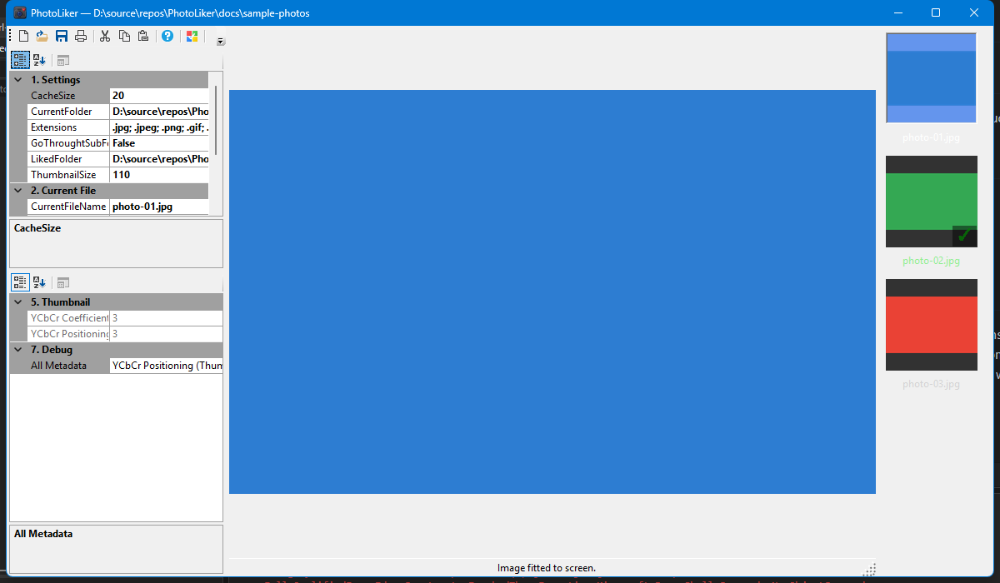

# PhotoLiker

PhotoLiker is a Windows desktop photo triage tool for quickly browsing images and marking favorites.

## Happy path walkthrough

The screenshots below were captured from a common flow using a sample folder with photos:

1. Launch the app with a photo folder loaded.
2. Browse to the next image using the **Right Arrow** key.
3. Toggle like/unlike for the current image using the **Space** key.
4. Move back using the **Left Arrow** key.
5. Fit the image to the viewer using the **O** key.

### 1) Home view (folder loaded)

### 2) Next photo

### 3) Liked photo toggled

### 4) Previous photo

### 5) Fit image to viewer

## Keyboard shortcuts used in this flow

- `Right Arrow`: Next photo
- `Left Arrow`: Previous photo
- `Space`: Toggle like/unlike
- `O`: Fit image to viewer
- `1`-`9`, `A`-`Z`: Toggle the photo in a group (see below)

## Settings file

Each photo folder keeps its settings in `photo-liker-config.json` inside the folder. The paths in it are stored relative
to that folder (`"CurrentFolder": "."`, `"LikedFolder": "Liked"`), so the folder opens the same from any machine, drive
letter or network share. Files written by older versions, which hold full paths such as `Y:\...`, are read the same way:
the paths below the stored `CurrentFolder` are taken to be below the folder you opened, and the file is converted the next
time it is saved. A liked folder outside the photo folder, for example on another drive, keeps its full path.

## Groups

Besides liking a photo, you can sort it into groups. Press `1`-`9` or `A`-`Z` (without Ctrl/Alt/Shift) and a copy of the
current photo is saved in the folder `<key> - Group` under the Liked folder, e.g. `A - Group` or `3 - Group`. The
folders are created when they are first needed, together with the Liked folder. Pressing the same key again removes
the copy. Liking with `Space` works as before and is independent of the groups.

You can rename a group folder as long as the new name still starts with `<key> - Group`: `A - Group Family` is
used for `A` from then on. The **Current File** section of the settings grid lists every folder that holds a copy
of the current photo (**SavedInFolders**). The row shows them on one line, e.g. `[Liked]; [3 - Group]; [A - Group Family]`,
and expands into one row per folder.

A photo that is in the Liked folder or in any group gets a green check in the top-left corner of the viewer (and on its
thumbnail). The viewer lists the folders next to the check, each in brackets, e.g. `[Liked] [3 - Group] [A - Group Family]`.

The bottom-left corner of the viewer shows a legend of all group folders, under their current names, so you can see which
key saves where. The folders that hold a copy of the current photo are ticked and highlighted. A group shows up in the
legend once its folder exists, that is after the first press of its key.

`O` keeps fitting the image to the viewer, so there is no group `O`. Keys are ignored while you type into a text box.
