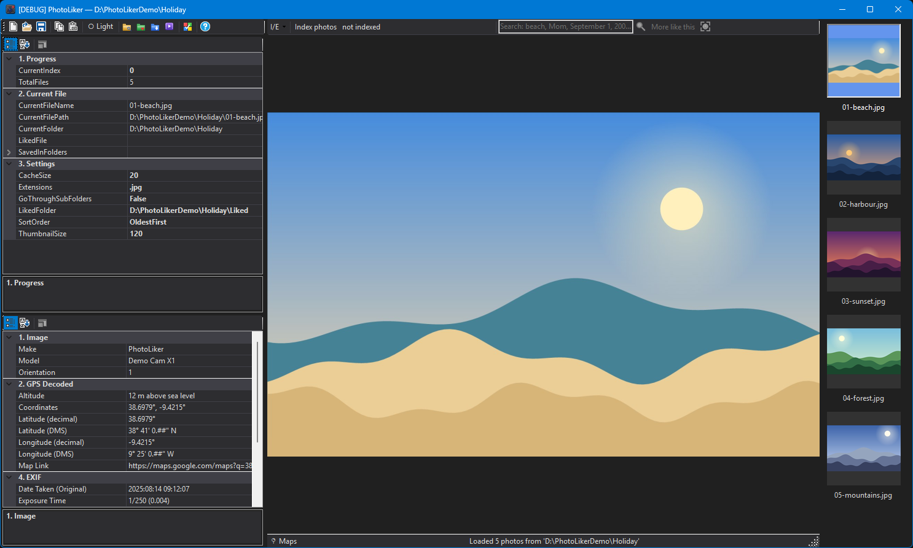
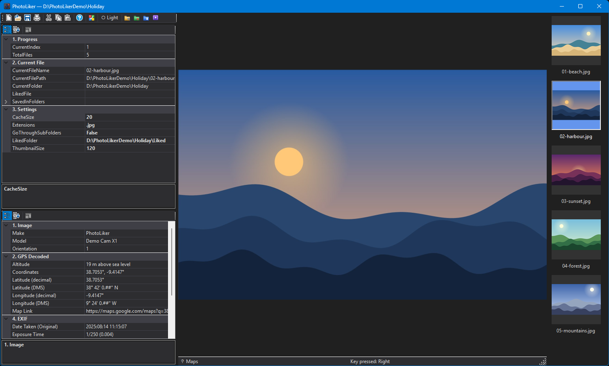
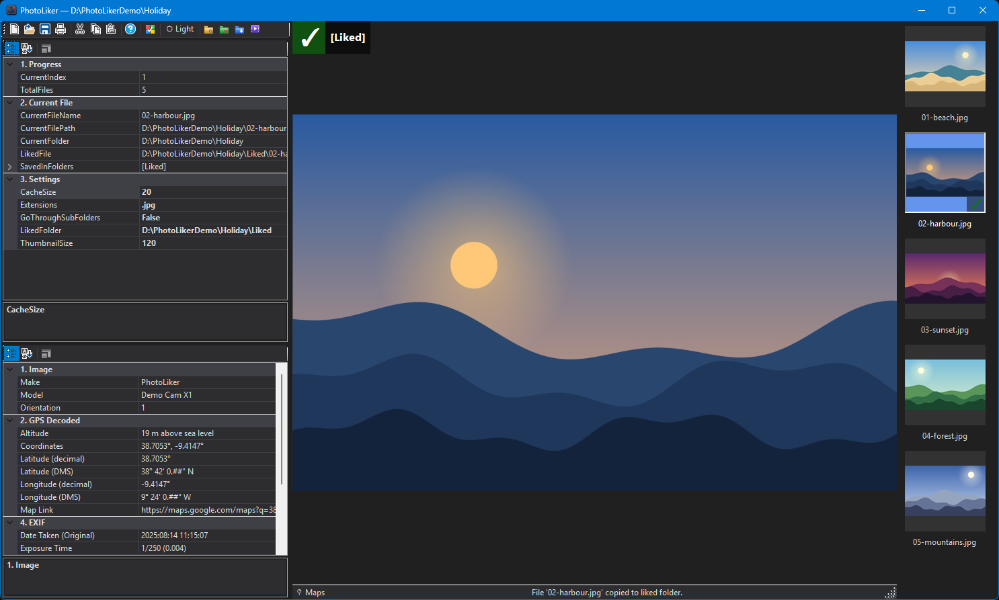
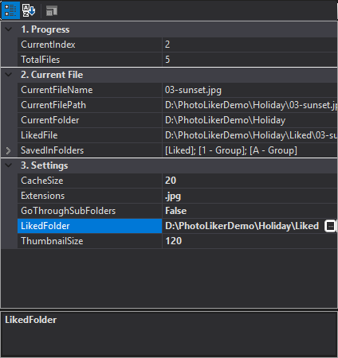
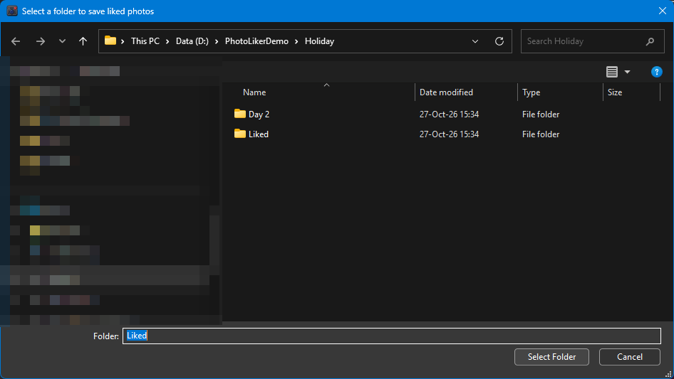
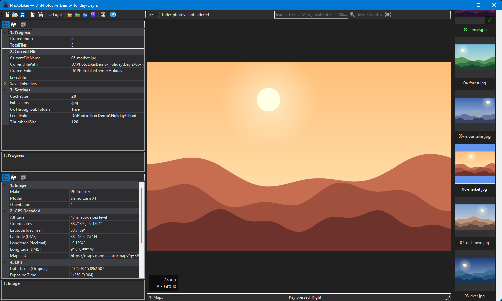
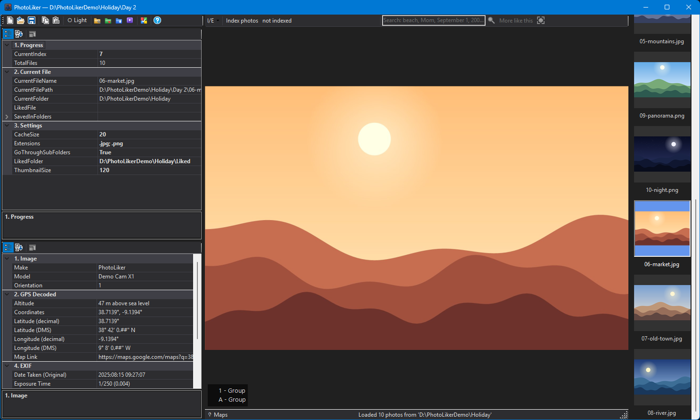
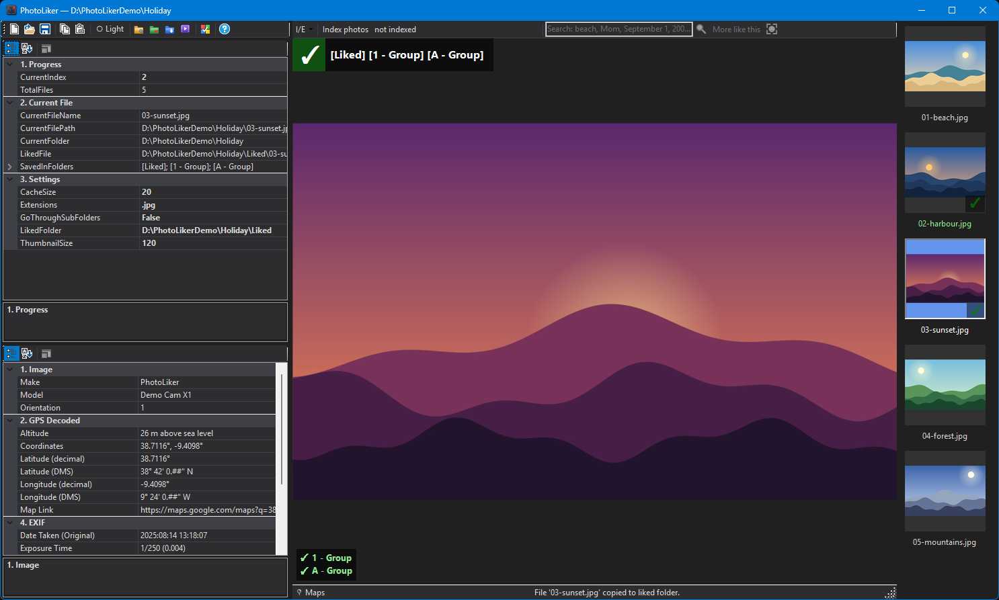
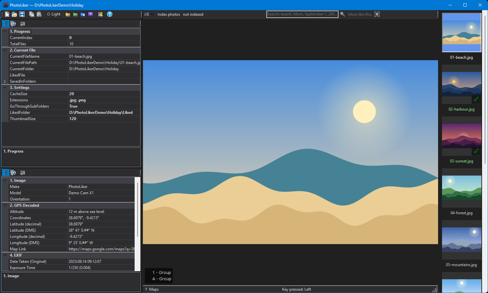
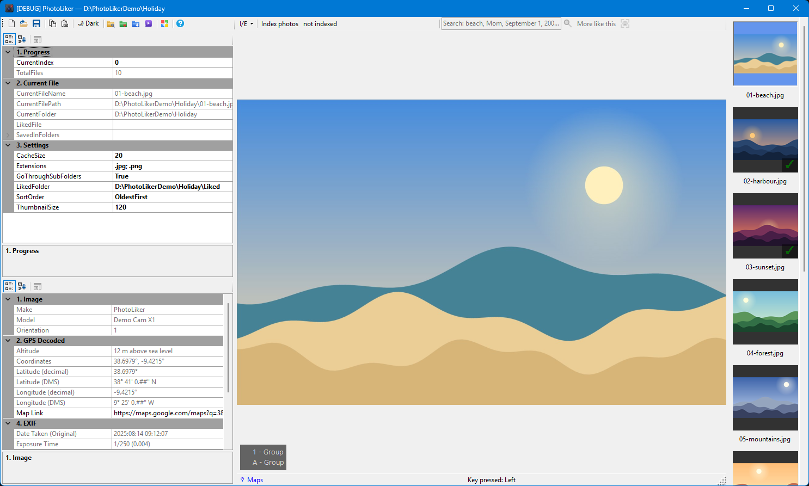

# PhotoLiker

PhotoLiker is a Windows desktop photo triage tool for quickly browsing images and marking favorites.
Open a folder, flip through it with the arrow keys, press <kbd>Space</kbd> to like a photo or a letter/number key to sort it
into a group. Likes are plain copies of the files, so nothing is hidden in a database.

And when the folder is a NAS full of old photos you can no longer scroll through, let PhotoLiker index it once in the
background and then **search it like the web**: type "birthday cake" or "children on a stage", or name a person once and
find every photo they are in. It all runs on your own computer, no photo is ever uploaded.

## Contents

- [Install](#install)
- [Happy path walkthrough](#happy-path-walkthrough)
  - [Keyboard and mouse](#keyboard-and-mouse)
  - [Toolbar](#toolbar)
- [Settings](#settings)
  - [Folder picker](#folder-picker)
  - [Changes that reload the folder](#changes-that-reload-the-folder)
  - [Order of the photos](#order-of-the-photos)
- [Groups](#groups)
- [Deleting photos](#deleting-photos)
- [Rotating photos](#rotating-photos)
- [Big folders open at once](#big-folders-open-at-once)
- [EXIF and GPS](#exif-and-gps)
- [Aligning file dates](#aligning-file-dates)
- [Removing empty folders](#removing-empty-folders)
- [Finding duplicates](#finding-duplicates)
- [Dark and light theme](#dark-and-light-theme)
- [Photo search](#photo-search)
- [Settings file](#settings-file)
- [Project layout](#project-layout)
- [Development](#development)
  - [Smoke tour](#smoke-tour)
- [License](#license)



- **AI photo search** of a big old library, by what is in the photos ("snow", "autumn leaves") and by who is in them:
  a background indexer with a progress bar, face detection and naming, "more like this". See [Photo search](#photo-search).
- **Fast browsing** with a thumbnail strip, preloading of the neighbouring photos, and a folder scan that also works
  on network shares. The photos are listed oldest first (or newest first, or as the disk gives them) by the date their
  files were created. A big folder opens at once on every visit after the first, from a list saved on this computer
  (see [Big folders open at once](#big-folders-open-at-once)).
- **Likes and groups**: copy the current photo to a `Liked` folder, or into `1 - Group` ... `Z - Group` folders under it.
- **Delete** moves the photo to a `Deleted` folder inside the photo folder; nothing is erased, and the scan leaves that
  folder out.
- **Rotate** turns the shown photo a quarter clockwise from the button in the right corner of the status bar and saves
  it in its file, without losing anything (see [Rotating photos](#rotating-photos)).
- **Settings grid** next to the photo, with a folder picker for the liked folder. Changing which photos are listed,
  or in what order, reloads the folder at once.
- **EXIF and GPS** of the shown photo, GPS decoded to coordinates and a link to the map.
- **Dark and light theme**, remembered per folder.
- **Portable settings**: each photo folder keeps its own settings file, so the folder opens the same from any machine.

## Install

PhotoLiker needs Windows 10/11 (x64) and the [.NET 10 Desktop Runtime](https://dotnet.microsoft.com/download/dotnet/10.0).

- **Installer**: build it with `installer\build-installer.ps1` (see [Development](#development)), or take `PhotoLiker-Setup` from
  the artifacts of a GitHub Actions run (see below). It installs per user, needs no administrator rights and checks for the runtime.
- **Zip**: `PhotoLikerUI.zip`, also an artifact of the GitHub Actions run.
- **GitHub Actions artifacts**: every push and pull request to `master` builds both `PhotoLikerUI` (the zip) and `PhotoLiker-Setup`
  (the installer). To get them for another branch, open *Actions > Build and Package PhotoLikerUI > Run workflow* and pick the
  branch. The artifacts are on the page of the run.
- **From source**: `dotnet run --project PhotoLikerUI -c Release -- "C:\Photos\Holiday"`. The folder argument is optional;
  without it the last folder you used is opened.

The **Register Context Menu** button of the toolbar adds *Open in Photo Liker* to the right-click menu of folders (current
user only, no administrator rights). The same button removes it again.

## Happy path walkthrough

1. Launch the app with a photo folder loaded.
2. Browse to the next image using the **Right Arrow** key.
3. Toggle like/unlike for the current image using the **Space** key.
4. Move back using the **Left Arrow** key.

| | |
|---|---|
|  |  |
| **Right Arrow**: next photo. | **Space**: the photo is copied to the Liked folder. It gets a green check, in the viewer and on its thumbnail. |


### Keyboard and mouse

| Input | What it does |
|---|---|
| <kbd>Right</kbd> / <kbd>Left</kbd> | Next / previous photo. Clicking a thumbnail jumps to it. |
| <kbd>Home</kbd> / <kbd>End</kbd> | The first / the last photo of the list (of the search results, while they are shown). |
| <kbd>PageDown</kbd> / <kbd>PageUp</kbd> | The first photo of the next / the previous month of the list. The list is cut into runs of photos of the same month, in the order it has (see **SortOrder**), so in a folder that is not in date order every change of month counts. A photo's month is the one of its date: the EXIF date if the folder is [indexed](#photo-search), otherwise the date its file was created. The status bar names the month. |
| <kbd>Space</kbd> | Like the photo (copy it to the Liked folder), or remove the copy again. |
| <kbd>Delete</kbd> | Move the photo to the `Deleted` folder and show the next one (see [Deleting photos](#deleting-photos)). |
| <kbd>1</kbd>-<kbd>9</kbd>, <kbd>A</kbd>-<kbd>Z</kbd> | Save the photo in a group, or take it out again (see [Groups](#groups)). |
| <kbd>Alt</kbd>+<kbd>1</kbd>-<kbd>9</kbd> (also on the numpad), <kbd>Alt</kbd>+<kbd>A</kbd>-<kbd>Z</kbd> | While search results are shown: save *all* of them in the group, after telling how many photos and MB that is and asking. A group without a folder gets one named after the search (see [Groups](#groups)). |
| <kbd>0</kbd> | Fit the image to the viewer (after zooming in). |
| <kbd>F5</kbd> | List the folder again from scratch instead of from the saved list (see [Big folders open at once](#big-folders-open-at-once)). |
| <kbd>Ctrl</kbd>+<kbd>C</kbd> | Copy the photo to the clipboard, as a file and as a picture: paste it into Explorer or a messenger. |
| <kbd>Ctrl</kbd>+mouse wheel | Over the photo: zoom, then drag to pan. Over the thumbnail strip: change the size of the thumbnails. |

Keys are ignored while you type into a text box: the value you are editing in a grid, the search box. A click on the
photo (or on a thumbnail, or on the empty space around the photo) takes the keyboard focus out of the text box, so the keys
work on the photo again.

### Toolbar

Open a photo folder, copy the photo, *About* (version and build date), register the folder context menu, switch the
theme, open the photo folder or the Liked folder in Explorer, load the Liked folder as a photo folder of its own, and
**Generate Video**: turn photos into a video with ffmpeg (a copy of `ffmpeg.exe` ships with the app; otherwise
the one on your `PATH` is used). The dialog opens at once. *Photos from* picks the photos: **Current** (the loaded ones: the
folder, or the search results), **Liked** (the copies in the Liked folder), or one of the group folders that are in the Liked
folder (`A - Group`, `3 - Group Family`, ... each is listed under its own name, once the dialog has looked them up). It starts
on **Liked**, and every entry shows its number of photos, "Liked (123)" (the folders are counted in the background, one after
the other, so a count shows `...` until it is known). The *Output folder* follows the pick: the folder of the
photos, or the Liked or group folder; one that you typed or browsed to is left alone.
*Sort order* decides the order of the photos in the video: oldest first, newest first (by file date, as the *SortOrder*
setting does; a copy in Liked or a group goes by the date of its photo, not by when it was liked), by name (as Explorer
lists them, `IMG_2` before `IMG_10`), random (a new order for each video) or as listed. It starts as the *SortOrder* setting. The dialog follows the dark theme
of the window. You also choose resolution, the time each photo is shown, codec (H.264 / H.265) and quality.
Photos that have gone from the disk since they were listed are left out.
The photos come out the way the app shows them, turned upright by their EXIF orientation. ffmpeg is told not to turn
them itself (ffmpeg 7.1 also turned the photos that come after a turned one, so landscape photos came out as portrait), so
before it starts, each photo that has to be turned or mirrored is copied upright, no bigger than the video frame, into a
temporary folder that is removed when the video is done; the log says how many. Photos that GDI+ cannot read are left as they are.
*Audio (optional)* puts a sound under the video: **Browse...** picks the file (mp3, m4a, wav, flac, ogg... anything ffmpeg can read), **Play audio**
and **Stop** let you listen to it first (ffmpeg makes a WAV of the first 10 minutes of it in a temporary folder, which is removed when the dialog
closes), **Clear** takes it away again. An audio that is shorter than the video is played over and over until the video ends; a longer one
is cut where the video ends. Only the sound of the file is used, not the cover picture of a music file.
**Align dates** (the calendar with the green equals sign) makes the dates of the photo files the date the photo was taken,
see [Aligning file dates](#aligning-file-dates). **Remove empty folders** (a folder with a red cross) lists the folders that hold
no photos and removes them, see [Removing empty folders](#removing-empty-folders). **Find duplicates** (two overlapping photos)
finds photos that are the same file in different folders and moves the copies in the worse folders away, see
[Finding duplicates](#finding-duplicates).

## Settings

The settings grid at the top left shows the progress, the current file and the settings of the folder. It scrolls back to
the top whenever another photo is shown:



| Setting | Meaning |
|---|---|
| **LikedFolder** | Where liked photos are copied. By default the folder `Liked` inside the photo folder. Click the **...** button for a folder picker. A folder with any other name than `Liked` is kept as it is, wherever it is. |
| **GoThroughSubFolders** | Also list the photos in the subfolders. The Liked folder itself is left out. |
| **Extensions** | The file extensions that count as photos, separated by `;` or `,`, each with its dot: `.jpg; .png`. Case does not matter. |
| **SortOrder** | The order of the photos: `OldestFirst` (the default) or `NewestFirst`, by the date the file was created, `ByName` by the name of the file, `Random` in a random order, or `None` for the order the disk gives (by name on most local disks). See [below](#order-of-the-photos). |
| **CacheSize** | How many photos on each side of the current one are kept decoded in memory. |
| **ThumbnailSize** | Size of the thumbnails in pixels. <kbd>Ctrl</kbd>+mouse wheel over the strip changes it. |

The rows of **Current File** and **TotalFiles** are read-only. **CurrentIndex** is the number of the shown photo, counted
from 0: type another number into it to jump to that photo (a number outside the list goes to the nearest end).

Every row has a description: select it and the pane under the grid says what it is for (drag the divider above the pane to
make it taller when a text is cut off).

### Folder picker

The **...** button of **LikedFolder** opens the Windows folder dialog, starting at the current folder. Cancelling keeps
the old value.



*(The navigation pane of the dialog is blurred in this screenshot, it lists the folders of whoever took it.)*

### Changes that reload the folder

Changing **GoThroughSubFolders**, **Extensions** or **SortOrder** lists the folder again straight away: the settings are
saved first, and the photo you are looking at stays selected if it is still in the list. The other settings do not need
that: the new **LikedFolder** is used from the next like. (A folder that was listed before opens from its saved list, see
[Big folders open at once](#big-folders-open-at-once).)

With **GoThroughSubFolders** on, the title of the window names the subfolder of the current photo:



Adding `.png` to **Extensions** brings the PNG files of the folder in:



### Order of the photos

**SortOrder** decides how the list is ordered, and so what <kbd>Right</kbd>, <kbd>Left</kbd>, <kbd>Home</kbd>, <kbd>End</kbd>
and <kbd>PageDown</kbd> / <kbd>PageUp</kbd> walk through:

- `OldestFirst` (the default) and `NewestFirst` go by the date each file was **created**. That date comes with the listing of
  the folder, so sorting costs nothing extra, even on a network share. (Reading the date a photo was taken from its EXIF
  data would mean opening every photo, which is what takes minutes over a network.) Photos created at the same moment are
  ordered by their path, so `NewestFirst` is exactly `OldestFirst` backwards.
- `ByName` goes by the name of the file, the way Explorer lists a folder: case does not matter and numbers count as numbers,
  so `IMG_2` comes before `IMG_10` and `IMG_007` is the same as `IMG_7`. With subfolders, the photos of a folder come first,
  then those of its subfolders, each folder in this order. The name comes with the listing, so it costs nothing extra either.
- `Random` shuffles the photos, and it is a **new** order every time the photos are listed: when the folder is opened again,
  with <kbd>F5</kbd>, when the folder changed while it is open (the photo that is shown stays on screen), and for each search
  and each video. To get another order, list the folder again.
- `None` does not sort: the photos come in the order the file system lists them, by name on most local disks (which is not
  quite `ByName`: `IMG_10` comes before `IMG_2` there). It is the quickest on a folder with very many photos.

Keep in mind that the created date is when the file appeared on that disk. A photo copied from a card or another disk
usually has the date of the copy, not of the shot, so a folder copied in one go is in the order it was copied.
A folder whose settings file has no **SortOrder** yet is listed `OldestFirst`.

The results of a [search](#photo-search) follow the same setting, but by the date the photos were taken, which the index
knows for every photo without opening it: `OldestFirst` and `NewestFirst` order them by that date (photos of the same moment by
path), `ByName` by the name of the file, `Random` shuffles them, `None` leaves them as the search ranked them. Where the created date and the date taken differ (a folder copied in one
go), the results are in the order of the photos, the folder in the order of the copying; [Align dates](#aligning-file-dates) makes them agree.

## Groups

Besides liking a photo, you can sort it into groups. Press `1`-`9` or `A`-`Z` (without Ctrl/Alt/Shift) and a copy of the
current photo is saved in the folder `<key> - Group` under the Liked folder, e.g. `A - Group` or `3 - Group`. The
folders are created when they are first needed, together with the Liked folder. Pressing the same key again removes
the copy. Liking with `Space` works as before and is independent of the groups.



You can rename a group folder as long as the new name still starts with `<key> - Group`: `A - Group Family` is
used for `A` from then on. The **Current File** section of the settings grid lists every folder that holds a copy
of the current photo (**SavedInFolders**). The row shows them on one line, e.g. `[Liked]; [3 - Group]; [A - Group Family]`,
and expands into one row per folder.

A photo that is in the Liked folder or in any group gets a green check in the top-left corner of the viewer (and on its
thumbnail). The viewer lists the folders next to the check, each in brackets, e.g. `[Liked] [3 - Group] [A - Group Family]`.

The bottom-left corner of the viewer shows a legend of all group folders, under their current names, so you can see which
key saves where. The folders that hold a copy of the current photo are ticked and highlighted. A group shows up in the
legend once its folder exists, that is after the first press of its key.

`0` is not a group: it fits the image to the viewer. (It used to be `O`, which is a group like every other letter now.)

**All the results at once.** While the results of a [search](#photo-search) are shown, <kbd>Alt</kbd>+`1`-`9` or <kbd>Alt</kbd>+`A`-`Z`
saves *every* photo of the results in that group. Nothing is copied before you agree: a box tells how many photos will be copied
and how many MB they take (and how many of the results are in the group already, which are left as they are), and asks. On
*Yes* the program is blocked and a progress bar shows how far the copying is; **Cancel** stops after the photo that is being copied,
and the copies made by then stay. Unlike the single key this only ever adds: a photo that has a copy in the group is never taken
out again. A photo that cannot be copied (it was moved away after it was indexed, the drive is gone) is listed afterwards and the
others go on; after ten in a row the run stops, because the same thing will happen to the rest (a full disk, a share that went
away). Outside the results the keys do nothing but say so in the status bar. The digits of the numpad work with <kbd>Alt</kbd>
too (<kbd>Alt</kbd>+numpad `3` is group 3).

If the group has no folder yet, it is made for the occasion and named after the search: after `children on a stage` the
folder is `A - Group children on a stage` (the request is tidied for a folder name, quotes and characters Windows does not
allow are dropped, and it is cut at 50 characters), and the box says so before you agree. That is a renamed group folder like any
other, so the group is still `A` and you can rename it again. A group that has a folder is used as it is, whatever it is
called; the single key (<kbd>A</kbd> without <kbd>Alt</kbd>) still makes `A - Group`.

A copy has the id of its photo in its name: `IMG_0001 [3f9a1c2e].jpg`. Photos of different folders often share a file
name (every camera folder has its own `IMG_0001.jpg`), and the id keeps their copies apart: a copy never replaces the copy
of another photo, and a photo is never shown as liked because another one of the same name is. The id is made from the
size of the photo and the time it was last written, and from nothing else, not from its folder, its drive or the
computer. So the same photo gets the same name wherever it is found and whatever else is open, and the Liked folders of
different computers can be put together. Copies made before the ids (`name.jpg`, `name (2).jpg`) are still recognised, by
size and date.

## Deleting photos

<kbd>Delete</kbd> moves the shown photo into the folder `Deleted` inside the photo folder, takes it out of the list and
shows the photo that came after it (the one before it, if it was the last). Nothing is erased. The photo keeps its path
below the photo folder: `314CANON\IMG_0001.jpg` goes to `Deleted\314CANON\IMG_0001.jpg`, so photos of different
subfolders with the same name don't meet. If a photo with that name is already in `Deleted`, the new one is called
`name (2).jpg`. To put a photo back, move it out of `Deleted` in Explorer; the next time the folder is listed it is there.

The `Deleted` folder of the photo folder is left out when the folder is listed (also with **GoThroughSubFolders** on) and
by the search indexer. Only that one: a folder called `Deleted` further down is yours and is listed as any folder. A photo
that is deleted leaves the search index at once; its copies in the Liked and group folders stay where they are. Open the
`Deleted` folder itself with the folder button to look at what is in it. The copies that [Find duplicates](#finding-duplicates) moves
away are in `Deleted\Duplicated`, in the same way.

While search results are shown, <kbd>Delete</kbd> works the same on the photo shown. Like the other keys, it does nothing
while you type into a text box.

## Rotating photos

The button in the right corner of the status bar turns the shown photo a quarter clockwise and saves that in its file; press
it again for the next quarter. It works on JPEG files (`.jpg`, `.jpeg`); with another kind of file the status bar says so and
nothing is written.

A JPEG is not decoded and written again: that would lose a little of the picture each time. What changes is its **orientation**,
the number in its EXIF block that tells every viewer how the stored picture is turned to show the photo upright (this app,
Windows, phones and browsers all follow it). So turning is lossless however often you do it, and on a network share it costs two
bytes instead of a new file.

- A photo that has the orientation already (every phone and most cameras write it, also when it is 1) gets the new number in the
  same place: the file keeps its size and nothing else in it changes.
- A photo that has none (a scan, a picture saved by an editor) gets it added: a new EXIF block of 36 bytes, or, if it has an EXIF
  block, a copy of its directory with the entry in it at the end of the block (nothing the block points to moves, maker notes
  included). That file is written next to the old one and replaces it, so it is a little larger. A block that is almost 64 KB
  full has no room for the entry; the photo is then left as it is and the status bar says why.
- The **dates of the file** (created, modified) stay as they were: the app knows a photo by its size and its date of change, and
  its order in the list may go by them. If the drive does not keep a date that is set, the status bar tells.
- The copies of the photo in the Liked and group folders are not turned; they are the photo as it was when it was liked. When the
  size of the photo changed (the second case) they are renamed to the new id (see [Groups](#groups)), so they are
  still shown as its copies. The saved list of the folder and the search index take over the new size, and the boxes of the faces
  in the index turn with the photo, so "Update index" does not analyze it again.

## Big folders open at once

Listing a folder on a network share costs a round trip per subfolder, however few photos each holds: 6.6 seconds for
16,000 photos in 985 folders on a router, minutes for a big archive. So the list is kept. The first time a folder is
opened it is listed (a little faster than before: four folders at a time), and the list is saved on this computer, in
`%LocalAppData%\PhotoLiker\listing`, one file per folder and set of settings (625 KB for those 16,000 photos). From then
on the folder opens from the saved list in a fraction of a second, and is checked for changes while you already look at
the photos.

The check asks every subfolder for the time it last changed: one short question each (a router answers in about 1.5 ms),
instead of a listing. A folder's time moves when something is created, renamed, moved or deleted in it. The folders whose
time differs are listed again, and new subfolders are found through their parent. When the check ends, photos that came
or went are in the list or out of it, the photo you are looking at stays where it is, and the status bar says what was
found:

> Loaded 16,337 photos from 'Y:\OldFotik\Photo'. Checked for changes in 1.5 s: 2 added.

For the 16,000 photos above that is 1.5 seconds in the background where it was 6.6 in front. If the folder cannot be reached
(a share that is off) the saved list is shown and the status bar says so.

What the check does not see is a photo that another program changes in place: the time of a folder does not move when a
file inside is rewritten. For an archive that is only touched with PhotoLiker that does not matter. <kbd>F5</kbd> lists
the folder from scratch, and **Align dates**, **Find duplicates** and **Remove empty folders** do the same themselves after
they changed files. Photos that you delete with <kbd>Delete</kbd> are taken out of the saved list by the app.

Changing **SortOrder** only puts the saved list in another order. Another **Extensions**, **GoThroughSubFolders** or
**LikedFolder** (the liked folder is left out of the list) is another list, made the first time it is used. The saved lists
are only a cache: they can be deleted at any time, and the folders are listed again.

## EXIF and GPS

The grid below the settings shows the metadata of the shown photo in categories: Image, GPS Decoded, EXIF, Thumbnail, and
the tags PhotoLiker has no name for under Unknown. The *All Metadata* row under Debug holds everything as text. Select a row
and the pane under the grid explains the tag: what shutter speed or ISO means, what the numbers of *Flash* or *Orientation*
stand for, which date PhotoLiker takes as the date of the photo.

GPS tags are decoded into decimal and degree/minute/second coordinates, altitude, speed and the UTC time. When the photo has a
position, the **Map Link** row and the **Maps** link at the right of the status bar open it in Google Maps.



Dates are shown with the month as a word, `14 Aug 2025 09:12:07` (the month is English whatever the language of Windows), in
the grids and in the dialogs below; the file itself keeps them the way EXIF writes them, `2025:08:14 09:12:07`. The format is
set in one place, `DateText` in `PhotoLiker.Core`.

The **File Date** row (in the Image rows, right after *Date Last Saved* when the photo has that tag) is not EXIF: it is the
date of the file on the disk, created and, if different, modified. It ends with `(= Date Taken (Original))` when the file has the
time of shooting that the camera wrote into the photo and with `(≠ Date Taken (Original))` when it has not (a copied file gets
the day of the copy); the note names the row it was compared with, and that one is never *Date Last Saved*.

Two EXIF dates look alike and are not. **Date Taken (Original)** (in the EXIF rows) is when the picture was shot. **Date Last Saved**
(in the Image rows, EXIF's `DateTime`) is when a program last saved the photo: a photo that was turned or edited in Windows Photo
Viewer shows that day there, months after it was shot. Everything in PhotoLiker (search by date, the order of the list, Align dates) goes by the first.

## Aligning file dates

A file that was copied from a card, a phone or an old disk has the day of the copy as its created date, and the date of the
photo only sits inside it (EXIF). The **Align dates** button of the toolbar sets the dates of the files to the date taken, so
that Explorer, other programs and the order of the list (**SortOrder** goes by the created date) agree with the camera.

The dialog looks at the folder first (it reads only the start of each file, so it takes minutes for tens of thousands of photos
even on a network drive, and can be stopped) and shows, before anything is touched, how many photos will change and which:

- **Will change** lists each photo with its date taken, its created and modified date now, and what would be set; **Already
  match**, **No usable EXIF date** and **Unreadable** list the others. The counts and the list follow the ticks at once.
- The ticks are *File created date* and *File modified date* (on) and *Dates inside the photo too* (off). With the last one on,
  the other two dates inside the photo (Date Time Digitized and Date Last Saved) are made equal to Date Taken (Original). They are overwritten
  in place (a date has a fixed size), so the file does not grow and the picture is not touched.
- A photo can be taken out of the run: select it, then <kbd>Space</kbd> or the right-click menu *Leave out of this run*.
- A **double click** on a row opens the photo in the program Windows has for it (the right-click menu also has *Open* and *Show in
  File Explorer*, which opens the folder with the file selected), to look at it before deciding. This works while a run is in progress too.
- Only the date the camera wrote is used, and only if PhotoLiker believes it (see [Photo search](#photo-search): not before
  1995, not in the future, not a camera that lost its clock). A photo without such a date is listed under **No usable EXIF
  date** and left as it is, unless you give it one (next list). The date of the camera has no time zone, so it is taken as the
  time of this computer.

**Photos without a usable date.** Select some of them (or none, for all) and press **Use a date...** (<kbd>Enter</kbd>, or
the right-click menu). It asks where their date taken comes from, and shows for each answer how many of the photos have one
from there, and what it would be:

- *The date the photo has: I know it is right*: the EXIF date that looks like a camera that lost its clock but is real, a
  photo of New Year's night in a folder `2016-01-01`;
- *The date in the name of its folder*: a day in the folder name (`2015-05-01`, `20150501`, `01.05.2015 Anna`), the innermost
  folder that has one, at the time of day the photo has, or at noon (a folder called `2015-05` has no day and gives none);
- *The date of the file*: when it was created, else changed. For a photo that was copied this is the day of the copy, which
  the dialog says;
- *This date*: one you type.

The photos then count as having that date taken: they move to **Will change** (marked "(given)") and are changed like the others,
with the file dates set to it, and the dates inside the photo too if that is ticked, which replaces the date that was not
believed. A photo that has no place for a date inside it (no EXIF at all) only gets its file dates, which is also the date the
app goes by for it (the date of its file). "Forget the date given" in the right-click menu takes a date back; a given date is
not kept after the dialog closes, and the run is logged and can be undone like any other.

**Change N photos** does it. Things that go along:

- Every run writes a log (`photo-liker-datefix-<date>-<time>.jsonl`) in the photo folder, before the first file of each hundred is
  touched. **Undo last run...** puts the dates (and the dates inside the photo) back from it; a photo that was changed after the
  run, or whose date was changed again, is left alone and counted.
- The copies of a changed photo in the Liked and group folders get the same dates. A copy is matched with its photo by the id in its
  name, which comes from the size and the date the photo had when it was copied, or else by size and date.
- If the folder is indexed, the index is told that the photos are the same ones: without that, "Update index" would take every
  changed date for a changed photo and analyze it again. (Stop indexing before using the button.)
- The dates are read back after writing. A network drive that does not keep the created date is reported, not ignored.
- The folder is listed again afterwards, so the list is in the new order and the **File Date** row is up to date.

## Removing empty folders

Moving and deleting photos leaves folders behind, and Windows leaves a thumbnail cache (`Thumbs.db`) in the ones it showed. The
**Remove empty folders** button of the toolbar lists the folders of the photo folder, at any depth, that hold nothing of use:
nothing at all, or only thumbnail files (`Thumbs.db`, `ehthumbs.db`, `desktop.ini`, `.DS_Store`, `._*` stubs of macOS), or only
other folders like that. Every folder is ticked and nothing is deleted until you press **Remove N folders**.

- The rule is strict: any other file, whatever it is, keeps its folder and every folder above it. A folder that can not be read
  is not guessed at. A link to another folder, the `Deleted` folder, the Liked folder with its group folders, and NAS or system
  folders (`@eaDir`, `#recycle`, `$RECYCLE.BIN`) are left alone, and so are the folders that hold them. The photo folder itself is never removed.
- Unticking a folder unticks the folders above it (they could not go without it); ticking a folder ticks the ones inside it.
- A **double click** on a row opens the folder in File Explorer (also *Open in File Explorer* in the right-click menu), to see what is in it before it is removed. It does not change the tick.
- The thumbnail files are deleted with their folder, the folder is deleted without recursion (a folder that got a file since
  the list was made stays, and is reported), and the folders inside go before the folder around them.
- Nothing can be undone here: there is nothing in these folders to bring back, and a missing folder is made again when needed.

**Photos that can not be read.** The second list of the dialog, *Unreadable photos*, holds the photos that no program can show:

- the ones the [search index](#photo-search) could not decode (a damaged or cut-off file: "The image header might be corrupted"). These
  are the "unreadable" of the index status, and they are only as many as the indexer has got to, so index the folder first;
  they are taken from the index, so listing them reads nothing from the (possibly slow) drive;
- empty files (0 bytes) with the extension of a photo, found on the same walk of the folders.

Unlike a thumbnail cache, a photo may still be worth something to another program, so the list starts **unticked**; double click
a row to look at it, tick the ones to go (*Tick all* ticks them all) and press **Move N to Deleted\Unreadable**. They are moved, not
erased, with the path they had, like every deleted photo, and the search index forgets them; to bring one back, move it up again in File Explorer
(to erase them for good, empty that folder). A folder that held only such photos is empty afterwards: press *Look again* to find it. Moving is
not offered while the folder is being indexed. Photos in the `Deleted` and Liked folders are left out.

## Finding duplicates

Photos get copied: a card into a folder named for the day, the same card again, a folder of discards. The **Find duplicates**
button of the toolbar finds photos that show *exactly the same picture* in different folders, keeps one of each and moves the other
copies to `Deleted\Duplicated` inside the photo folder, with the path they had, so a copy goes back by moving it up again.

**How they are found.** The name plays no part (a renamed copy is a copy; two cameras that both count to `IMG_1234` are not).
Neither does what is written around the picture: a JPEG has a header (EXIF, XMP, a thumbnail) in front of its picture data, and a
program that writes a rating, a keyword or a date changes the header, often without changing the size of the file. Two copies of
one camera photo are then not the same *file*, but they are the same photo, so the comparison is of the picture data after the
header. Only files with the same size can be the same, and the folder listing says that for free, so only those are looked at, by a
fingerprint of three blocks of 64 KB of the picture data (the start, the middle and the end), which takes minutes for tens of
thousands of photos even on a network drive. Tick *Compare all of the picture* to read all of it instead: much slower, no doubt left. The
sample can miss two photos that are the same everywhere but between the blocks; the unit tests show that case. A group whose
metadata is not the same in all copies says so in the list ("metadata differs from the others"): the copy that stays keeps
its own, so look at those if you rated or tagged photos in a folder that loses. A file that is not a JPEG is compared as it is.
Subfolders are always included, and the photos in a folder called `Liked` or in a group folder (`A - Group ...`) are left out: they are copies on purpose.
A copy whose metadata has another *size* (an XMP block that was added to one of them) is hidden from a comparison of sizes; tick
*Also look at photos that only share their name with another* to look at those too: it reads more files, and the name is only
what picks the photos to look at, the picture decides.

**Which copy stays.** The folder decides, the way you would have sorted them by hand:

- a folder **named for a date** (`2014-11-23`, `20141123`, `23.11.2014`, `2014`) or **with a name of its own** (`Natasha's camera`,
  `Crete trip`) beats a folder that only holds what the camera called the card (`107_2311`, `135___07`, `314CANON`, `100NIKON`);
  what all the copies have in common (the folder `Photo` that every photo is in) counts for nothing;
- anything inside a folder called `Deleted` (or `Duplicated`, `Trash`) loses, and among copies that are all in such folders the better name still wins;
- between copies in equally good folders, the one whose file name is not that of a copy stays: `IMG_5407 - копия.JPG`,
  `IMG_5407 - Copy.JPG`, `IMG_5407 (2).JPG` and `Copy of IMG_5407.JPG` move, `IMG_5407.JPG` stays (the folder still counts first);
- the copies that still tie (two date-named folders, two card folders) are left to you, and are never moved until you choose.

Every row says why. You can fill in the two boxes to override the rules: *Always keep copies in folders with* and *Always move
copies out of folders with* take parts of a path, separated by `;`, with `*` and `?` as wildcards (`107_*; Fotik1`). Select a
photo and press **Keep this one** (<kbd>Enter</kbd>) to make it the one that stays whatever the rules say, or **Leave group
alone** (<kbd>Delete</kbd>) to keep a group out of the run; both work from the right-click menu too. At least one copy of every group always stays.
A **double click** on a row opens that copy in the program Windows has for it, to see which one is the better picture before you
decide (the right-click menu also has *Open* and *Show in File Explorer*).

**Move N photos** does it. A copy is only moved if the photo that stays is still there with the same size and the copy itself
is unchanged since the look. Every run writes a log (`photo-liker-duplicates-<date>-<time>.jsonl`) in the photo folder before the
first move of each hundred, and **Undo last run...** puts the copies back (a copy whose old place is taken stays where it is, and is counted).
The search index forgets the moved copies at once (after an undo, *Update index* adds them again). Stop indexing before using the button.
Which folder you open matters for one thing: the `Deleted` folder directly inside the opened folder is the app's own and is not
scanned; a `Deleted` folder deeper down is a folder like any other, and its copies are found and are the first to go.
Afterwards **Remove empty folders** clears the card folders that are left with nothing in them.

## Dark and light theme

The theme button of the toolbar switches between the two. The choice is stored in the settings file of the folder.



## Photo search

For a library of thousands of old photos on a NAS, PhotoLiker can look at every photo once (**Index photos**, in the strip
above the viewer) and then answer questions about them. Nothing is uploaded: the analysis runs on this computer.

1. **Index photos** analyzes the folder and its subfolders in the background, with a progress bar and an estimate of the
   time left. You can keep browsing, stop it (the button turns into **Stop indexing**) and continue later: only new or
   changed photos are done again. The search box works as soon as the first photos are in the index.
   The first time, the AI models are downloaded (about 650 MB, you are asked first).
2. **Search** by describing what you look for: `children on a stage`, `snow`, `a dog`, `autumn leaves`. Type it into the
   search box and press <kbd>Enter</kbd> or click the magnifier icon. The results replace
   the folder in the viewer, and the keyboard focus moves to the photo, so the keys work at once: browse, like and group
   them like any photos (<kbd>Alt</kbd>+a group key groups all of them, see [Groups](#groups)). If nothing is found the focus stays in the
   search box, to change the words. <kbd>Esc</kbd> or **Close results** goes
   back. **More like this** finds photos that look like the one shown. Descriptions work in English.
   There is no limit to the number of photos a search shows (a text search shows the photos that match well, however many that is).
   Each photo is shown once: a photo that is in the library several times (a card copied into two folders, its copy in a group
   folder) is one result. Copies are photos of the same size, saved at the same second and showing the same picture, the way the
   name of a copy in a group folder is made (see [Groups](#groups)); of them the one that is not itself a saved copy stays, then
   the first by path. A copy whose file time was changed on the way is not recognised here, **Find duplicates** deals with those.
   The results are in the order of **SortOrder**: `OldestFirst` and `NewestFirst` by the date the photos were taken (the EXIF
   date, see below; the folder itself goes by the date the file was created because that costs nothing there), `ByName` by the
   name of the file, `Random` shuffled, `None` as the search ranks them, best match first.
3. **Dates**: put a date into the search box to look at when the photos were taken, alone or together with the rest of the
   search: `September 1` (that day in every year), `September 2009`, `1 Sep 2009`, `2009-09-01`, `2009`, `2009-2011`,
   `beach September 2009`, `Mom 2005`. A date alone lists the photos oldest first (or as **SortOrder** says), like every search without a limit. Month names are English;
   a short name (`sep`, `dec`) needs a day or a year with it, and a text in double quotes is searched as words only.
   The window title says how the date was understood.
4. **Faces**: switch the face icon (the smiling face in scanner brackets, last button of the strip) on to see the faces
   found in the shown photo. Click a face to say who it is (**New person...**
   or one you named before), to find all photos of that person, or to delete a wrong face (dolls, posters). Typing the name
   of a person into the search box finds their photos, best match first. A dashed yellow box with a name and a question
   mark is a guess ("looks like Mom"); click it to confirm. A face the program missed (small, turned away, dark): hold
   <kbd>Shift</kbd> and drag a box around it.

| Input | What it does |
|---|---|
| Click / right click on a face | The menu of the face: name it, find the person, delete it. |
| <kbd>Shift</kbd>+drag over the photo | Mark a face that was not found (with the face icon on). |
| <kbd>Enter</kbd> in the search box | Search. |
| <kbd>Esc</kbd> | Close the results. |

The models need the current Microsoft Visual C++ runtime (it comes with Windows updates, or as the *Visual C++
Redistributable* x64). PhotoLiker loads the one of Windows first thing when it starts: some programs (the shell extension of
TortoiseGit, for one) put an old private copy of it into every program that opens a file or folder dialog, and ONNX Runtime
does not just fail with that, it takes the whole program down (`0xC0000005` while loading the models). If an old copy is
there all the same, loading the models stops with a message that says so.

How long indexing takes depends mostly on the processor and on how fast the photos can be read: on a 6-core desktop
processor it is about three photos per second (20,000 photos: roughly two hours), a network drive can be slower. It does
not need a graphics card.

Where the date of a photo comes from: the EXIF date of the camera. If that is missing or cannot be believed, the date the file
was created is used instead (for photos copied off a camera or a card that is about the day they were copied), and the status
bar says how many of the results are dated that way. A camera date is not believed when it is before 1995 or in the future, or
when it is on January 1 before noon (an old camera that lost its clock starts again there, and writes `2001-01-01` into every
photo) and the file was not created at about that time (two days, for a time zone); a real photo of New Year's night is
kept. An index made before dates were kept gets them when you press **Update index**: that reads only the start of each file,
needs no models and takes about a minute per 2,000 photos on a network drive.

What is kept where:

- **The index** (what was found in each photo, and when it was taken) is a cache in `%LocalAppData%\PhotoLiker\index`, one file per photo folder.
  It can always be rebuilt, so deleting it only costs the time of indexing again. Your photos are only read, never changed
  (except by [Align dates](#aligning-file-dates), which you press yourself).
  To use it on another computer (or to index on the faster one), choose **I/E > Export index...** (the first button of the
  strip: import / export), bring the `.plindex` file over, open the same photos there (whatever the drive letter) and choose
  **I/E > Import index...**.
  **Update index** then brings it up to date: photos whose size and date are the same are not analyzed again. The models
  are downloaded there on first use, or copy the `models` folder (below) along.
- **The names you give** are kept in `photo-liker-people.json` in the photo folder, next to the photos: the face examples of each
  person. It is the only new file in your folder, it is plain JSON, and a rebuilt index finds the same people again.
  The people of all your folders are also collected in `%LocalAppData%\PhotoLiker\people.json`, so a folder you open and index
  for the first time already knows the people you named in the others: their names are in the list of the face menu and
  the search box, typing one finds the photos of that person in this folder, and a face that looks like one of them is
  offered as "Looks like ...". Names are matched without caring about case, so *Mom* in two folders is one person.
  A face named in another folder is only an example here, it is not marked as named: the faces you confirm in this folder
  go into this folder's file. The file of a folder stays the truth about that folder (delete it and the folder's people are
  gone from the shared file the next time the folder is opened), the shared one is a copy that can be deleted any time.
  Folders you named people in before this existed join it when you open them once (no indexing needed).
- **The models** are in `%LocalAppData%\PhotoLiker\models`: CLIP ViT-B/32 (OpenAI, MIT licence) to match words with photos, and
  InsightFace's SCRFD and ArcFace (`buffalo_l`) to find and recognize faces. The InsightFace models are free for
  non-commercial use only, which fits a private photo library.

## Settings file

Each photo folder keeps its settings in `photo-liker-config.json` inside the folder, so every folder remembers its own
theme, window position, extensions and the photo you stopped at. The paths in it are stored relative
to that folder (`"CurrentFolder": "."`, `"LikedFolder": "Liked"`), so the folder opens the same from any machine, drive
letter or network share. Files written by older versions, which hold full paths such as `Y:\...`, are read the same way:
the paths below the stored `CurrentFolder` are taken to be below the folder you opened, and the file is converted the next
time it is saved. A liked folder outside the photo folder, for example on another drive, keeps its full path.

```json
{
  "CurrentFolder": ".",
  "LikedFolder": "Liked",
  "GoThroughtSubFolders": true,
  "Extensions": [ ".jpg", ".png" ],
  "SortOrder": "OldestFirst",
  "CacheSize": 20,
  "ThumbnailSize": 120,
  "IsDarkTheme": true,
  "WindowLeft": 30, "WindowTop": 20, "WindowWidth": 1500, "WindowHeight": 900,
  "ScreenIndex": 0,
  "WindowState": 0,
  "CurrentFilePath": "01-beach.jpg"
}
```

`GoThroughtSubFolders` is spelled like that in the file on purpose: it is the name the first versions wrote, and folders are
shared between machines that may run different versions. The spelling `GoThroughSubFolders` (used by the MAUI app) is read
as well. `WindowState` is the number of `FormWindowState`: 0 normal, 2 maximized. `SortOrder` is written by name
(`OldestFirst`, `NewestFirst`, `ByName`, `Random` or `None`); a name the app does not know (a typo, or one written by a newer version) reads
as `OldestFirst` and does not spoil the rest of the file.

Besides that the app keeps small files in `%LocalAppData%\PhotoLiker`: `global-config.json` (the last folder that
was opened), `people.json` (the people named in all folders, see above) and `crash.log` (the stack trace of an unexpected
error). Set the environment variable `PHOTOLIKER_DATA_DIR` to keep them somewhere else; the tests do that, so running them
leaves your own files alone.

## Project layout

| Project | What it is |
|---|---|
| `PhotoLikerUI` | The Windows (WinForms) app. Everything that needs WinForms or GDI+: the window, decoding and caching of photos, the settings grid with its editors, themes, the context menu registration. |
| `PhotoLiker.Core` | The logic without a user interface: settings and their file, scanning folders and keeping the list of a folder between runs, finding empty ones and duplicates (and the rules that pick the copy to keep), the liked and group libraries, EXIF reading and GPS decoding, how dates are shown, the ffmpeg video service. Shared by all front ends. |
| `PhotoLiker.Search` | Photo search: model download, the indexing pipeline, CLIP text search, face detection and recognition, the SQLite index and the people files (one per folder, one shared by all); the dates of photos (reading them, the rules, and writing them back for **Align dates** with its log and undo). Windows only (WPF's image decoder). |
| `PhotoLiker.Maui` | An experimental cross-platform front end on top of the Core library. It is not built by CI and needs the .NET MAUI workloads. |
| `PhotoLiker.Tests` | xUnit tests of the Core library (and of the one WinForms-free converter of the app). |
| `PhotoLiker.Search.Tests` | xUnit tests of the search library: tokenizer, image and face geometry, index, people file, search. They need no models. |
| `tools/SmokeTour` | Smoke test of the real window in dark mode that also takes the screenshots of this README, see below. |
| `installer` | Inno Setup script and `build-installer.ps1`. |
| `docs` | Screenshots and a small sample folder of photos. |

## Development

You need the .NET 10 SDK (see `global.json`) on Windows.

```powershell
dotnet build PhotoLikerUI\PhotoLikerUI.csproj          # build the app
dotnet test  PhotoLiker.Tests\PhotoLiker.Tests.csproj  # run the tests of the Core library
dotnet test  PhotoLiker.Search.Tests\PhotoLiker.Search.Tests.csproj  # run the tests of the search library
installer\build-installer.ps1                           # publish and pack the installer (needs Inno Setup 6)
```

The installer is written to `publish\installer\PhotoLiker-Setup-<version>.exe`. Inno Setup is available with
`winget install JRSoftware.InnoSetup`.

### Smoke tour

The unit tests cannot open a window, so `tools/SmokeTour` does: it generates a demo folder of photos (with EXIF and GPS
data), opens the real PhotoLiker window in **dark mode** and uses it the way a person would, checking what happens at
every step:

- the folder opens with the dark theme read from its settings file, and the window really is dark on screen;
- the arrow keys, <kbd>Home</kbd>, <kbd>End</kbd>, <kbd>PageUp</kbd>, <kbd>PageDown</kbd> (by the months of the files' dates),
  <kbd>Space</kbd> and the group keys move through the photos and copy and remove files in the Liked and group folders, a new
  photo brings the settings grid back to its top, and a number typed into **CurrentIndex** jumps to that photo;
- the strip above the viewer starts with the **I/E** button and has icons for Search and Faces;
- with real mouse clicks and key presses: after a value was typed into the settings grid, picked from a drop-down list or
  turned over by a double click, and after a click on the photo or a thumbnail while a value is still being edited, the
  arrow keys and <kbd>End</kbd> work on the photo again;
- the settings grid lists what it should, **LikedFolder** has the folder picker, and cancelling the dialog keeps the value;
- changing **GoThroughSubFolders** and **Extensions** reloads the folder with the right number of photos, and changing
  **SortOrder** lists the same photos oldest first, newest first or as the disk gives them, keeping the shown photo;
- <kbd>Delete</kbd> moves the photo (keeping its subfolder) to `Deleted`, shows the next one, and the folder is not listed
  again, also with the subfolders on; with the list emptied nothing is shown and the keys do nothing;
- **Rotate**, the button in the right corner of the status bar, turns a photo that has an orientation by two bytes, four clicks give
  the file back byte for byte, the dates of the file stay; a JPEG without any EXIF gets the flag, and its copy in the Liked folder
  is renamed and still found (Space takes it away); a PNG is left alone;
- the EXIF and GPS rows are there, the map link is offered, every row of both grids has a description, and the **File Date**
  row says the file date is not the date taken;
- a folder opens from its saved list (one photo is taken out of the file to tell), <kbd>F5</kbd> lists it again, and a folder
  with two photos that comes and goes outside the app is found by the check that follows the opening, keeping the shown photo;
- **Align dates** opens its dialog, lists what would change without touching anything, sets the dates of the files (and of the
  copies in the Liked folders), leaves a log, sorts the list by the date taken, and finds nothing left to do the second time;
- photos that have no usable EXIF date can be given one (from their folder name, or typed): they move from **No usable EXIF
  date** to **Will change**, are marked "(given)", and get their file dates;
- **Remove empty folders** also lists photos that can not be read (here empty files), unticked, moves the ticked ones to
  `Deleted\Unreadable` and leaves a real photo and an empty note alone; looking again then finds the folder that is empty now;
- a double click with the real mouse on a row of the three dialogs reaches the right photo or folder (it is deleted first, so that
  nothing is launched, and what the dialog says about it names it), and a double click on the list with ticks leaves the tick alone;
- **Remove empty folders** lists the empty folders (one with only a hidden `Thumbs.db` too), the ticks follow the folder tree,
  and the button removes what is ticked and nothing else: a folder with another file, the group and Deleted folders and every photo stay;
- **Find duplicates** is shown real small photos in a camera folder, a date-named folder and a Deleted folder under other
  names: the date-named copy stays, a folder with a name of its own beats a camera folder, a group the folders can not decide waits
  for a choice (*Keep this one*) and a group can be left alone; the copy in a folder called Liked is not touched; the move
  goes to `Deleted\Duplicated` with the folder path and a log, and **Undo** (answered with the key of its Yes button) puts the copies back;
- the theme button switches to light and back;
- <kbd>0</kbd> fits the image to the viewer, and <kbd>O</kbd> saves into a group like any other letter;
- the settings file written on exit has relative paths, the legacy `GoThroughtSubFolders` key, the sort order and the dark theme.

```powershell
dotnet run -c Release --project tools\SmokeTour                              # the checks only
dotnet run -c Release --project tools\SmokeTour -- --screenshots docs\images # and the screenshots of this README
```

The exit code is 0 when every check passed. The window is photographed as it is on screen, and the last step clicks and
presses keys for real, so leave the mouse and the keyboard alone for the minute it takes. The demo photos go to `PhotoLikerDemo\Holiday` on the drive of the repository (change it with
`--demo-folder <path>`; `--keep` leaves it there afterwards); the tool only ever deletes a folder it made itself. Your own
settings and last folder are not touched.

## License

MIT, see [LICENSE.txt](LICENSE.txt).
