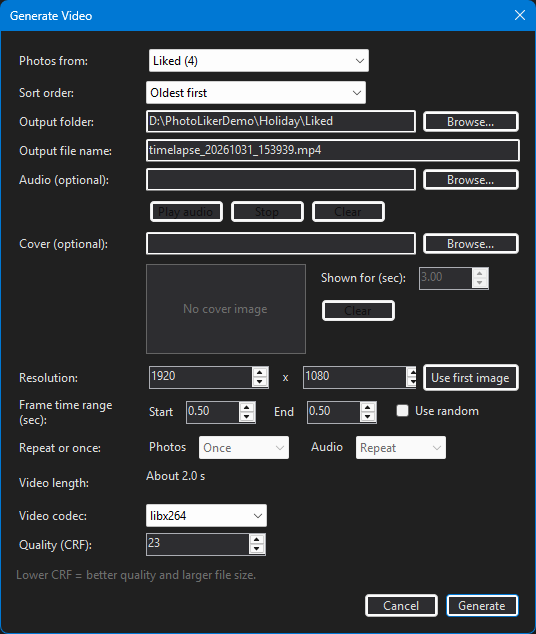
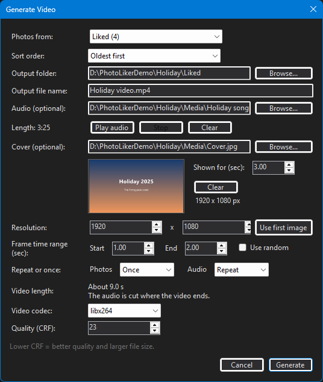
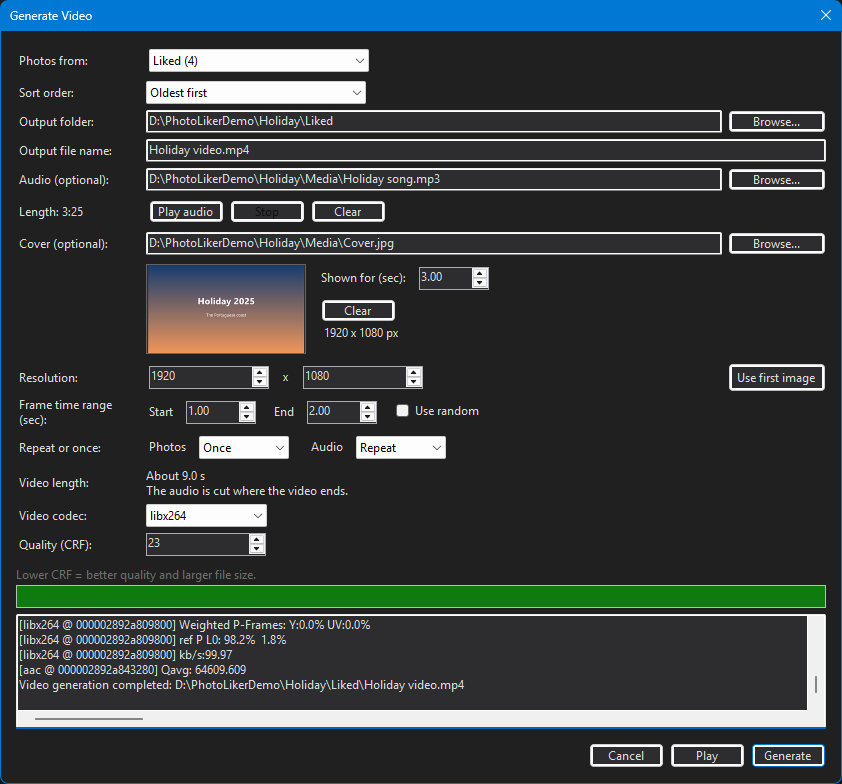

# How to make a video of your photos

PhotoLiker turns a set of photos into a video: each photo is shown for a moment, one after the other, optionally behind a
title picture and with a song under it. You need nothing besides PhotoLiker: a copy of ffmpeg, the program that makes the
video, comes with it.

The steps below make a video of four liked photos with a title picture and a song. The reference of every box is in
[Generate Video](../README.md#generate-video) in the README, and the same walkthrough is in the user manual (**About > User
manual**).

## 1. Pick the photos

The video is made of the photos of **one folder**, which you choose in the dialog (step 3). The easy way to collect them is
to *like* them first:

- open your photo folder, and press <kbd>Space</kbd> on each photo you want in the video: it is copied to the `Liked`
  folder, and gets a green check;
- or sort them into groups with <kbd>1</kbd>-<kbd>9</kbd> and <kbd>A</kbd>-<kbd>Z</kbd> (each group is a folder under `Liked`), and
  make one video per group;
- or search for them (see *Photo search* in the README) and make a video of the search results.

A video of every photo of the folder you have open needs no liking at all: pick **Current** in step 3.

## 2. Open the dialog

Click **Generate Video**, the button with the film icon in the toolbar at the top left of the window:

The dialog opens at once, even on a folder with tens of thousands of photos.

## 3. Choose the photos and their order

- **Photos from** lists where the photos come from, each with its number of photos: **Current** (what the window shows now: the
  folder, or the search results), **Liked** (the copies in the Liked folder) and each **group** folder. It starts on
  **Liked**. A number shows `...` for a moment while the folders are counted.
- **Sort order** is the order of the photos in the video: oldest first, newest first (by the date of the files), by name
  (`IMG_2` before `IMG_10`), random (another order for each video) or as listed.
- **Output folder** and **Output file name**: where the video goes. The folder follows **Photos from** (the video lands next to
  the photos it was made of); type or browse to another one and it stays. A name that does not end in `.mp4` gets it.

## 4. Add a title picture (optional)

Under **Cover (optional)** click **Browse...** and pick a picture. A preview shows how it will look. The cover is the **first**
picture of the video, whatever the sort order is, and **Shown for (sec)** says how long it stays on screen (3 seconds to
begin with). **Clear** takes it away again.

## 5. Add a song (optional)

Under **Audio (optional)** click **Browse...** and pick a file: mp3, m4a, wav, flac, ogg or anything else that plays.

- **Play audio** and **Stop** let you listen to it first.
- Its length is shown under the name of the box (`Length: 3:25`).
- A song **longer** than the video is cut where the video ends. A **shorter** one is played over and over until the video
  ends.
- **Repeat or once** changes that. *Photos: Repeat* shows the photos over and over, in the same order, until a long song ends
  instead of cutting it; *Audio: Once* plays a short song once and leaves the rest of the video silent. The two boxes are only
  there once an audio file is chosen.

## 6. Say how long each photo is shown

- **Frame time range (sec)** gives the time of the first photo (**Start**) and of the last (**End**), and the photos in between
  go in even steps. Start = End shows every photo for the same time.
- **Use random** gives each photo a time of its own, picked at random between Start and End.
- **Video length** says how long the video will be with these settings, and what becomes of the song. It follows every
  change you make, so you can try the numbers before you start.

## 7. Resolution, codec and quality

- **Resolution** is the size of the video. 1920 x 1080 is Full HD. **Use first image** takes the size of the first photo.
- **Video codec**: `libx264` (H.264) plays everywhere; `libx265` (H.265) makes a smaller file but not every player reads it.
- **Quality (CRF)**: lower is better and makes a bigger file. 23 is a good start.

## 8. Generate

Click **Generate**. The dialog grows to show a progress bar and what ffmpeg says. Photos that have gone from the disk
since the folder was listed are left out, photos taken with the phone held upright are turned the right way, and the log tells
what was done.

When the log says *Video generation completed*, the video is in the output folder, and **Play** opens it in your player.
**Cancel** closes the dialog (it is off while the video is being made).

## If something is not right

- **"No photos in this folder"**: the folder you picked has no photos yet. Like some photos first (step 1), or pick **Current**.
- **A message that ffmpeg was not found**: PhotoLiker installed without its `ffmpeg` folder. Reinstall it, or put `ffmpeg.exe` on
  your `PATH`.
- **The song is too short or too long**: look at the second line of **Video length** and at **Repeat or once** (step 5).
- **The video is longer than you wanted**: with many photos, even half a second each adds up. Lower **Start** and **End**; the
  length is shown before you start.
